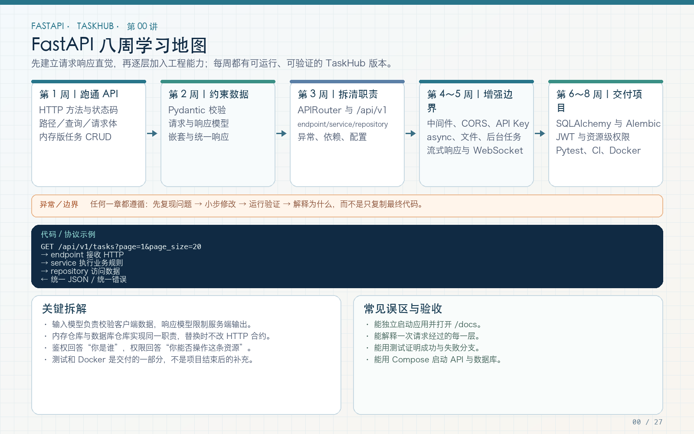

# FastAPI 中文独立学习路线：从 HTTP 到 TaskHub 完整工程

一套以 **TaskHub API** 为主线的 FastAPI 中文长篇教程。27 讲从最小请求响应开始，逐步完成 Pydantic、分层、异步、数据库、认证权限、测试、CI 和 Docker 部署；每讲都有完整解释、代码、验证、常见错误、练习与验收，并配一张 PNG 技术图解和一份可编辑 SVG。



## 快速入口

- [完整学习总路线与 27 讲导航](00-FastAPI框架独立学习总路线.md)
- [TaskHub 最终工程使用说明](taskhub_api/README.md)
- [第 27 讲：综合项目验收](第27讲_TaskHub综合项目验收与演进.md)
- [技术图解目录](images/)
- [图解生成器](tools/generate_diagrams.py) · [教程结构校验器](tools/validate_course.py)

## 全部章节

### 第一阶段：HTTP、CRUD 与 Pydantic

1. [HTTP API 基础与 FastAPI 入门](01-HTTP-API基础与FastAPI入门.md)
2. [请求体、HTTP 方法与内存版任务 CRUD](02-请求体HTTP方法与内存版任务CRUD.md)
3. [Pydantic 请求模型与响应模型](03-Pydantic请求模型与响应模型.md)
4. [Pydantic 模型拆分、嵌套模型与规范响应结构](04_Pydantic模型拆分嵌套与规范响应.md)

### 第二阶段：工程结构与通用能力

5. [APIRouter、项目结构与分层入门](第05讲_APIRouter项目结构与分层入门.md)
6. [业务异常与统一错误处理入门](第06讲_业务异常与统一错误处理入门.md)
7. [Depends 依赖注入入门](第07讲_Depends依赖注入入门.md)
8. [配置管理与环境变量](第08讲_配置管理与环境变量.md)
9. [中间件、Request ID、请求日志与 CORS](第09讲_中间件RequestID请求日志与CORS.md)
10. [API Key 认证与服务级保护](第10讲_APIKey认证与服务级保护.md)

### 第三阶段：异步、生命周期、文件与实时通信

11. [async 异步编程与 httpx](第11讲_async异步编程与httpx.md)
12. [lifespan 生命周期与 BackgroundTasks](第12讲_lifespan生命周期与BackgroundTasks.md)
13. [文件上传、Form 与安全下载](第13讲_文件上传Form与安全下载.md)
14. [StreamingResponse、SSE 与 WebSocket](第14讲_StreamingSSE与WebSocket.md)

### 第四阶段：SQLAlchemy、事务与迁移

15. [SQLAlchemy 异步 Engine 与 Session](第15讲_SQLAlchemy异步Engine与Session.md)
16. [ORM 模型、外键与关系加载](第16讲_ORM模型外键与关系加载.md)
17. [数据库 CRUD、事务与分页](第17讲_数据库CRUD事务与分页.md)
18. [Alembic 数据库迁移](第18讲_Alembic数据库迁移.md)

### 第五阶段：认证与资源级权限

19. [密码哈希与用户注册](第19讲_密码哈希与用户注册.md)
20. [JWT 登录与 Bearer 鉴权](第20讲_JWT登录与Bearer鉴权.md)
21. [项目角色与资源级权限](第21讲_项目角色与资源级权限.md)

### 第六阶段：测试、CI、部署与综合验收

22. [pytest 与 TestClient 接口测试](第22讲_pytest与TestClient接口测试.md)
23. [测试数据库隔离与事务清理](第23讲_测试数据库隔离与事务清理.md)
24. [依赖覆盖与 Mock](第24讲_依赖覆盖与Mock.md)
25. [Ruff 代码质量与 GitHub Actions](第25讲_Ruff代码质量与GitHubActions.md)
26. [Docker 与 Compose 部署](第26讲_Docker与Compose部署.md)
27. [TaskHub 综合项目验收与演进](第27讲_TaskHub综合项目验收与演进.md)

## 最终工程包含什么

`taskhub_api/` 是与教程对应的完整示例，不依赖旧教程压缩包中的虚拟环境：

- FastAPI 应用工厂、APIRouter 与 `/api/v1`；
- SQLAlchemy 2.x 异步 ORM、请求级 AsyncSession、Alembic；
- users、projects、memberships、tasks、comments、tags、attachments 数据模型；
- Argon2 密码哈希、PyJWT、API Key、项目成员与任务所有者权限；
- 统一错误体、Request ID、CORS、UTC 时间与显式关系加载；
- 文件安全上传/下载、SSE、WebSocket、异步外部 HTTP；
- pytest 独立数据库、依赖覆盖、httpx MockTransport；
- Ruff、GitHub Actions、非 root Dockerfile、PostgreSQL Compose。

## 本地启动

要求 Python 3.12+。

```bash
cd taskhub_api
python -m venv .venv
source .venv/bin/activate
# Windows PowerShell：.venv\Scripts\Activate.ps1
python -m pip install -r requirements-dev.txt
cp .env.example .env
alembic upgrade head
uvicorn app.main:app --reload
```

打开：

- Swagger：<http://127.0.0.1:8000/docs>
- ReDoc：<http://127.0.0.1:8000/redoc>
- 就绪检查：<http://127.0.0.1:8000/health/ready>

`.env.example` 是本地学习占位配置；生产必须更换 JWT secret、数据库凭据和 CORS，并关闭自动建表、使用 Alembic。

## 完整校验

```bash
# 教程章节、链接、代码围栏、28 组 PNG/SVG
python tools/validate_course.py

cd taskhub_api
ruff check .
ruff format --check .
pytest -q

# 使用一个独立、可丢弃的迁移数据库
export DATABASE_URL='sqlite+aiosqlite:////tmp/taskhub-migration.db'
alembic upgrade head
alembic check
```

Docker 验证：

```bash
docker compose up -d --build
docker compose ps
curl --fail --retry 30 --retry-delay 2 --retry-all-errors \
  http://127.0.0.1:8000/health/ready
docker compose down
```

## 仓库结构

```text
00-FastAPI框架独立学习总路线.md   总路线与全部导航
第01～27讲（根目录 Markdown）      中文长篇正文
taskhub_api/                     最终可运行工程与工程 README
images/                          28 张 PNG + 28 张可编辑 SVG
tools/generate_diagrams.py       确定性图解生成器
tools/validate_course.py         教程结构与链接校验
.github/workflows/taskhub-ci.yml  自动质量门禁
```

## 学习与贡献建议

1. 按顺序阅读，每讲先复现问题，再写代码和验证。
2. 第 01～08 讲保留渐进式写法；最终工程是第 27 讲的完成形态，不要把早期内存版误认为最终架构。
3. 修改业务代码时同步更新对应教程、图解、测试和迁移。
4. 不提交 `.env`、真实密钥、数据库、上传文件、虚拟环境或测试缓存。

---

原项目：FastAPI 框架独立学习路线笔记。  
抖音关注：**欧皓辰我选你**，分享更多经验与技巧文档。
