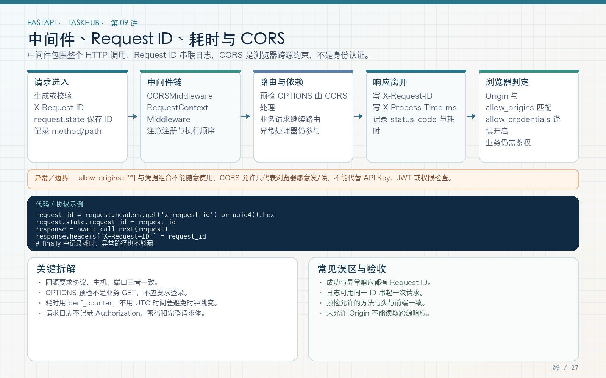

# 第 09 讲：中间件、Request ID、请求日志与 CORS

学习路线位置：第 4 周  
前置章节：第 06～08 讲  
最终工程：`taskhub_api/`  
本讲核心文件：`app/core/middleware.py`、`app/core/error_handlers.py`、`app/main.py`



> 可编辑矢量版本：`images/09-middleware-cors.svg`。图中重点是：中间件包住完整 HTTP 调用；Request ID 用于串联日志；CORS 是浏览器跨源约束，不是身份认证。

---

## 1. 本讲要解决的真实问题

第 08 讲之后，应用已经可以读取配置、校验请求、返回统一错误。但一次线上请求失败时，我们仍然缺少三种信息：

1. 这次请求的唯一标识是什么？
2. 请求经过了哪些公共处理，耗时是多少？
3. 前端从 `http://localhost:5173` 调用 `http://127.0.0.1:8000` 时，为什么 curl 成功而浏览器报 CORS？

如果每个 endpoint 都自己生成 ID、记录日志、写响应头，就会出现重复代码和遗漏。正确做法是把横切逻辑放到中间件和异常处理器中，让业务函数继续只处理业务。

本讲完成后，一次正常请求和一次异常请求都应该出现同一组响应头：

```http
X-Request-ID: 7e8c2d3f0f434e39a33f6f0fd54d0d4a
X-Process-Time-ms: 12.36
X-Content-Type-Options: nosniff
```

日志中还应出现相同的 Request ID：

```text
request_id=7e8c2d3f0f434e39a33f6f0fd54d0d4a method=GET path=/api/v1/tasks status=200 duration_ms=12.36
```

---

## 2. 中间件到底是什么

可以把 FastAPI 请求处理简化为：

```text
客户端
  ↓
最外层中间件 before
  ↓
下一层中间件 before
  ↓
路由匹配 → 依赖注入 → endpoint → 响应模型序列化
  ↓
下一层中间件 after
  ↓
最外层中间件 after
  ↓
客户端
```

中间件适合处理“几乎所有请求都需要”的逻辑，例如：

- Request ID；
- 访问日志和耗时；
- CORS；
- 安全响应头；
- GZip；
- 全局限流的入口。

它不适合替代所有业务代码。例如“只有项目 owner 才能删除任务”属于资源级权限，放在 service 中比在全局中间件里查数据库更清楚。

### 2.1 中间件和 Depends 的区别

| 维度 | 中间件 | Depends |
|---|---|---|
| 作用范围 | 整个 HTTP 调用链 | 某个 endpoint、router 或全局依赖 |
| 常见职责 | 日志、耗时、CORS、安全头 | 当前用户、数据库 Session、配置、权限前置条件 |
| 是否能直接拿到业务响应模型 | 通常只能看到响应对象/流 | 能把对象注入业务函数 |
| 是否适合复杂资源权限 | 不适合 | 可与 service 配合 |

“我能在中间件里做”不等于“我应该放在中间件里”。

---

## 3. Request ID 为什么不能只靠日志时间

同一毫秒可能有很多请求，同一个用户也可能连续发出相同请求。时间、IP、路径都不能唯一标识一次调用。

Request ID 的目标是建立一条可检索链路：

```text
浏览器/调用方
  → X-Request-ID
  → 访问日志
  → 业务日志
  → 下游服务日志
  → 错误响应中的 request_id
```

最终工程使用以下规则：

- 客户端提供合法 ID 时保留，便于跨服务串联；
- 未提供或格式非法时生成 UUID；
- 长度最多 100 个字符，只允许字母、数字、点、下划线和短横线；
- 不把换行、控制字符、任意长字符串写进日志；
- 成功和异常响应都使用同一个 ID。

Request ID 是排障标识，不是安全凭证，不能用它判断用户身份。

---

## 4. 完整中间件代码

文件：`taskhub_api/app/core/middleware.py`

```python
import logging
import re
import time
from uuid import uuid4

from fastapi import Request
from starlette.middleware.base import BaseHTTPMiddleware

logger = logging.getLogger("taskhub.access")


class RequestContextMiddleware(BaseHTTPMiddleware):
    async def dispatch(self, request: Request, call_next):
        incoming_id = request.headers.get("X-Request-ID", "")
        valid_incoming = bool(
            re.fullmatch(r"[A-Za-z0-9._-]{1,100}", incoming_id)
        )
        request_id = incoming_id if valid_incoming else uuid4().hex
        request.state.request_id = request_id

        started = time.perf_counter()
        status_code = 500
        try:
            response = await call_next(request)
            status_code = response.status_code
            response.headers["X-Request-ID"] = request_id
            response.headers["X-Content-Type-Options"] = "nosniff"
            return response
        finally:
            elapsed_ms = round(
                (time.perf_counter() - started) * 1000,
                2,
            )
            if "response" in locals():
                response.headers["X-Process-Time-ms"] = str(elapsed_ms)
            logger.info(
                "request_id=%s method=%s path=%s "
                "status=%s duration_ms=%s",
                request_id,
                request.method,
                request.url.path,
                status_code,
                elapsed_ms,
            )
```

### 4.1 为什么使用 `perf_counter`

`datetime.now()` 表示墙上时间，可能受系统校时影响；`time.perf_counter()` 适合测量时间间隔。这里计算的是“服务器处理耗时”，不包含客户端到服务器的全部网络时间。

### 4.2 为什么把状态码初始值设为 500

如果 `call_next` 抛出异常，`response.status_code` 尚未产生。初始化为 500 能保证异常路径也留下明确日志。真正的异常响应由第 06 讲的异常处理器生成。

### 4.3 为什么使用 `finally`

正常返回、业务异常、校验异常都会离开 `dispatch`。把耗时和日志放在 `finally` 中，可以避免“成功有日志，失败没日志”。

### 4.4 为什么记录 path 而不记录完整 URL

完整 URL 可能带查询参数，查询参数可能包含邮箱、搜索词甚至 token。默认只记录路径，不记录：

- `Authorization`；
- Cookie；
- 密码；
- 完整请求体；
- 文件内容；
- 未脱敏的查询字符串。

排障能力不能以泄露敏感信息为代价。

---

## 5. 错误响应如何拿到同一个 Request ID

文件：`app/core/error_handlers.py`

核心构造函数：

```python
def error_body(request, code, message, details=None):
    return {
        "code": code,
        "message": message,
        "details": details or {},
        "request_id": getattr(request.state, "request_id", None),
    }
```

注册器分别处理：

```python
@app.exception_handler(AppError)
async def handle_app_error(request, exc):
    ...

@app.exception_handler(RequestValidationError)
async def handle_validation_error(request, exc):
    ...

@app.exception_handler(StarletteHTTPException)
async def handle_http_error(request, exc):
    ...
```

这三条分支不能合并成一句“出错了”：

- `AppError`：业务明确知道错误类型，例如 403、404、409；
- `RequestValidationError`：FastAPI/Pydantic 在调用 endpoint 前发现输入错误，通常是 422；
- `StarletteHTTPException`：框架路由或 `HTTPException` 产生的 HTTP 错误。

最终响应示例：

```json
{
  "code": "VALIDATION_ERROR",
  "message": "Request validation failed",
  "details": [
    {
      "type": "missing",
      "loc": ["body", "title"],
      "msg": "Field required"
    }
  ],
  "request_id": "course-request-001"
}
```

注意：本工程采用扁平错误字段，不再沿用总路线早期的 `{"error": {...}}` 示例。统一格式以第 06 讲和最终工程为准，不能两种格式混用。

---

## 6. 注册中间件与执行顺序

文件：`app/main.py`

```python
app.add_middleware(
    CORSMiddleware,
    allow_origins=settings.cors_origins,
    allow_credentials=True,
    allow_methods=["*"],
    allow_headers=["*"],
)
app.add_middleware(RequestContextMiddleware)
```

在 Starlette 中，后添加的中间件位于更外层。因此本工程的执行顺序是：

```text
RequestContextMiddleware
  → CORSMiddleware
    → router / endpoint
```

这样即使是 CORS 预检请求，也会有 Request ID 和访问日志。

如果顺序写反，某些由 CORS 中间件直接结束的 OPTIONS 请求可能绕过你想要的外层记录逻辑。修改顺序后必须重新测试预检，不要只看正常 GET。

---

## 7. CORS 究竟解决什么

CORS 不是 FastAPI 独有的功能，也不是服务器禁止 curl 的防火墙。它是浏览器对跨源读取响应的一套约束。

同源要求三项都一致：

```text
协议 + 主机 + 端口
```

下面两个地址不同源：

```text
前端：http://localhost:5173
后端：http://127.0.0.1:8000
```

主机名和端口都不同。即使前后端都在你的电脑上，也仍然是跨源。

### 7.1 简单请求与预检请求

某些跨源请求会先发送：

```http
OPTIONS /api/v1/users/me
Origin: http://localhost:5173
Access-Control-Request-Method: GET
Access-Control-Request-Headers: Authorization
```

这叫预检。它询问服务器：“浏览器是否允许我随后发送真正请求？”预检不是业务 GET，不应要求先登录。

服务器允许后返回：

```http
Access-Control-Allow-Origin: http://localhost:5173
Access-Control-Allow-Methods: GET, ...
Access-Control-Allow-Headers: Authorization, ...
```

浏览器随后才发送真正的 `GET /users/me`。

### 7.2 为什么不能用 `allow_origins=["*"]` 加凭据

本工程配置的是明确来源列表，并允许凭据：

```python
allow_origins=[
    "http://127.0.0.1:5173",
    "http://localhost:5173",
]
allow_credentials = True
```

不要随意把通配符和 Cookie/Authorization 凭据组合成“全都允许”。生产环境应填写真实前端域名，并按环境注入配置。

### 7.3 CORS 不能代替鉴权

CORS 通过只表示浏览器愿意让前端读取响应。非浏览器客户端仍可发送请求；同源恶意调用也可能存在。因此：

```text
CORS：浏览器跨源策略
API Key：调用方凭证
JWT：用户身份凭证
项目角色：资源级授权
```

四者解决不同问题，不能互相替代。

---

## 8. 配置 CORS 来源

`.env` 示例：

```dotenv
CORS_ORIGINS=["http://127.0.0.1:5173","http://localhost:5173"]
```

`Settings` 中字段为：

```python
cors_origins: list[str] = [
    "http://127.0.0.1:5173",
    "http://localhost:5173",
]
```

这里必须是 JSON 数组格式，不要写成：

```dotenv
# 不推荐：这不是 list[str] 的可靠解析格式
CORS_ORIGINS=http://localhost:5173,http://127.0.0.1:5173
```

修改 `.env` 后重启服务；`lru_cache` 不会自动知道文件已改变。

---

## 9. 启动与手工验证

进入工程目录：

```bash
cd taskhub_api
python -m venv .venv
source .venv/bin/activate        # Windows PowerShell 使用 .venv\Scripts\Activate.ps1
pip install -r requirements-dev.txt
uvicorn app.main:app --reload
```

### 9.1 验证合法 Request ID

```bash
curl -i http://127.0.0.1:8000/health/live \
  -H 'X-Request-ID: course-request-001'
```

检查响应：

```text
x-request-id: course-request-001
x-process-time-ms: ...
x-content-type-options: nosniff
```

### 9.2 验证非法 ID 不会进入日志

```bash
curl -i http://127.0.0.1:8000/health/live \
  -H 'X-Request-ID: bad id with spaces'
```

响应中的 ID 应是新生成的 32 位 UUID 十六进制字符串，而不是原样回显 `bad id with spaces`。

### 9.3 验证 CORS 预检

```bash
curl -i -X OPTIONS http://127.0.0.1:8000/api/v1/users/me \
  -H 'Origin: http://localhost:5173' \
  -H 'Access-Control-Request-Method: GET' \
  -H 'Access-Control-Request-Headers: Authorization'
```

应看到允许来源和 Request ID。把 Origin 改成未配置域名，再比较响应差异。

---

## 10. 自动化测试

文件：`tests/test_middleware_and_api_key.py`

```python
def test_request_id_and_cors_preflight(client):
    response = client.get(
        "/health/live",
        headers={"X-Request-ID": "course-request-001"},
    )
    assert response.headers["x-request-id"] == "course-request-001"
    assert "x-process-time-ms" in response.headers

    response = client.options(
        "/api/v1/users/me",
        headers={
            "Origin": "http://localhost:5173",
            "Access-Control-Request-Method": "GET",
            "Access-Control-Request-Headers": "Authorization",
        },
    )
    assert response.status_code == 200
    assert response.headers["access-control-allow-origin"] == \
        "http://localhost:5173"
    assert response.headers["x-request-id"]
```

运行：

```bash
pytest tests/test_middleware_and_api_key.py -q
```

只验证“返回 200”不够，还要验证响应头，因为本讲的核心行为就在头部和日志中。

---

## 11. 常见错误与排查

### 错误 1：所有请求都是 200，所以日志没有问题

错误。必须制造 404、422、401 和业务 403，检查异常响应是否也有 Request ID。

### 错误 2：把 Request ID 当用户 ID

错误。任何人都能构造 Request ID，它只用于关联日志。

### 错误 3：curl 没报 CORS，所以后端配置正确

错误。curl 不执行浏览器 CORS 策略。至少发送带 Origin 的预检，或在真实浏览器中验证。

### 错误 4：预检返回 401，所以给预检也加 token

通常方向错了。预检应由 CORSMiddleware 处理，不要强迫浏览器在预检中携带业务凭证。

### 错误 5：日志里记录完整请求体方便排错

危险。请求体可能含密码、token、个人数据或文件内容。应记录必要的结构化字段，并设计脱敏策略。

### 错误 6：调整中间件顺序后没有重测

中间件顺序会影响预检、异常和响应头。调整后至少重跑本讲测试和完整测试。

---

## 12. 本讲练习

1. 给 `X-Request-ID` 增加一个只含中文的输入，确认服务器生成新 ID。
2. 新增一条只允许 `X-Course-Client` 的 CORS 请求头测试，观察预检变化。
3. 在 task service 中记录一条业务日志，把 `request.state.request_id` 通过安全的上下文方式传入，而不是新增全局可变变量。
4. 制造一个 422 错误，核对错误体 `request_id` 与响应头一致。
5. 把允许的 Origin 改成不存在的域名，解释 curl 与浏览器结果为什么不同。

---

## 13. 自测问题

1. 中间件与 Depends 的职责边界是什么？
2. 为什么使用 `perf_counter` 测耗时？
3. 为什么 Request ID 要校验字符和长度？
4. CORS 预检为什么不应要求业务登录？
5. 为什么 `allow_origins` 不能替代 JWT？
6. 后添加的中间件为什么能包住 CORS 预检？

---

## 14. 本讲验收清单

- [ ] 成功响应包含 Request ID、耗时和 `nosniff`。
- [ ] 失败响应也包含同一个 Request ID。
- [ ] 非法客户端 ID 不会被原样写入日志。
- [ ] 日志不记录密码、Authorization 和请求体。
- [ ] 允许的 Origin 能通过预检。
- [ ] 预检响应也带 Request ID。
- [ ] 能解释 CORS、认证和授权的区别。
- [ ] 中间件与统一错误测试通过。

---

## 15. 下一讲预告

本讲解决了请求可观测性和浏览器跨源问题，但受保护接口仍需要一种机器调用凭证。第 10 讲将实现 API Key，并重点解释为什么“功能开关已开启但密钥未配置”必须直接拒绝启动，而不是悄悄放行。
