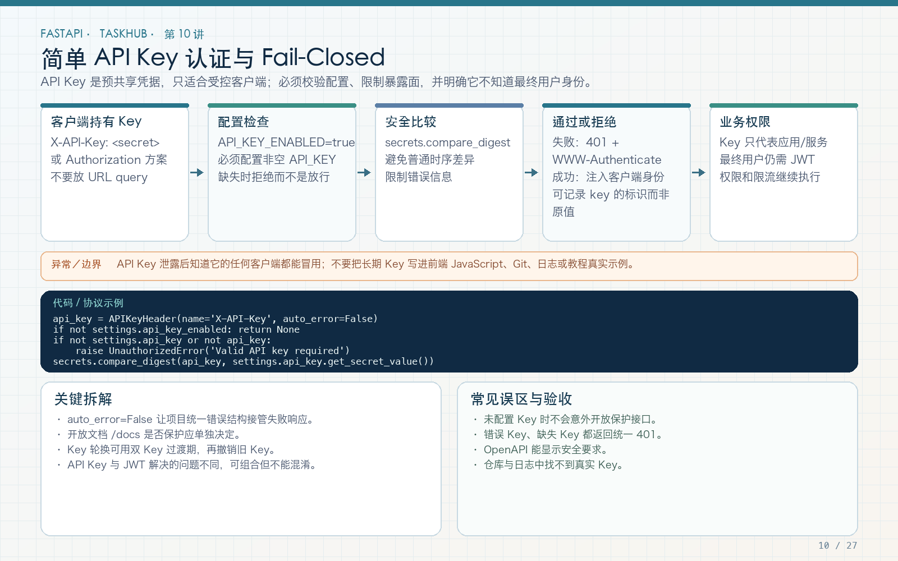

# 第 10 讲：API Key 认证与服务级保护

学习路线位置：第 4 周  
前置章节：第 07～09 讲  
本讲核心文件：`app/core/dependencies.py`、`app/core/config.py`、`app/api/v1/endpoints/service.py`



> 可编辑矢量版本：`images/10-api-key.svg`。API Key 用于识别机器调用方，不等同于登录用户，也不能替代项目成员权限。

---

## 1. 为什么有了统一错误还需要认证

公开健康检查可以不登录，但内部服务信息、批量导出、管理接口不能被匿名调用。TaskHub 先增加一种最简单的凭证：API Key。

典型请求：

```http
GET /api/v1/service/info
X-API-Key: a-long-random-secret
```

服务器要做四件事：

1. 判断该接口是否启用；
2. 读取请求头；
3. 与服务端保存的密钥进行恒定时间比较；
4. 成功才进入 endpoint，失败返回统一 401。

第 20 讲的 JWT 会表示“哪个用户在操作”；本讲的 API Key 表示“哪个机器客户端在调用”。不要把两者混为一个概念。

---

## 2. API Key、用户密码和 JWT 的边界

| 机制 | 常见使用方 | 代表什么 | 本教程用途 |
|---|---|---|---|
| API Key | 后端服务、脚本、合作方 | 一个机器客户端 | `/service/info` |
| 密码 | 人 | 登录时证明身份 | 注册与登录，永不存明文 |
| JWT | 登录后的客户端 | 一段时间内有效的用户身份声明 | 用户接口和项目权限 |
| 项目角色 | 已认证用户 | 对具体项目能做什么 | viewer/member/owner |

仅验证 API Key 后，并不能直接说“这是 Alice，因此她能删除任务”。如果接口同时需要用户身份和资源权限，应分别校验。

---

## 3. 安全设计：失败时默认关闭

本讲最重要的原则不是 `X-API-Key` 怎么写，而是 fail-closed：

```text
开关关闭 → 服务接口返回 404，不暴露能力
开关开启但未配置 API_KEY → Settings 校验失败，应用拒绝启动
开关开启但请求没带 key → 401
开关开启但 key 错误 → 401
开关、配置、请求 key 都正确 → 放行
```

绝不能写成：

```python
# 错误示例：配置缺失时反而跳过认证
if not settings.api_key:
    return True
```

配置错误是部署问题，不应被转换成匿名访问。

---

## 4. 完整配置代码

文件：`app/core/config.py` 节选

```python
from pathlib import Path
from pydantic import SecretStr, model_validator
from pydantic_settings import BaseSettings, SettingsConfigDict


class Settings(BaseSettings):
    model_config = SettingsConfigDict(
        env_file=".env",
        env_file_encoding="utf-8",
        extra="ignore",
    )

    environment: str = "development"
    api_key_enabled: bool = False
    api_key: SecretStr | None = None
    upload_dir: Path = Path("var/uploads")

    @model_validator(mode="after")
    def validate_production_secrets(self):
        if self.api_key_enabled and self.api_key is None:
            raise ValueError(
                "API_KEY is required when API_KEY_ENABLED=true"
            )
        return self
```

### 4.1 为什么使用 `SecretStr`

`SecretStr` 在普通字符串表示和日志格式中会隐藏内容，降低误打印风险。真正比较时显式读取：

```python
expected = settings.api_key.get_secret_value()
```

`SecretStr` 不是加密存储，也不能让环境变量变成不可读取；它主要防止意外展示。

### 4.2 为什么配置在启动时校验

如果等第一次请求才发现密钥缺失，服务已经以错误状态启动。启动即失败能让部署系统立刻报警，避免“看起来运行正常，实际配置不完整”。

---

## 5. 完整依赖代码

文件：`app/core/dependencies.py`

```python
import secrets
from typing import Annotated

from fastapi import Depends
from fastapi.security import APIKeyHeader

api_key_header = APIKeyHeader(
    name="X-API-Key",
    auto_error=False,
)


async def require_api_key(
    settings: SettingsDep,
    supplied_key: Annotated[str | None, Depends(api_key_header)],
) -> str:
    if not settings.api_key_enabled:
        raise NotFoundError("Service endpoint is disabled")

    if settings.api_key is None or not supplied_key:
        raise UnauthorizedError(
            "Valid API key required",
            headers={"WWW-Authenticate": "APIKey"},
        )

    expected = settings.api_key.get_secret_value()
    if not secrets.compare_digest(supplied_key, expected):
        raise UnauthorizedError(
            "Valid API key required",
            headers={"WWW-Authenticate": "APIKey"},
        )
    return "api-key-client"
```

### 5.1 为什么 `auto_error=False`

让安全依赖返回 `None`，再由业务统一抛出 `UnauthorizedError`，这样 401 的错误格式、Request ID 和响应头都保持统一。

如果让 `APIKeyHeader` 直接抛错，行为会分散在框架默认异常路径中，不利于统一协议。

### 5.2 为什么使用 `compare_digest`

普通字符串 `==` 会提前在不匹配位置结束。`secrets.compare_digest` 用于减少比较时间泄露密钥内容的可能性。

它不是“密钥加密函数”，而是“安全比较函数”。

### 5.3 为什么返回客户端名称

依赖返回 `"api-key-client"`，endpoint 可以把它放入响应或日志。真实系统可以查询客户端表，返回 `client_id`、权限范围和限流桶，而不是只有一个布尔值。

---

## 6. 把依赖挂到 endpoint

文件：`app/api/v1/endpoints/service.py`

```python
from typing import Annotated

from fastapi import APIRouter, Depends, Request

from app.core.dependencies import require_api_key

router = APIRouter(prefix="/service", tags=["service"])


@router.get("/info")
async def service_info(
    request: Request,
    client: Annotated[str, Depends(require_api_key)],
):
    return {
        "service": request.app.state.settings.app_name,
        "environment": request.app.state.settings.environment,
        "client": client,
    }
```

注意依赖位于函数参数中，认证失败时函数体不会执行。这正是 Depends 的价值：公共前置条件不需要复制到每个 endpoint。

如果整个 router 都需要 API Key，也可以在 router 注册时统一添加依赖；但本讲保留显式参数，便于看清返回的客户端身份。

---

## 7. 环境变量与启动验证

`.env.example` 只提供占位符：

```dotenv
API_KEY_ENABLED=false
# API_KEY=replace-only-when-service-endpoint-is-enabled
```

本地启用时：

```dotenv
API_KEY_ENABLED=true
API_KEY=local-course-key-change-me
```

生产环境应使用足够随机、足够长的密钥，并由部署平台的 secret 管理注入。不要把真实密钥写入：

- `.env.example`；
- README；
- 教程截图；
- GitHub Actions 日志；
- 测试断言；
- 前端 JavaScript。

如果密钥曾经提交到 Git，仅从最新提交删除不够，应立刻轮换，并按仓库托管平台建议清理历史。

---

## 8. Swagger 与 curl 验证

启动后打开 `/docs`，`/service/info` 会显示 API Key 安全要求。也可以在 Authorize 中填写 API Key。

不带 key：

```bash
curl -i http://127.0.0.1:8000/api/v1/service/info
```

预期：

```json
{
  "code": "UNAUTHORIZED",
  "message": "Valid API key required",
  "details": {},
  "request_id": "..."
}
```

错误 key：

```bash
curl -i http://127.0.0.1:8000/api/v1/service/info \
  -H 'X-API-Key: wrong'
```

正确 key：

```bash
curl -i http://127.0.0.1:8000/api/v1/service/info \
  -H 'X-API-Key: local-course-key-change-me'
```

预期 200，并且响应不包含 `api_key` 本身。

关闭开关后再请求，应得到 404。这样未启用的内部能力不会在 API 行为上持续暴露。

---

## 9. 自动化测试：正常和失败路径都要写

文件：`tests/test_middleware_and_api_key.py`

```python
def test_api_key_is_fail_closed(tmp_path):
    app = create_app(
        make_settings(
            tmp_path,
            api_key_enabled=True,
            api_key="test-api-key",
        )
    )
    with TestClient(app) as client:
        assert client.get(
            "/api/v1/service/info"
        ).status_code == 401

        assert client.get(
            "/api/v1/service/info",
            headers={"X-API-Key": "wrong"},
        ).status_code == 401

        response = client.get(
            "/api/v1/service/info",
            headers={"X-API-Key": "test-api-key"},
        )
        assert response.status_code == 200
        assert response.json()["client"] == "api-key-client"
```

配置错误也要测：

```python
def test_api_key_enabled_without_key_fails_configuration(tmp_path):
    with pytest.raises(ValueError, match="API_KEY"):
        make_settings(
            tmp_path,
            api_key_enabled=True,
            api_key=None,
        )
```

这两类测试分别证明：

- 请求认证失败时不会放行；
- 部署配置不完整时不会以不安全状态启动。

---

## 10. 密钥轮换与真实系统扩展

课程示例使用一个静态 key 方便理解。真实服务通常需要：

1. 每个客户端独立 key，而不是所有服务共享一个；
2. 数据库存 hash 后的 key，并保存前缀用于查找；
3. 支持新旧 key 短期并存，完成轮换后吊销旧 key；
4. 记录 `client_id`、创建时间、最后使用时间和权限范围；
5. 对错误尝试和调用频率限流；
6. 只通过 HTTPS 传输；
7. 对高价值操作增加签名、时间戳和防重放机制。

一个可演进的数据结构可以是：

```text
api_clients
  id
  name
  key_prefix
  key_hash
  scopes
  is_active
  expires_at
  created_at
  last_used_at
```

不要为了“看起来完整”在第一天全部实现，但要知道静态 key 的边界。

---

## 11. 常见错误

### 错误 1：把 API Key 放在 URL 查询参数

不推荐。URL 容易进入访问日志、浏览器历史和代理记录。本讲使用请求头。

### 错误 2：响应中返回服务端 API Key

永远不要。响应只返回客户端标识，不返回秘密。

### 错误 3：前端保存 API Key 后当作公开应用鉴权

浏览器代码和移动端解包都不能可靠保存机器密钥。公开前端应使用用户登录和后端代理。

### 错误 4：只在代码里判断 key，不限制传输

明文 HTTP 会让密钥被窃听。生产环境必须使用 HTTPS，并限制可信代理和访问日志内容。

### 错误 5：401 和 403 混用

缺失或无效凭证通常是 401；凭证有效但权限不足是 403。本讲 key 错误返回 401。

---

## 12. 练习、自测与验收

### 练习

1. 给依赖增加 `client_id` 返回，并让两个客户端使用不同测试 key。
2. 增加 `disabled` 配置测试，确认接口返回 404。
3. 在错误响应中确认没有泄露 supplied key 或 expected key。
4. 为一个内部 POST 接口添加相同依赖，验证未认证时函数体不执行。

### 自测

1. API Key 与 JWT 分别代表谁？
2. 为什么启用功能却没有 key 必须启动失败？
3. `SecretStr` 能做什么，不能做什么？
4. 为什么使用 `compare_digest`？
5. 为什么不能把机器 API Key 放在公开前端？

### 验收

- [ ] 未启用时接口返回 404。
- [ ] 启用但未配置时 Settings 拒绝启动。
- [ ] 未带 key 和错误 key 都返回统一 401。
- [ ] 正确 key 才进入 endpoint。
- [ ] 响应、日志、示例文件中均无真实密钥。
- [ ] 正常与失败测试均通过。

---

## 13. 下一讲预告

API Key 校验通常是内存操作，但真实后端大量时间花在数据库、缓存和下游 HTTP 等 I/O 上。第 11 讲将解释事件循环、`async def`、阻塞调用和 `httpx.AsyncClient`，并通过两个并发请求看清异步真正的收益。
