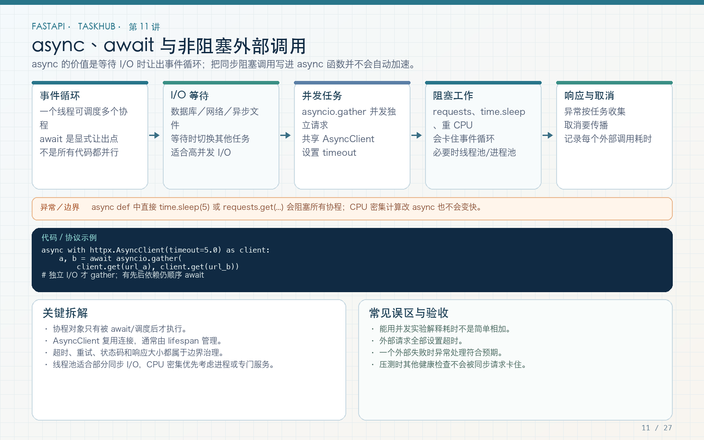

# 第 11 讲：async def、事件循环与 httpx.AsyncClient

学习路线位置：第 5 周  
前置章节：第 05、07、09 讲  
本讲核心文件：`app/services/external_service.py`、`app/api/v1/endpoints/external.py`、`app/core/dependencies.py`



> 可编辑矢量版本：`images/11-async-httpx.svg`。异步的主要收益是等待 I/O 时让事件循环处理其他任务，不是让 CPU 计算自动变快。

---

## 1. 本讲要纠正的最大误区

很多教程把 `async def` 描述成“高性能接口的写法”，这不准确。

下面函数即使加上 `async`，仍然会阻塞事件循环：

```python
import time


async def bad_endpoint():
    time.sleep(2)  # 阻塞整个事件循环约 2 秒
    return {"ok": True}
```

因为 `time.sleep` 不会让出控制权。等待期间，当前事件循环无法推进同一循环上的其他协程。

本讲要掌握的不是语法装饰，而是完整判断链：

```text
任务是否在等待 I/O？
  → 使用的库是否支持异步？
  → 是否真正 await？
  → 是否复用连接资源？
  → 是否有超时、取消和异常映射？
```

---

## 2. 协程、Task 和事件循环

### 2.1 `async def` 定义了什么

调用普通函数会立即执行函数体；调用 async 函数会创建协程对象：

```python
async def fetch_data():
    return {"value": 1}


coroutine = fetch_data()  # 此时函数体尚未真正运行
result = await coroutine  # 在当前协程中等待它完成
```

在 FastAPI endpoint 中，框架负责调度最外层协程；函数内部的异步操作由你显式 `await`。

### 2.2 事件循环像什么

可以把事件循环理解为协调者：

```text
协程 A 发起网络请求 → 等待响应 → 暂停
协程 B 此时可以运行 → 发起数据库请求 → 等待 → 暂停
协程 A 的响应到了 → 恢复执行
```

它不是为每个协程创造一个 CPU 核，而是利用等待空档切换任务。

### 2.3 Task 与 `asyncio.gather`

`await` 一个协程后再 `await` 下一个，是顺序等待：

```python
first = await fetch(url_a)   # 等 A 完成
second = await fetch(url_b)  # 然后才开始 B
```

`gather` 会调度两个协程并发推进：

```python
first, second = await asyncio.gather(
    fetch(url_a),
    fetch(url_b),
)
```

如果两个请求各耗时约 1 秒，理想 I/O 情况下总耗时接近较慢的一个，而不是简单相加。真实结果还受网络、连接池、远端限流影响，不能承诺固定加速比例。

---

## 3. I/O 密集与 CPU 密集

| 任务 | 典型例子 | 合适方式 |
|---|---|---|
| I/O 等待 | 数据库、HTTP、缓存、对象存储 | 异步驱动/异步客户端 |
| 小型同步库调用 | 快速本地查询、旧 SDK | 普通 def 或线程池，先测量 |
| CPU 计算 | 图像处理、复杂压缩、大规模 JSON 运算 | 进程池/专门 Worker |
| 必须可靠执行的后台工作 | 邮件、视频转码、付费任务 | 持久化队列，不用内存协程冒充 |

`async` 不会让图片压缩更快；把 CPU 函数改成 `async def` 也不会自动进入其他进程。

---

## 4. FastAPI 中 async def 和 def 怎么选

### 使用 async def

- 使用 `AsyncSession`；
- 使用 `httpx.AsyncClient`；
- 使用异步 Redis、对象存储客户端；
- 需要 `await` 其他异步服务。

### 可以使用普通 def

- 函数主要调用同步、短小的阻塞库；
- 没有可等待的异步操作；
- 已理解框架会将普通路径操作放到工作线程中执行。

不要在普通 `def` 中直接使用只能 `await` 的异步库，也不要在 `async def` 中随意调用长阻塞同步函数。

折中方案：

```python
result = await asyncio.to_thread(blocking_function, arg)
```

`to_thread` 适合有限的同步 I/O 兼容，不会解除 GIL 对纯 Python CPU 计算的限制，也需要控制线程池压力。

---

## 5. 完整外部请求服务

文件：`app/services/external_service.py`

```python
import asyncio

import httpx

from app.core.errors import UpstreamError


async def fetch_json_pair(
    client: httpx.AsyncClient,
    url_a: str,
    url_b: str,
) -> tuple[dict, dict]:
    async def fetch(url: str) -> dict:
        try:
            response = await client.get(url)
            response.raise_for_status()
            payload = response.json()
        except (httpx.HTTPError, ValueError) as exc:
            raise UpstreamError(
                "External service request failed",
                details={"url": url},
            ) from exc

        if not isinstance(payload, dict):
            raise UpstreamError(
                "External service returned a non-object JSON value",
                details={"url": url},
            )
        return payload

    return await asyncio.gather(fetch(url_a), fetch(url_b))
```

### 5.1 每一步为什么存在

`await client.get(url)`：等待网络 I/O，事件循环可以切换其他任务。  
`raise_for_status()`：把 4xx/5xx 变成异常，避免把错误页当成功数据。  
`response.json()`：解析响应；解析失败也进入上游错误分支。  
`isinstance(payload, dict)`：确保接口约定的 JSON object，不接受 list/string 冒充。  
`UpstreamError`：把下游异常映射成应用统一的 502，不向调用方泄露堆栈。

生产系统还应在日志中用 Request ID 关联下游调用，但不要把下游密钥和完整敏感响应写入日志。

---

## 6. 为什么复用 AsyncClient

不要每次请求都创建并销毁一个客户端：

```python
# 不推荐作为高频接口的默认方式
async with httpx.AsyncClient() as client:
    ...
```

短示例可以这样写，但高频服务复用客户端可以复用连接池、减少重复建连成本，并集中管理超时。

最终工程在 lifespan 中创建：

```python
app.state.http_client = httpx.AsyncClient(
    timeout=settings.external_timeout_seconds
)
```

关闭时：

```python
await app.state.http_client.aclose()
```

依赖注入：

```python
def get_http_client(request: Request) -> httpx.AsyncClient:
    return request.app.state.http_client


HttpClientDep = Annotated[
    httpx.AsyncClient,
    Depends(get_http_client),
]
```

这里复用的是客户端对象，不是把一次响应或某个用户的数据放进全局变量。`AsyncClient` 的调用仍要遵守所用库的连接池与并发语义。

---

## 7. 完整 endpoint

文件：`app/api/v1/endpoints/external.py`

```python
from fastapi import APIRouter, Query

from app.core.dependencies import CurrentUser, HttpClientDep
from app.services.external_service import fetch_json_pair

router = APIRouter(prefix="/external", tags=["external"])


@router.get("/aggregate")
async def aggregate_external_data(
    http_client: HttpClientDep,
    current_user: CurrentUser,
    url_a: str = Query(min_length=8, max_length=500),
    url_b: str = Query(min_length=8, max_length=500),
):
    first, second = await fetch_json_pair(
        http_client,
        url_a,
        url_b,
    )
    return {
        "data": {"first": first, "second": second},
        "requested_by": current_user.id,
    }
```

本接口要求登录，因为下游调用会消耗资源。真实公开服务不能允许用户传任意内网 URL，否则可能形成 SSRF。生产实现应使用固定上游标识或严格白名单，并阻止 loopback、私网、链接本地地址和危险重定向。

本讲示例保留 URL 参数是为了演示客户端与异常处理，不代表可以不加限制地暴露到公网。

---

## 8. 超时、取消与异常不是可选项

### 8.1 超时

```python
client = httpx.AsyncClient(timeout=5.0)
```

没有超时的外部调用可能长期占用连接、协程和请求资源。真实项目可分别配置 connect/read/write/pool 超时。

### 8.2 gather 的异常

默认情况下，`gather` 中一个任务异常会向调用方抛出。其他任务的状态和取消策略必须按业务明确处理，不能假设“另一个一定成功”或“所有副作用都回滚”。

下游请求不是数据库事务。若 A 已产生远端副作用而 B 失败，需要补偿、重试幂等或记录中间状态。

### 8.3 重试

重试只适用于明确可重试的错误和幂等操作。网络超时不代表远端没有处理成功。POST 支付、创建订单等操作必须有幂等键，不能无脑循环。

---

## 9. 不用真实外网测试：MockTransport

文件：`tests/test_external_service.py`

成功测试：

```python
@pytest.mark.asyncio
async def test_external_requests_succeed():
    def handler(request: httpx.Request) -> httpx.Response:
        return httpx.Response(200, json={"url": str(request.url)})

    async with httpx.AsyncClient(
        transport=httpx.MockTransport(handler)
    ) as client:
        first, second = await fetch_json_pair(
            client,
            "https://service.test/a",
            "https://service.test/b",
        )

    assert first["url"].endswith("/a")
    assert second["url"].endswith("/b")
```

失败测试：

```python
@pytest.mark.asyncio
async def test_external_failure_is_mapped_to_502():
    def handler(request):
        return httpx.Response(503, json={"upstream": "unavailable"})

    async with httpx.AsyncClient(
        transport=httpx.MockTransport(handler)
    ) as client:
        with pytest.raises(UpstreamError) as error:
            await fetch_json_pair(
                client,
                "https://service.test/a",
                "https://service.test/b",
            )

    assert error.value.status_code == 502
    assert error.value.code == "UPSTREAM_ERROR"
```

这样测试不依赖公网、第三方可用性或 API 配额，CI 才能稳定重复。

---

## 10. 一个可观察的并发小实验

在独立脚本中写：

```python
import asyncio
import time


async def wait(name, delay):
    await asyncio.sleep(delay)
    return name


async def sequential():
    await wait("a", 1)
    await wait("b", 1)


async def concurrent():
    await asyncio.gather(wait("a", 1), wait("b", 1))


async def main():
    start = time.perf_counter()
    await sequential()
    print("sequential", time.perf_counter() - start)

    start = time.perf_counter()
    await concurrent()
    print("concurrent", time.perf_counter() - start)


asyncio.run(main())
```

`asyncio.sleep` 是模拟异步等待，不是业务里替代真实 I/O 的万能工具。把 `await asyncio.sleep` 改成 `time.sleep` 再运行，观察事件循环如何被阻塞。

---

## 11. 常见错误

### 错误 1：写了 async，却在里面调用 `requests.get`

`requests` 是同步阻塞客户端。应改用异步客户端，或明确放入受控线程，而不是假装已经异步。

### 错误 2：创建协程却忘记 await

未等待的协程不会按预期完成，还可能出现 `RuntimeWarning`。检查所有异步服务调用。

### 错误 3：两个 await 就以为是并发

顺序 await 是串行。需要并发时使用 `gather` 或 TaskGroup，并处理异常和取消。

### 错误 4：把 AsyncClient 存成全局后不关闭

应用退出时应 `aclose`，释放连接。测试中使用 `with TestClient(app)` 触发 lifespan。

### 错误 5：外部接口异常原样抛给客户端

应记录必要上下文并映射统一 502/504，避免泄露内部地址、堆栈和密钥。

### 错误 6：任意 URL 转发

这可能访问云元数据、内网管理面或本机服务。生产环境采用白名单和严格网络策略。

---

## 12. 练习、自测与验收

### 练习

1. 把 MockTransport 改为一个延迟 100ms、一个延迟 200ms，记录并发总耗时。
2. 增加返回非 JSON 的测试，确认映射为 502。
3. 把 URL 参数改为 `provider: Literal["github", "internal"]`，由服务器选择固定地址。
4. 给 `fetch` 增加针对 429 的单次受控重试，说明为什么只重试 GET。

### 自测

1. 为什么 `time.sleep` 会阻塞事件循环？
2. `async def` 是否适合所有 CPU 计算？
3. 顺序 await 和 gather 有什么区别？
4. 为什么复用 AsyncClient？
5. 为什么外部调用必须有超时？
6. 为什么超时 POST 不能直接无脑重试？

### 验收

- [ ] 能区分 I/O 密集和 CPU 密集。
- [ ] 异步调用链没有明显阻塞函数。
- [ ] 外部请求有超时、状态码检查和 JSON 类型校验。
- [ ] 下游错误映射为统一 502。
- [ ] AsyncClient 在 lifespan 中创建和关闭。
- [ ] 测试不依赖真实公网。
- [ ] 理解并记录任意 URL 的 SSRF 风险。

---

## 13. 下一讲预告

本讲已经在 lifespan 中创建了 HTTP 客户端。第 12 讲将完整拆解应用启动/关闭、数据库 Engine、上传目录和 BackgroundTasks，并说明哪些工作能在响应后执行，哪些必须先持久化再交给可靠 Worker。
