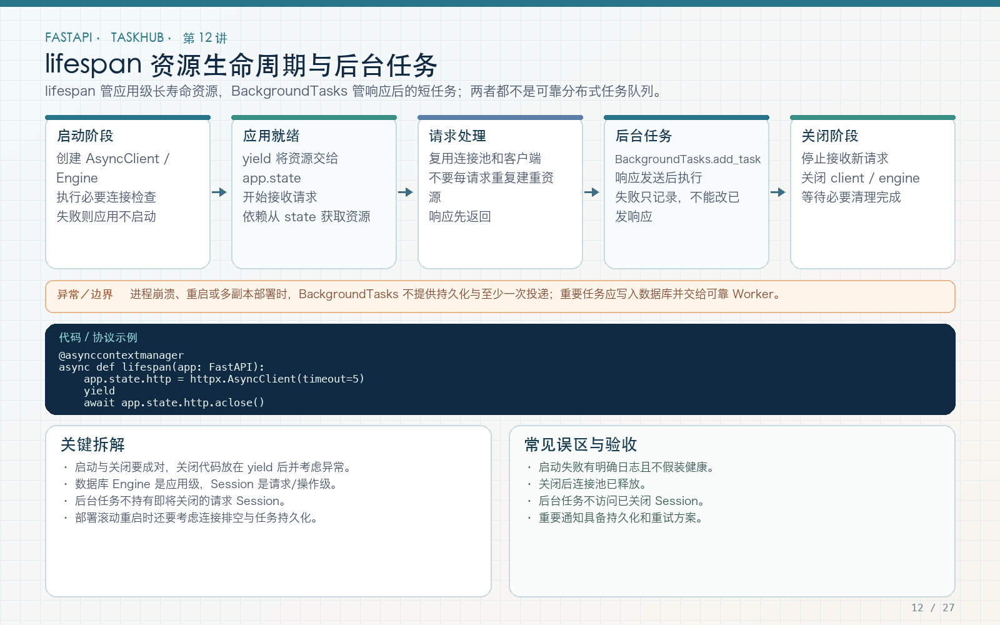

# 第 12 讲：lifespan 生命周期与 BackgroundTasks

学习路线位置：第 5 周  
前置章节：第 07、08、11 讲  
本讲核心文件：`app/main.py`、`app/services/notification_service.py`、`app/api/v1/endpoints/tasks.py`



> 可编辑矢量版本：`images/12-lifespan-background.svg`。lifespan 管应用级资源；BackgroundTasks 管一次响应后的轻量动作；可靠业务任务必须持久化。

---

## 1. 为什么需要生命周期管理

第 11 讲复用了 `AsyncClient`，但还有几个问题：

- 客户端什么时候创建？
- 服务关闭时谁关闭连接池？
- 数据库 Engine 是否每个请求新建？
- 上传目录不存在怎么办？
- 测试为什么必须触发启动和关闭流程？

如果把资源创建写在 endpoint 里，每个请求都可能重复建连；如果只写全局对象而不关闭，测试和滚动部署时可能泄露连接。

lifespan 把应用分为：

```text
启动阶段 → yield → 服务运行阶段 → 关闭阶段
```

启动阶段准备共享资源，运行阶段处理请求，关闭阶段释放资源。

---

## 2. 应用级资源与请求级资源

| 资源 | 生命周期 | 原因 |
|---|---|---|
| Settings | 应用级 | 配置在一次进程中稳定 |
| Engine | 应用级 | 连接池应复用 |
| AsyncClient | 应用级 | HTTP 连接池应复用 |
| AsyncSession | 请求级/工作单元级 | 保存当前事务和 ORM 身份映射，不能全局共享 |
| UploadFile | 请求级 | 属于当前上传内容 |
| 当前用户 | 请求级 | 每个请求身份不同 |

最常见错误之一是把 `AsyncSession` 或当前用户塞进 `app.state` 共享。共享连接池可以，共享事务上下文不可以。

---

## 3. 完整 lifespan 代码

文件：`app/main.py`

```python
from contextlib import asynccontextmanager

import httpx
from fastapi import FastAPI


@asynccontextmanager
async def lifespan(app: FastAPI):
    settings = app.state.settings
    settings.upload_dir.mkdir(parents=True, exist_ok=True)

    if settings.auto_create_tables:
        from app.db.base import Base
        from app import models  # 注册所有 ORM 表
        async with app.state.engine.begin() as connection:
            await connection.run_sync(Base.metadata.create_all)

    app.state.http_client = httpx.AsyncClient(
        timeout=settings.external_timeout_seconds
    )
    try:
        yield
    finally:
        await app.state.http_client.aclose()
        await app.state.engine.dispose()
```

### 3.1 yield 前

应用开始接收请求前完成必要准备：

- 创建上传目录；
- 测试环境按需建表；
- 创建 HTTP 客户端；
- 真实项目可在这里执行只读配置检查。

生产环境不依赖 `create_all` 修改数据库，而是通过第 18 讲 Alembic 迁移。`auto_create_tables` 主要用于测试和教学演示。

### 3.2 yield

`yield` 把控制权交回 FastAPI。服务在此期间处理请求。它不是 endpoint 返回值，也不是后台任务。

### 3.3 finally

无论正常关闭还是启动后发生异常，都要尽力释放已创建资源。HTTP Client 先关闭，再 dispose Engine，避免遗留连接。

如果启动阶段在创建客户端之前失败，`finally` 的位置必须与实际已创建资源匹配，不能访问尚不存在的属性。

---

## 4. create_app 如何组装资源

```python
def create_app(settings: Settings | None = None) -> FastAPI:
    settings = settings or get_settings()
    connect_args = (
        {"check_same_thread": False}
        if settings.database_url.startswith("sqlite")
        else {}
    )
    engine = create_async_engine(
        settings.database_url,
        pool_pre_ping=True,
        connect_args=connect_args,
    )

    app = FastAPI(
        title=settings.app_name,
        version="1.0.0",
        lifespan=lifespan,
    )
    app.state.settings = settings
    app.state.engine = engine
    app.state.session_factory = async_sessionmaker(
        engine,
        expire_on_commit=False,
    )
    ...
    return app


app = create_app()
```

### 4.1 为什么使用应用工厂

测试可以注入不同配置：

```python
app = create_app(test_settings)
```

每个测试使用独立数据库文件、上传目录和密钥，不需要修改全局 `.env`。这比导入后就固定的单例更容易测试。

### 4.2 `pool_pre_ping=True`

连接池取出连接时检查其可用性，能降低长时间空闲后使用失效连接的概率。它不是数据库高可用方案，也不能代替真实健康检查和重连策略。

### 4.3 `expire_on_commit=False`

提交后保留已加载对象属性，便于在事务后构造响应。它不等于所有 relationship 都已加载，关系加载仍在第 16 讲显式处理。

---

## 5. 数据库 Session 依赖与 lifespan 的关系

```python
async def get_db(request: Request):
    async with request.app.state.session_factory() as session:
        yield session
```

调用链：

```text
lifespan 创建应用级 Engine
  → session_factory 绑定 Engine
  → 每次请求创建独立 AsyncSession
  → service 提交或回滚
  → 请求结束关闭 Session
```

Engine 管连接池，Session 管一次工作单元。不要把 Engine、Connection、Session 三个概念混用。

---

## 6. BackgroundTasks 完整示例

文件：`app/services/notification_service.py`

```python
import logging

logger = logging.getLogger("taskhub.notifications")


def log_task_created(task_id: int) -> None:
    # 示例后台动作：真实系统应先把通知持久化。
    logger.info(
        "background notification created for task_id=%s",
        task_id,
    )
```

任务创建 endpoint：

```python
@router.post("", status_code=201)
async def create_task(
    payload: TaskCreate,
    current_user: CurrentUser,
    db: DbDep,
    background_tasks: BackgroundTasks,
):
    task = await task_service.create_task(
        db,
        current_user,
        payload,
    )
    background_tasks.add_task(
        notification_service.log_task_created,
        task.id,
    )
    return {
        "data": TaskRead.model_validate(task),
        "message": "task created",
    }
```

`BackgroundTasks.add_task` 接收函数和参数，不接收“已经执行的结果”：

```python
# 正确：登记函数
background_tasks.add_task(log_task_created, task.id)

# 错误：在 add_task 之前就调用了函数
background_tasks.add_task(log_task_created(task.id))
```

这里只传 `task.id`，不把请求级 AsyncSession 传入后台继续使用。响应结束后 Session 可能已关闭。

---

## 7. BackgroundTasks 什么时候执行

概念顺序：

```text
endpoint 完成业务
  → 生成响应
  → 响应发送后运行已登记后台任务
  → 请求处理结束
```

它适合：

- 写一条尽力而为的日志；
- 清理临时文件；
- 发送失败可重试但丢失影响很小的通知；
- 轻量、短时的后续动作。

它不适合：

- 必须成功发送的邮件；
- 支付、扣费、订单状态推进；
- 耗时很长的视频转码；
- 需要跨进程重启恢复的任务；
- 需要复杂重试、延迟、死信和进度查询的工作。

多 Worker 部署时，后台任务只在处理该请求的进程中执行。进程崩溃后，内存中的任务列表无法恢复。

---

## 8. 可靠任务的正确边界

可靠任务通常先在与业务相同的数据库事务中写入任务表或 outbox：

```text
业务事务：
  创建 Task
  写入 notification_job(status=pending)
提交
  → 独立 Worker 查询 pending
  → 执行并记录 attempts/result
  → 失败重试或进入死信
```

关键不是“用了 Redis 就可靠”，而是任务状态有持久化、执行有幂等、失败有恢复路径。

本课程第 27 讲再讨论按需引入队列，不在基础项目里强行加入所有基础设施。

---

## 9. lifespan 在测试中的触发方式

正确：

```python
with TestClient(app) as client:
    response = client.get("/health/live")
```

`with` 进入时运行启动阶段，退出时运行关闭阶段。

不推荐：

```python
client = TestClient(app)
# 若没有进入上下文，不能假设 lifespan 已完整运行
```

本工程 fixture：

```python
@pytest.fixture
def client(tmp_path):
    app = create_app(make_settings(tmp_path))
    with TestClient(app) as test_client:
        yield test_client
```

这样测试数据库建表、上传目录、HTTP Client 和关闭流程都走真实路径。

---

## 10. 健康检查与 lifespan 的区别

本工程有两个健康接口：

```text
GET /health/live   进程和 HTTP 服务是否可响应
GET /health/ready  数据库是否可执行 SELECT 1
```

存活检查失败通常意味着进程需要重启；就绪检查失败意味着暂时不应接收流量。不要把所有外部依赖都塞进 liveness，否则一个下游抖动可能导致容器被反复重启。

lifespan 启动成功也不等于永远健康，运行中仍需检查关键依赖。

---

## 11. 常见错误

### 错误 1：在 import 时连接数据库

导入模块应尽量轻量。连接和建表放到明确的生命周期或迁移命令中，测试才能控制。

### 错误 2：每个请求创建 Engine

Engine 和连接池应复用；每请求创建的是 Session。

### 错误 3：生产启动时静默 create_all

这无法可靠表达列修改、索引调整和数据迁移，应使用 Alembic。

### 错误 4：把 Session 传给 BackgroundTasks

请求级资源生命周期不匹配。传 ID，由可靠 Worker 创建自己的 Session。

### 错误 5：把 BackgroundTasks 当消息队列

它没有持久化和跨进程恢复保证。

### 错误 6：测试不使用上下文管理器

这样可能没有执行 lifespan，也可能没有释放资源。

---

## 12. 练习、自测与验收

### 练习

1. 在 lifespan 启动和关闭位置各加一条日志，用 TestClient 观察顺序。
2. 写一个失败的后台日志任务，观察它是否改变已发送的业务响应。
3. 将后台通知改为先写 `notification_jobs` 表的设计草图，不直接引入 Redis。
4. 给 `/health/ready` 增加数据库不可用测试，确认返回失败而不是伪造 ready。

### 自测

1. 为什么 Engine 应用级、Session 请求级？
2. `yield` 前后分别执行什么？
3. 为什么生产环境不能只靠 create_all？
4. BackgroundTasks 为什么不能保证可靠投递？
5. 为什么测试要用 `with TestClient(app)`？

### 验收

- [ ] AsyncClient 在启动时创建，关闭时释放。
- [ ] Engine 在关闭时 dispose。
- [ ] 上传目录自动创建且路径可配置。
- [ ] 请求使用独立 AsyncSession。
- [ ] 后台任务不共享请求 Session。
- [ ] 能清楚说出内存后台任务的可靠性边界。
- [ ] 测试真实覆盖 lifespan。

---

## 13. 下一讲预告

本讲创建了上传目录，下一讲将真正处理 multipart 上传：分块读取、大小限制、文件签名、随机存储名、临时文件清理、附件元数据和带权限的下载。重点不是“能保存文件”，而是避免路径穿越、无限上传和越权下载。
