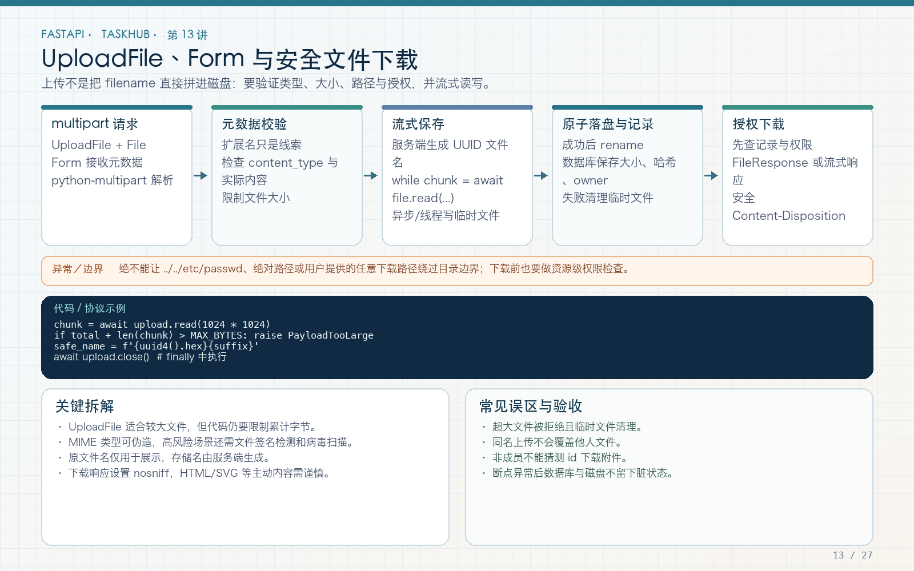

# 第 13 讲：文件上传、Form 与安全下载

学习路线位置：第 5 周  
前置章节：第 02、07、08、12 讲  
本讲核心文件：`app/api/v1/endpoints/files.py`、`app/models/attachment.py`、`app/schemas/attachment.py`



> 可编辑矢量版本：`images/13-uploads.svg`。上传不是简单调用 `write`：必须处理大小、类型、文件名、路径、事务、权限和失败清理。

---

## 1. 本讲完整业务链

TaskHub 允许项目成员给任务上传附件，项目 viewer 可以下载：

```text
POST /api/v1/tasks/{task_id}/attachments
  → 校验登录
  → 查询任务与项目
  → 校验 member 权限
  → 校验声明类型
  → 分块写入随机命名的临时文件
  → 校验大小与文件签名
  → 原子移动到正式路径
  → 数据库保存附件元数据
  → 返回 AttachmentRead

GET /api/v1/attachments/{attachment_id}
  → 查询元数据
  → 校验项目 viewer 权限
  → 计算并限制实际路径
  → FileResponse 下载
```

任何一步失败都不能留下“数据库说存在但文件丢失”或“文件存在但数据库无记录”的静默状态。本地文件与数据库无法组成一个 ACID 事务，因此要设计清理和补偿。

---

## 2. multipart/form-data 与 JSON 的区别

普通 JSON 请求：

```http
Content-Type: application/json

{"title": "task"}
```

文件上传通常使用：

```http
Content-Type: multipart/form-data; boundary=...
```

一个请求可以包含多个 part，例如文件、表单字段和文本说明。FastAPI 需要：

```bash
pip install python-multipart aiofiles
```

- `UploadFile`：表示上传文件；
- `File`：声明文件参数；
- `Form`：声明 multipart 中的普通字段；
- `aiofiles`：异步写本地文件。

不要把文件内容 base64 后塞进 JSON 作为默认方案：这会增加体积、内存和解析成本。小文件元数据可用 JSON，真正的二进制上传用 multipart。

---

## 3. UploadFile 不等于已经把整个文件读入内存

`UploadFile` 提供异步方法：

```python
chunk = await upload.read(1024 * 1024)
await upload.seek(0)
await upload.close()
```

底层可能使用临时文件 spool，但应用仍应分块处理，不要：

```python
content = await upload.read()  # 大文件可能占用大量内存
```

本工程每次读取 1 MiB，并在累计大小超过配置时返回 413。

反向代理和 Web 服务器也应设置请求体上限。应用层限制是最后一道防线，不是唯一防线。

---

## 4. 文件元数据模型

文件：`app/models/attachment.py`

```python
class Attachment(Base, TimestampMixin):
    __tablename__ = "attachments"

    id: Mapped[int] = mapped_column(primary_key=True)
    task_id: Mapped[int] = mapped_column(
        ForeignKey("tasks.id", ondelete="CASCADE"),
        index=True,
    )
    uploader_id: Mapped[int] = mapped_column(
        ForeignKey("users.id", ondelete="RESTRICT")
    )
    original_name: Mapped[str] = mapped_column(String(255))
    stored_name: Mapped[str] = mapped_column(
        String(255),
        unique=True,
    )
    content_type: Mapped[str] = mapped_column(String(100))
    size: Mapped[int] = mapped_column(BigInteger)
```

数据库保存元数据，磁盘保存内容。`stored_name` 是服务器生成的随机名称，`original_name` 仅用于展示和下载文件名。

响应模型不包含服务器绝对路径，避免泄露部署目录。

---

## 5. 类型白名单与文件签名

```python
ALLOWED_TYPES = {
    "text/plain",
    "text/csv",
    "application/pdf",
    "image/png",
    "image/jpeg",
}


def validate_signature(content_type: str, first_chunk: bytes) -> None:
    signatures = {
        "application/pdf": (b"%PDF",),
        "image/png": (b"\x89PNG\r\n\x1a\n",),
        "image/jpeg": (b"\xff\xd8\xff",),
    }
    expected = signatures.get(content_type)
    if expected and not first_chunk.startswith(expected):
        raise AppError("File content does not match its declared type")
```

`UploadFile.content_type` 来自客户端声明，不能单独信任。PNG/JPEG/PDF 至少检查 magic bytes。

这也只是基础检查，不等于文件无病毒或内容完全合法。真实系统还应按业务增加：

- 图片解码和尺寸限制；
- 病毒扫描；
- 压缩炸弹防护；
- 文件存储隔离；
- 下载强制附件和 `nosniff`。

文本文件通常没有固定 magic bytes，因此不能靠签名证明其安全性。

---

## 6. 为什么不能直接使用原文件名

危险示例：

```python
# 错误：用户可尝试路径穿越
path = upload_dir / upload.filename
```

客户端文件名可能是 `../../secret`，也可能包含绝对路径、特殊字符、超长字符串或重复名称。

本工程：

```python
suffix = Path(upload.filename or "").suffix[:20]
stored_name = f"{uuid4().hex}{suffix}"
final_path = upload_dir / stored_name
original_name = Path(
    upload.filename or "upload.bin"
).name[:255]
```

- 存储名由 UUID 决定；
- 原名只保留最后一段并限制长度；
- 后缀长度受限；
- 正式路径由服务端目录和随机名组成。

下载时仍需重新 resolve 并检查父目录，不能只因为“现在生成逻辑安全”就省略边界验证。

---

## 7. 完整上传代码

文件：`app/api/v1/endpoints/files.py`

```python
@router.post(
    "/tasks/{task_id}/attachments",
    response_model=DataResponse[AttachmentRead],
    status_code=201,
)
async def upload_attachment(
    task_id: int,
    upload: UploadFile,
    current_user: CurrentUser,
    db: DbDep,
    settings: SettingsDep,
):
    task = await get_existing_task(db, task_id)
    await require_project_role(
        db,
        current_user,
        task.project_id,
        "member",
    )
    if upload.content_type not in ALLOWED_TYPES:
        raise AppError(
            "Unsupported file type",
            details={"allowed": sorted(ALLOWED_TYPES)},
        )

    upload_dir = settings.upload_dir.resolve()
    upload_dir.mkdir(parents=True, exist_ok=True)
    suffix = Path(upload.filename or "").suffix[:20]
    stored_name = f"{uuid4().hex}{suffix}"
    temporary_path = upload_dir / f".{stored_name}.part"
    final_path = upload_dir / stored_name
    total = 0

    try:
        async with aiofiles.open(temporary_path, "wb") as output:
            while chunk := await upload.read(1024 * 1024):
                if total == 0:
                    validate_signature(upload.content_type, chunk)
                total += len(chunk)
                if total > settings.max_upload_bytes:
                    raise PayloadTooLargeError(
                        "Uploaded file is too large",
                        details={
                            "max_bytes": settings.max_upload_bytes
                        },
                    )
                await output.write(chunk)

        await asyncio.to_thread(
            temporary_path.replace,
            final_path,
        )
        async with transaction(db):
            attachment = Attachment(
                task_id=task_id,
                uploader_id=current_user.id,
                original_name=Path(
                    upload.filename or "upload.bin"
                ).name[:255],
                stored_name=stored_name,
                content_type=upload.content_type,
                size=total,
            )
            db.add(attachment)
            await db.flush()

        return {
            "data": AttachmentRead.model_validate(attachment),
            "message": "attachment uploaded",
        }
    except Exception:
        await asyncio.to_thread(
            lambda: temporary_path.unlink(missing_ok=True)
        )
        await asyncio.to_thread(
            lambda: final_path.unlink(missing_ok=True)
        )
        raise
    finally:
        await upload.close()
```

### 7.1 先写 `.part` 临时文件

半写入文件不应被当成完整附件。全部块写完后，使用 `Path.replace` 移到正式文件名。这里上传目录和正式目录相同，移动通常具有原子性。

### 7.2 为什么数据库提交失败要删除正式文件

文件已移动后，数据库仍可能失败。异常清理删除本次随机文件，避免孤儿文件。删除使用本次唯一路径，不触碰其他附件。

### 7.3 为什么响应构造放在事务后

数据库 `flush` 获得 ID，事务提交成功后，元数据才可靠存在。随后再构造响应，避免把未提交状态当成功。

### 7.4 `finally` 关闭 UploadFile

无论成功、413、类型错误还是数据库异常，都要关闭上传资源。

---

## 8. 安全下载代码

```python
@router.get("/attachments/{attachment_id}")
async def download_attachment(
    attachment_id: int,
    current_user: CurrentUser,
    db: DbDep,
    settings: SettingsDep,
):
    attachment = await db.get(Attachment, attachment_id)
    if attachment is None:
        raise NotFoundError("Attachment not found")

    task = await get_existing_task(db, attachment.task_id)
    await require_project_role(
        db,
        current_user,
        task.project_id,
        "viewer",
    )

    upload_dir = settings.upload_dir.resolve()
    path = (upload_dir / attachment.stored_name).resolve()
    if path.parent != upload_dir or not path.is_file():
        raise NotFoundError("Attachment content not found")

    return FileResponse(
        path,
        media_type="application/octet-stream",
        filename=attachment.original_name,
    )
```

三个关键点：

1. 先查数据库，不接受用户直接提供磁盘路径；
2. 下载也需要项目权限，不能知道 ID 就下载；
3. `resolve()` 后确认父目录恰好是上传目录，并确认文件存在。

`application/octet-stream` 让浏览器按附件处理，减少 HTML/SVG 等内容直接在站点源下执行的风险。真实项目还应设置合适的 Content-Disposition 与 CSP。

---

## 9. 配置大小限制

```dotenv
UPLOAD_DIR=var/uploads
MAX_UPLOAD_BYTES=5242880
```

`5242880 = 5 × 1024 × 1024`，即 5 MiB。界面显示“MB”还是“MiB”要统一，不要混淆十进制和二进制。

测试环境把上限设为 1024 字节，便于快速验证 413，而不是每次生成 5 MiB 文件。

---

## 10. curl 完整验证

先注册、登录、创建项目和任务，保存 token 与 task ID。上传：

```bash
curl -i http://127.0.0.1:8000/api/v1/tasks/1/attachments \
  -H "Authorization: Bearer $TOKEN" \
  -F 'upload=@./notes.txt;type=text/plain'
```

路径穿越式原名测试可用 curl 自定义 filename：

```bash
curl -i http://127.0.0.1:8000/api/v1/tasks/1/attachments \
  -H "Authorization: Bearer $TOKEN" \
  -F 'upload=@./notes.txt;filename=../../notes.txt;type=text/plain'
```

响应的 `original_name` 应只有 `notes.txt`，磁盘存储名应是 UUID，而不是进入上级目录。

下载：

```bash
curl -i http://127.0.0.1:8000/api/v1/attachments/1 \
  -H "Authorization: Bearer $TOKEN" \
  --output downloaded.bin
```

用另一个非成员账号请求，应返回 403，而不是文件内容。

---

## 11. 自动化测试

正常路径：

```python
response = client.post(
    f"/api/v1/tasks/{task['id']}/attachments",
    headers=auth(token),
    files={
        "upload": (
            "../../notes.txt",
            b"hello taskhub",
            "text/plain",
        )
    },
)
assert response.status_code == 201
attachment = response.json()["data"]
assert attachment["original_name"] == "notes.txt"
```

大小与签名：

```python
response = client.post(
    url,
    headers=auth(token),
    files={"upload": ("large.txt", b"x" * 1025, "text/plain")},
)
assert response.status_code == 413

response = client.post(
    url,
    headers=auth(token),
    files={"upload": ("fake.png", b"not-a-png", "image/png")},
)
assert response.status_code == 400
```

下载后再断言字节内容，不能只检查状态码。

---

## 12. 常见错误

### 错误 1：只校验扩展名

`evil.png` 可能不是 PNG。扩展名和 Content-Type 都是声明，需要内容检查。

### 错误 2：直接拼接用户文件名

可能路径穿越或覆盖文件。使用随机存储名并验证 resolve 后路径。

### 错误 3：上传公开，下载不鉴权

附件往往包含私有项目数据。下载必须与查看任务相同的权限。

### 错误 4：413 后留下临时文件

必须测试失败清理。否则反复失败上传会耗尽磁盘。

### 错误 5：返回服务器绝对路径

响应只需要附件 ID、名称、类型、大小和时间，不暴露部署结构。

### 错误 6：认为本地文件和数据库是同一事务

它们不是。需要临时文件、提交顺序、失败清理和后续对账任务。

---

## 13. 练习、自测与验收

### 练习

1. 添加一个非法 PDF 签名测试。
2. 上传 1025 字节后，检查上传目录没有残留 `.part` 和正式文件。
3. 用 viewer 尝试上传，确认 403；再尝试下载，确认 200。
4. 增加空文件策略：明确允许还是拒绝，并写测试。
5. 画出迁移到 S3 兼容对象存储后的接口变化，说明哪些安全规则仍保留。

### 自测

1. 为什么上传使用 multipart？
2. 为什么不能完全信任 Content-Type？
3. 为什么数据库保存 stored_name 和 original_name 两个字段？
4. 为什么先写临时文件？
5. 为什么下载也要做资源级权限？
6. 文件系统和数据库失败时如何补偿？

### 验收

- [ ] 上传分块读取，有明确大小上限。
- [ ] 类型白名单与图片/PDF 签名检查生效。
- [ ] 用户文件名不会成为磁盘路径。
- [ ] 上传失败会清理临时和正式文件。
- [ ] 元数据不泄露服务器路径。
- [ ] viewer 可下载，非成员不可下载。
- [ ] 正常、超限、伪造类型和权限测试通过。

---

## 14. 下一讲预告

附件下载是“一次性返回文件”，有些场景则需要持续发送数据。第 14 讲将比较普通响应、StreamingResponse、SSE 和 WebSocket，并完成带断连检查的事件流以及带认证和项目权限的 WebSocket。
