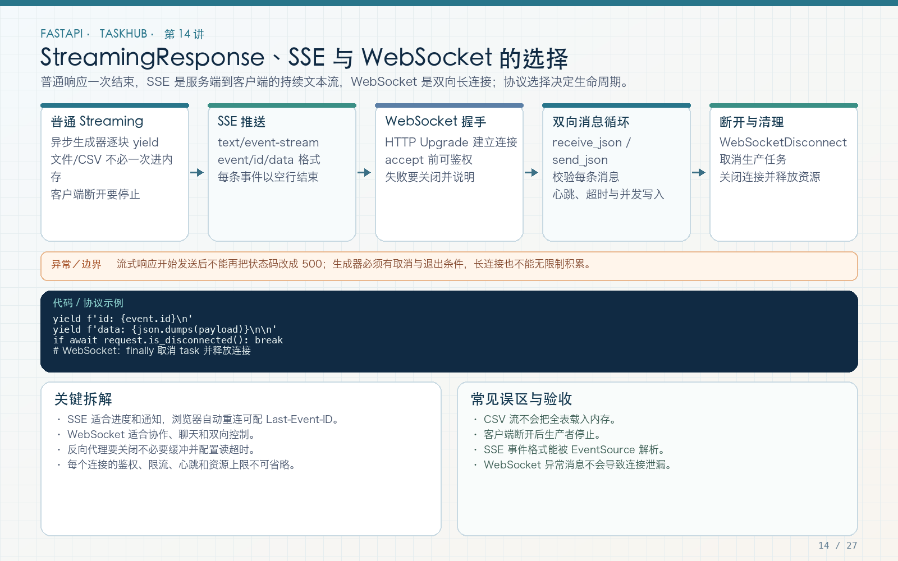

# 第 14 讲：StreamingResponse、SSE 与 WebSocket

学习路线位置：第 5 周  
前置章节：第 10～13 讲  
本讲核心文件：`app/api/v1/endpoints/events.py`、`tests/test_realtime.py`



> 可编辑矢量版本：`images/14-streaming-websocket.svg`。普通响应、SSE 和 WebSocket 不是同一协议的不同写法，要根据方向、频率、客户端和部署约束选择。

---

## 1. 先选择通信方式，再写代码

| 需求 | 推荐方式 | 原因 |
|---|---|---|
| 一次性返回计算结果 | 普通 JSON Response | 简单、缓存和重试语义清晰 |
| 大文件逐步发送 | FileResponse / StreamingResponse | 避免一次性拼出全部字节 |
| 服务器持续向浏览器推送事件 | SSE | 单向、基于 HTTP、浏览器 EventSource 友好 |
| 双向、高频、低延迟消息 | WebSocket | 长连接上双向帧通信 |
| 可靠离线通知 | 持久化消息 + 客户端补拉 | 长连接断开不能丢业务状态 |

TaskHub 本讲实现两个教学接口：

```text
GET /api/v1/events/stream       SSE，服务器单向推送 heartbeat
WS  /api/v1/ws/projects/{id}    WebSocket，认证后 ping/pong
```

它们用于演示协议与权限，不宣称已经实现完整的生产通知系统。

---

## 2. StreamingResponse 的本质

普通响应通常先得到完整对象，再序列化：

```python
return {"data": items}
```

StreamingResponse 接收迭代器或异步迭代器，逐步产生字节/字符串：

```python
async def generate():
    yield "first\n"
    yield "second\n"

return StreamingResponse(generate(), media_type="text/plain")
```

适合：

- 服务器已经能逐段获得数据；
- 数据量大，不想全部放入内存；
- 需要持续连接并按事件推送。

不适合把已经完整生成的大字符串再包一层 StreamingResponse，然后声称“节省了内存”。真正的收益来自生产过程也是流式的。

流式响应一旦开始发送，HTTP 状态码和部分响应头已经确定，后续生成器异常不能像普通 endpoint 那样重新返回一个完整 500 JSON。因此应在开始流之前完成关键权限和资源检查，并设计流内错误事件或断开策略。

---

## 3. SSE 的线路格式

Server-Sent Events 有明确文本协议。一个事件：

```text
id: 1
event: heartbeat
data: {"sequence":1,"user_id":1}

```

注意最后有两个换行，表示事件结束。常见字段：

- `id`：事件标识，可用于断线后的 Last-Event-ID；
- `event`：事件类型；
- `data`：事件数据，可多行；
- `retry`：建议客户端重连等待时间。

不能把普通 JSON 用 `text/event-stream` 返回就当成完整 SSE。客户端依赖这些字段和空行解析事件。

---

## 4. 完整 SSE 代码

文件：`app/api/v1/endpoints/events.py`

```python
import asyncio
import json

from fastapi import Query, Request
from fastapi.responses import StreamingResponse


@router.get("/events/stream")
async def stream_events(
    request: Request,
    current_user: CurrentUser,
    limit: int = Query(default=3, ge=1, le=100),
):
    async def generate():
        for event_id in range(1, limit + 1):
            if await request.is_disconnected():
                break
            payload = {
                "event": "heartbeat",
                "user_id": current_user.id,
                "sequence": event_id,
            }
            yield (
                f"id: {event_id}\n"
                f"event: heartbeat\n"
                f"data: {json.dumps(payload)}\n\n"
            )
            await asyncio.sleep(0.05)

    return StreamingResponse(
        generate(),
        media_type="text/event-stream",
        headers={
            "Cache-Control": "no-cache",
            "X-Accel-Buffering": "no",
        },
    )
```

### 4.1 为什么 endpoint 先生成响应

`CurrentUser` 和 Query 校验在进入生成器前完成。匿名、无效 token、limit 超界都能返回普通 401/422，不会先开启 200 流再报错。

### 4.2 为什么检查断连

客户端关闭后，继续生成事件没有意义。真实长时间任务还应处理取消、心跳超时和资源释放。

### 4.3 为什么使用 `await asyncio.sleep`

这里只是模拟事件间隔，并让出事件循环。真实事件应来自消息通道、数据库变更或业务发布器，而不是永远循环伪造 heartbeat。

### 4.4 为什么关闭代理缓冲

`X-Accel-Buffering: no` 给兼容的 Nginx 配置提示，避免代理缓存整个流后再发送。它不能保证所有中间代理都不缓冲，部署时仍需实际验证。

---

## 5. SSE 与鉴权的现实问题

浏览器原生 `EventSource` 自定义 Authorization 请求头的能力有限。本课程接口使用 Bearer，curl 测试：

```bash
curl -N http://127.0.0.1:8000/api/v1/events/stream?limit=2 \
  -H "Authorization: Bearer $TOKEN"
```

`-N` 关闭 curl 输出缓冲，便于观察事件。

如果浏览器必须原生 EventSource，常见方案：

- 使用安全、HttpOnly、SameSite 合适的短期 Cookie；
- 由后端签发一次性、短时效的流式连接票据；
- 使用支持自定义请求头的客户端库。

不要为了方便把长期 JWT 放 URL query。URL 容易进入日志和历史。任何连接票据都必须短期、限定用途并可撤销。

---

## 6. WebSocket 与 HTTP 请求的区别

WebSocket 先通过 HTTP 握手升级协议，随后保持长连接，双方可以发送帧。

本教程流程：

```text
客户端连接
  → 服务器 accept
  → 5 秒内收到 authenticate JSON
  → 校验 JWT
  → 查询用户是否 active
  → 校验项目 viewer 权限
  → 发送 ready
  → ping → pong
  → 断开时清理
```

为什么先 accept 再认证？因为 WebSocket 不能直接复用普通 HTTP 的 OAuth2 依赖返回 401 JSON。连接级错误通常用 close code 和 reason 表达。

策略违规使用 `1008`。不要向匿名客户端泄露过多内部细节。

---

## 7. 完整 WebSocket 代码

```python
@router.websocket("/ws/projects/{project_id}")
async def project_socket(
    websocket: WebSocket,
    project_id: int,
):
    await websocket.accept()
    try:
        try:
            async with asyncio.timeout(5):
                message = await websocket.receive_json()
        except TimeoutError:
            await websocket.close(
                code=1008,
                reason="Authentication timeout",
            )
            return

        token = (
            message.get("token")
            if message.get("type") == "authenticate"
            else None
        )
        if not token:
            await websocket.close(
                code=1008,
                reason="Authentication required",
            )
            return

        settings = websocket.app.state.settings
        try:
            payload = decode_access_token(token, settings)
            user_id = int(payload["sub"])
        except Exception:
            await websocket.close(
                code=1008,
                reason="Invalid token",
            )
            return

        async with websocket.app.state.session_factory() as session:
            user = await session.get(User, user_id)
            if user is None or not user.is_active:
                await websocket.close(
                    code=1008,
                    reason="Inactive user",
                )
                return
            try:
                await require_project_role(
                    session,
                    user,
                    project_id,
                    "viewer",
                )
            except AppError:
                await websocket.close(
                    code=1008,
                    reason="Project access denied",
                )
                return

        await websocket.send_json({
            "type": "ready",
            "project_id": project_id,
            "user_id": user_id,
        })
        while True:
            incoming = await websocket.receive_json()
            if incoming.get("type") == "ping":
                await websocket.send_json({"type": "pong"})
            else:
                await websocket.send_json({
                    "type": "error",
                    "message": "Unsupported message type",
                })
    except WebSocketDisconnect:
        return
```

### 7.1 认证超时

未认证连接不能无限占用资源。5 秒内必须发送首条认证消息。真实服务还应限制单用户连接数、消息大小和发送频率。

### 7.2 会话边界

认证时创建自己的 AsyncSession，离开 `async with` 即关闭。后续消息循环不长期持有数据库事务。

### 7.3 项目权限

“token 正确”只证明用户身份。连接项目频道前必须再查项目成员关系，否则任何登录用户都能监听任意项目。

### 7.4 断开处理

`WebSocketDisconnect` 是正常断开路径，不应记录成 500。生产代码还要区分协议错误、异常断网和服务端主动关闭。

---

## 8. 自动化测试

SSE：

```python
def test_sse_stream(client):
    register(client)
    token = login(client)
    response = client.get(
        "/api/v1/events/stream?limit=2",
        headers=auth(token),
    )
    assert response.status_code == 200
    assert response.headers["content-type"].startswith(
        "text/event-stream"
    )
    assert "id: 2" in response.text
    assert "event: heartbeat" in response.text
```

WebSocket：

```python
def test_websocket_authentication_and_ping(client):
    register(client)
    token = login(client)
    project = create_project(client, token)

    with client.websocket_connect(
        f"/api/v1/ws/projects/{project['id']}"
    ) as websocket:
        websocket.send_json({
            "type": "authenticate",
            "token": token,
        })
        assert websocket.receive_json()["type"] == "ready"
        websocket.send_json({"type": "ping"})
        assert websocket.receive_json() == {"type": "pong"}
```

运行：

```bash
pytest tests/test_realtime.py -q
```

还应补充匿名、错误 token、非成员和认证超时测试。成功 ping/pong 只证明主路径，不证明权限边界完整。

---

## 9. 断线重连与业务可靠性

长连接不等于可靠消息系统。如果客户端断线时错过事件，需要：

1. 事件持久化并带单调 ID；
2. 客户端记录最后已处理 ID；
3. 重连后按 ID 补拉或重新同步；
4. 消费逻辑幂等；
5. 明确保留期限和过期后的全量同步策略。

SSE 的 `Last-Event-ID` 可以辅助，但服务器必须真的实现按 ID 重放。只在响应里写 `id` 不会自动获得持久化能力。

WebSocket 也一样，ping/pong 只说明连接活跃，不说明消息已可靠处理。

---

## 10. 部署注意事项

- 反向代理启用 WebSocket Upgrade；
- 调整长连接 idle timeout；
- 多 Worker 下不能直接用进程内字典广播给所有连接；
- 多实例广播可使用 Redis Pub/Sub 等，但 Pub/Sub 本身也不一定持久化；
- 心跳、限流和最大连接数必须在真实环境测试；
- 日志不记录 token 和完整消息敏感内容。

不要为了实时而实时。任务列表偶尔更新时，短轮询或刷新可能更简单可靠。

---

## 11. 常见错误

### 错误 1：StreamingResponse 就是 SSE

错。StreamingResponse 是响应机制，SSE 是有具体格式和客户端语义的协议。

### 错误 2：事件流开始后才检查权限

此时可能已经返回 200，无法再规范返回 401/403。权限应在流开始前完成。

### 错误 3：WebSocket 只验 token 不验项目

会造成跨项目越权。

### 错误 4：长期 JWT 放 URL

容易泄露。使用 Authorization、受控 Cookie 或短期连接票据。

### 错误 5：用内存列表实现多实例广播

不同 Worker 不共享内存，客户端收不到其他实例上的事件。

### 错误 6：把 ping/pong 当可靠消息确认

连接活跃与业务消息持久化、处理成功是三件事。

---

## 12. 练习、自测与验收

### 练习

1. 给 WebSocket 增加非成员连接测试，断言 close code 1008。
2. 给 SSE 增加匿名访问测试，确认返回统一 401。
3. 为 SSE 设计 `Last-Event-ID` 补拉方案，写明事件存储表和过期策略。
4. 给 WebSocket 增加不支持消息类型测试。
5. 比较每 5 秒轮询任务状态与 SSE 推送，在何种需求下选择前者。

### 自测

1. StreamingResponse 和 SSE 是什么关系？
2. 为什么权限检查要在流开始前？
3. 为什么 WebSocket 需要认证超时？
4. 为什么项目频道必须校验成员？
5. 为什么 ping/pong 不代表消息可靠？
6. 多 Worker 下内存广播为什么失效？

### 验收

- [ ] SSE 输出符合 id/event/data 和空行格式。
- [ ] SSE 有登录校验、断连检查和非缓冲响应头。
- [ ] WebSocket 首条消息认证且有超时。
- [ ] WebSocket 校验 active 用户和项目 viewer 权限。
- [ ] 正常 SSE 与 WebSocket 测试通过。
- [ ] 能解释长连接与可靠消息的区别。
- [ ] 不把长期 token 放 URL。

---

## 13. 下一讲预告

前面的内存教程无法保存这些用户、项目和附件关系。第 15 讲开始数据库主线：SQLAlchemy 2.x 异步 Engine、Session、连接池、UTC 时间和声明式 Base，先把持久化基础设施搭稳。
