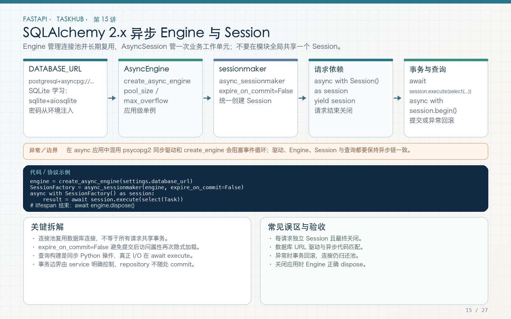

# 第 15 讲：SQLAlchemy 2.x 异步 Engine、Session 与连接池

学习路线位置：第 6 周  
前置章节：第 07、08、11、12 讲  
本讲核心文件：`app/main.py`、`app/core/dependencies.py`、`app/db/base.py`、`app/db/timestamp.py`



> 可编辑矢量版本：`images/15-sqlalchemy-async.svg`。Engine 管理连接池，Session 管理工作单元；二者不能混为一谈，也不能在请求间共享同一个 Session。

---

## 1. 从内存 CRUD 到数据库，变化的不只是存储位置

内存字典的问题是：

- 重启后数据丢失；
- 多 Worker 各自一份数据；
- 没有唯一约束、外键和事务；
- 并发修改缺少数据库级协调；
- 查询、分页、索引和备份能力有限。

接入 SQLAlchemy 后，TaskHub 的链路变成：

```text
HTTP 请求
  → endpoint
  → service 业务与事务
  → repository 构造查询
  → AsyncSession 执行
  → Engine 从连接池取得连接
  → 驱动与数据库通信
```

本讲只搭基础设施，第 16 讲定义关系，第 17 讲完成事务 CRUD，第 18 讲用 Alembic 管理真实表结构。

---

## 2. 安装与数据库 URL

依赖：

```bash
pip install 'SQLAlchemy[asyncio]' aiosqlite asyncpg
```

本地学习 SQLite：

```dotenv
DATABASE_URL=sqlite+aiosqlite:///./taskhub.db
```

Docker/PostgreSQL：

```dotenv
DATABASE_URL=postgresql+asyncpg://taskhub:password@db:5432/taskhub
```

拆解：

```text
postgresql  数据库种类
asyncpg     异步驱动
taskhub     用户名
password    密码（真实值由 secret 注入）
db          Compose 中的数据库服务名
5432        端口
taskhub     数据库名
```

同步 URL `postgresql://` 不能直接用于 `create_async_engine`。异步 ORM 不意味着数据库协议本身变了，而是驱动提供异步调用接口。

---

## 3. 声明式 Base 与时间戳

文件：`app/db/base.py`

```python
from sqlalchemy.orm import DeclarativeBase


class Base(DeclarativeBase):
    pass
```

所有 ORM 模型继承同一个 Base，才能注册到同一份 `Base.metadata`。Alembic 的 `target_metadata` 也指向它。

文件：`app/db/timestamp.py`

```python
from datetime import datetime, timezone

from sqlalchemy import DateTime
from sqlalchemy.orm import Mapped, mapped_column


def utc_now() -> datetime:
    return datetime.now(timezone.utc)


class TimestampMixin:
    created_at: Mapped[datetime] = mapped_column(
        DateTime(timezone=True),
        default=utc_now,
    )
    updated_at: Mapped[datetime] = mapped_column(
        DateTime(timezone=True),
        default=utc_now,
        onupdate=utc_now,
    )
```

### 3.1 为什么统一 UTC

服务器、数据库和开发者可能处于不同时区。统一存 UTC，展示层再按用户时区转换，避免“服务器搬走后时间变了”。

### 3.2 `default` 和 `onupdate`

`default=utc_now` 在 ORM 插入时提供值；`onupdate=utc_now` 在 ORM UPDATE 时提供新值。它们主要服务于 ORM 工作流，不应被误认为所有外部 SQL 客户端都会自动更新。

如果全公司都直接写 SQL，可考虑数据库默认值和触发器，并在迁移中明确。

### 3.3 SQLite 时区边界

SQLite 对带时区 DateTime 的处理与 PostgreSQL 不完全相同。测试数据库适合验证应用逻辑，但不能代替 PostgreSQL 特有类型、约束、并发和迁移验证。

---

## 4. 创建应用级 Engine

文件：`app/main.py`

```python
connect_args = (
    {"check_same_thread": False}
    if settings.database_url.startswith("sqlite")
    else {}
)
engine = create_async_engine(
    settings.database_url,
    pool_pre_ping=True,
    connect_args=connect_args,
)
app.state.engine = engine
app.state.session_factory = async_sessionmaker(
    engine,
    expire_on_commit=False,
)
```

`create_async_engine` 不意味着每次调用都会立即连数据库。真正的连接通常在执行 SQL 时建立。

### 4.1 Engine 的职责

- 保存数据库 URL 和方言配置；
- 管理连接池；
- 创建 DBAPI 连接；
- 为 Session 提供连接来源。

它不负责跟踪“哪个 ORM 对象被修改”，那是 Session 的职责。

### 4.2 为什么 Session factory 也应用级

`async_sessionmaker` 是工厂配置，可以复用；每次请求由它创建新 Session。工厂共享不等于 Session 共享。

### 4.3 SQLite `check_same_thread`

测试 TestClient 和异步连接可能跨线程使用 SQLite 连接，因此教学配置关闭驱动默认的同线程限制。该参数只用于 SQLite，不应无差别复制到 PostgreSQL。

---

## 5. 请求级 Session 依赖

文件：`app/core/dependencies.py`

```python
async def get_db(request: Request):
    async with request.app.state.session_factory() as session:
        yield session


DbDep = Annotated[AsyncSession, Depends(get_db)]
```

endpoint 注入：

```python
@router.get("")
async def list_tasks(db: DbDep, current_user: CurrentUser):
    ...
```

Session 在依赖进入时创建，在请求完成后关闭。事务的提交和回滚由 service 的事务边界负责。

### 5.1 为什么不用全局 Session

全局 Session 会把不同用户的未提交修改、事务状态和 ORM 对象混在一起，既可能数据串扰，也可能产生并发错误。

正确：

```text
Engine：全局一个
session_factory：全局一个
AsyncSession：每请求一个
```

### 5.2 为什么用 yield dependency

`yield` 后代码能在请求结束时清理资源。`async with` 还能保证异常时关闭 Session。第 07 讲的依赖生命周期在数据库中真正落地。

---

## 6. 连接池到底复用了什么

连接池复用的是数据库连接，不是查询结果，也不是事务。

```text
请求 A 使用连接 1 → 提交/回滚 → 归还连接 1
请求 B 从池中取得连接 1 → 开始自己的事务
```

连接归还前应保证事务状态被正确清理。应用不能在一个请求中把未提交事务留给下一个请求。

### 6.1 池大小不是越大越好

连接数受数据库上限、内存和 Worker 数影响。总连接可能接近：

```text
Worker 数 × 每 Worker 池上限 + 迁移/管理连接
```

盲目调大只会把压力转移给数据库。应根据真实并发、慢查询和数据库容量配置。

### 6.2 `pool_pre_ping`

取连接时检测失效连接，适合处理部分空闲断连。它增加检查成本，也不能保证执行 SQL 的整个期间连接永不失败。

---

## 7. 生命周期关闭

```python
finally:
    await app.state.http_client.aclose()
    await app.state.engine.dispose()
```

`dispose` 释放 Engine 管理的连接池资源。滚动部署和测试重复创建应用时尤其重要。

不要把 `engine.dispose()` 放在每个请求后，否则等于不断销毁要复用的池。

---

## 8. 测试环境为什么可以自动建表

```python
if settings.auto_create_tables:
    from app.db.base import Base
    from app import models
    async with app.state.engine.begin() as connection:
        await connection.run_sync(Base.metadata.create_all)
```

这里 `from app import models` 不是无用导入。`models/__init__.py` 导入 User、Project、Task 等模块，使它们注册到 Base.metadata。

如果只导入 Base 而没有导入模型模块，`create_all` 可能一张业务表也看不到。Alembic autogenerate 也会遇到同样问题。

测试使用独立文件数据库：

```python
Settings(
    database_url=f"sqlite+aiosqlite:///{tmp_path / 'test.db'}",
    auto_create_tables=True,
)
```

生产默认 `auto_create_tables=False`，由 Alembic 管理。

---

## 9. 为什么异步查询都要 await

```python
result = await session.execute(statement)
users = result.scalars().all()
```

`session.execute` 涉及数据库 I/O，所以 await；`scalars().all()` 是对已返回结果集的本地处理，不需要 await。

另一个例子：

```python
await session.flush()
await session.commit()
await session.rollback()
```

`flush` 把当前 ORM 变更同步到数据库事务中；`commit` 提交；`rollback` 回滚。三者含义不同，第 17 讲详细展开。

---

## 10. 就绪检查

```python
@router.get("/ready")
async def ready(db: DbDep):
    await db.execute(text("SELECT 1"))
    return {"status": "ready", "database": "ok"}
```

这条语句验证应用到数据库的基本执行链路，不验证所有表和迁移版本。部署时还可以检查 `alembic_version` 是否符合预期，但不要把复杂业务查询放进高频探针。

---

## 11. 一个容易踩坑的事务现象

当前用户依赖执行：

```python
user = await db.get(User, user_id)
```

这次查询已经可能让 Session autobegin。随后服务再写：

```python
async with session.begin():
    ...
```

可能报：

```text
InvalidRequestError: A transaction is already begun on this Session.
```

解决不是删掉所有事务，而是统一事务边界。最终工程使用 `transaction(session)` 提交或回滚当前事务，第 17 讲给出完整代码和失败回滚解释。

这也是实际测试比“代码看起来正确”更重要的例子。

---

## 12. 常见错误

### 错误 1：同步 URL 传给异步 Engine

检查驱动部分必须是 `+asyncpg` 或 `+aiosqlite`。

### 错误 2：全局共享 AsyncSession

改为请求级依赖。

### 错误 3：模型没导入导致 metadata 为空

在迁移 env 和建表路径统一导入 `app.models`。

### 错误 4：把 SQLite 测试当成 PostgreSQL 完整验证

数据库方言、约束和并发行为不同，发布前至少在目标数据库跑迁移和核心集成测试。

### 错误 5：连接池越大越快

池过大可能压垮数据库，应测量并计算 Worker 总连接数。

### 错误 6：commit 后以为 relationship 全部可用

`expire_on_commit=False` 不自动加载关系，第 16 讲处理 selectinload/joinedload。

---

## 13. 练习、自测与验收

### 练习

1. 打印 Engine 和 session_factory 的对象 ID，确认它们应用级复用。
2. 在两个请求中打印 Session ID，确认不是同一个对象。
3. 暂时不导入 `app.models`，观察 metadata 表集合，再恢复并解释。
4. 为 `/health/ready` 配置一个不存在的数据库地址，观察启动与就绪检查的差别。
5. 用当前用户依赖加一次写入，复现 autobegin 冲突，再阅读第 17 讲修复方式。

### 自测

1. Engine、Session factory、Session 各自负责什么？
2. 为什么 Session 不能全局共享？
3. `pool_pre_ping` 解决什么，不解决什么？
4. 为什么统一使用 UTC？
5. 为什么模型导入会影响 metadata？
6. SQLite 测试不能替代哪些 PostgreSQL 验证？

### 验收

- [ ] 数据库 URL 使用异步驱动。
- [ ] Engine 和 session factory 应用级复用。
- [ ] 每请求独立 AsyncSession。
- [ ] 应用关闭时 dispose Engine。
- [ ] 时间戳统一 UTC。
- [ ] 测试建表前所有模型已注册。
- [ ] 能解释 autobegin 与显式事务冲突。

---

## 14. 下一讲预告

基础设施已经准备好，但表之间还不是“对象之间的导航关系”。第 16 讲将定义 User、Project、Membership、Task、Comment、Tag 和 Attachment，解释外键、relationship、唯一约束、级联删除，以及异步环境最危险的 N+1 和隐式 lazy load。
