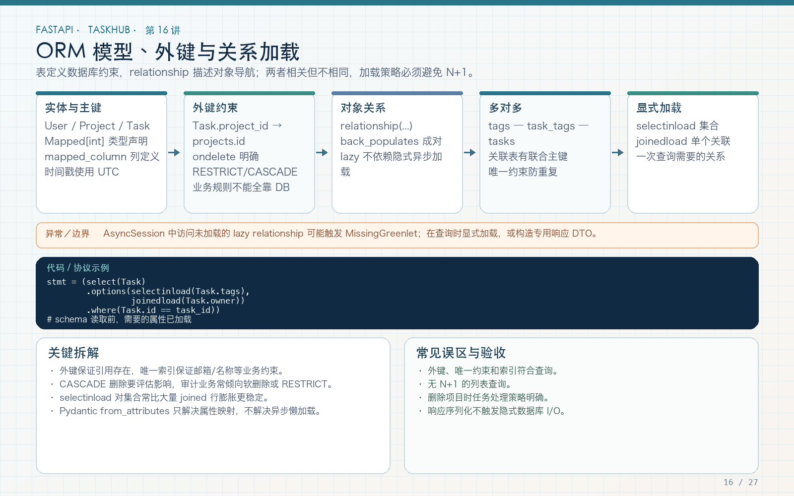

# 第 16 讲：ORM 模型、外键、relationship 与 N+1

学习路线位置：第 6 周  
前置章节：第 03～05、15 讲  
本讲核心文件：`app/models/`、`app/repositories/task_repository.py`



> 可编辑矢量版本：`images/16-orm-relationships.svg`。外键是数据库引用约束，relationship 是 ORM 对象导航；两者相关但不相同。异步环境必须显式加载响应需要的关系。

---

## 1. TaskHub 的实体关系图

```text
User 1 ─── n Project（owner）
User n ─── n Project（通过 ProjectMembership，带 role）
Project 1 ─── n Task
User 1 ─── n Task（owner）
Task 1 ─── n Comment
Task 1 ─── n Attachment
Task n ─── n Tag（通过 task_tags）
Project 1 ─── n Tag
```

这里有两种“用户与项目”的关系，不能混：

1. `Project.owner_id`：项目创建者/所有者，一个项目一个 owner；
2. `ProjectMembership`：项目成员及角色，一个项目可以有多个成员，一个用户也能加入多个项目。

创建项目时，最终工程同时创建项目记录和 owner 成员记录，保证后续权限查询统一走 membership。

---

## 2. mapped_column 与外键

Project 核心定义：

```python
class Project(TimestampMixin, Base):
    __tablename__ = "projects"
    __table_args__ = (
        UniqueConstraint(
            "owner_id",
            "name",
            name="uq_project_owner_name",
        ),
    )

    id: Mapped[int] = mapped_column(primary_key=True)
    name: Mapped[str] = mapped_column(String(100))
    description: Mapped[str] = mapped_column(Text, default="")
    owner_id: Mapped[int] = mapped_column(
        ForeignKey("users.id", ondelete="RESTRICT"),
        index=True,
    )
```

### 2.1 `Mapped[int]`

说明 Python 侧属性类型，并帮助 SQLAlchemy 推断列类型。主键通常由数据库生成，因此新建对象前不必手动分配 ID。

### 2.2 `String(100)` 与 Pydantic 长度限制

数据库列长度是持久化约束，Pydantic 的 `max_length=100` 是输入约束。两层都应保留：API 尽早返回 422，数据库防止其他写入路径破坏约束。

### 2.3 外键保证什么

`ForeignKey("projects.id")` 防止 Task 指向不存在的 Project（数据库启用外键约束时）。它不自动判断当前用户是否有权访问项目，权限仍由 service 负责。

SQLite 默认连接是否执行外键还受 PRAGMA 配置影响，不能把 SQLite 行为直接等同 PostgreSQL。最终部署以 PostgreSQL 验证为准。

---

## 3. 唯一约束不是可选项

```python
UniqueConstraint(
    "owner_id",
    "name",
    name="uq_project_owner_name",
)
```

表示同一个 owner 下项目名不能重复，不同 owner 可以拥有同名项目。

如果只对 `name` 全局 unique，就会错误地禁止 Alice 和 Bob 都创建 `Personal` 项目。

Tag 同理：

```python
UniqueConstraint(
    "project_id",
    "name",
    name="uq_tag_project_name",
)
```

约束属于数据库，因为两次并发请求可能同时通过“先查是否存在”的应用检查。service 捕获 `IntegrityError` 并转成 409，是友好响应；数据库唯一约束才是最后防线。

---

## 4. relationship 与 back_populates

```python
class Project(TimestampMixin, Base):
    owner = relationship("User")
    memberships = relationship(
        "ProjectMembership",
        back_populates="project",
        cascade="all, delete-orphan",
    )
    tasks = relationship(
        "Task",
        back_populates="project",
        cascade="all, delete-orphan",
    )


class Task(TimestampMixin, Base):
    project = relationship(
        "Project",
        back_populates="tasks",
    )
```

`Project.tasks` 和 `Task.project` 是同一个逻辑关系的两侧，`back_populates` 让 ORM 在内存中保持两侧同步。

外键回答“task.project_id 引用哪一行”；relationship 回答“已有 Task 对象时，如何获得它的 Project 对象”。

`owner = relationship("User")` 没有写 back_populates，是因为当前 User 模型不需要暴露 `owned_tasks` 导航。不是每种关系都必须双向。

---

## 5. 成员关系为什么要实体化

多对多可以只用简单 Table，但项目成员除了两个 ID，还有 `role`：

```python
class ProjectMembership(Base):
    __tablename__ = "project_memberships"

    project_id: Mapped[int] = mapped_column(
        ForeignKey("projects.id", ondelete="CASCADE"),
        primary_key=True,
    )
    user_id: Mapped[int] = mapped_column(
        ForeignKey("users.id", ondelete="CASCADE"),
        primary_key=True,
    )
    role: Mapped[str] = mapped_column(
        String(20),
        default="member",
    )
```

联合主键 `(project_id, user_id)` 防止同一用户重复加入同一项目。

如果未来还要 `invited_by`、`joined_at`、`status`，关联实体更容易扩展。简单无字段的 task-tag 关系则使用 Table 即可。

---

## 6. 多对多 task_tags

文件：`app/models/tag.py`

```python
task_tags = Table(
    "task_tags",
    Base.metadata,
    Column(
        "task_id",
        ForeignKey("tasks.id", ondelete="CASCADE"),
        primary_key=True,
    ),
    Column(
        "tag_id",
        ForeignKey("tags.id", ondelete="CASCADE"),
        primary_key=True,
    ),
)


class Task(TimestampMixin, Base):
    tags = relationship(
        "Tag",
        secondary=task_tags,
        back_populates="tasks",
    )


class Tag(Base):
    tasks = relationship(
        "Task",
        secondary=task_tags,
        back_populates="tags",
    )
```

联合主键防止同一个 task 重复关联同一个 tag。`secondary` 告诉 ORM 通过中间表导航，不需要在 API 响应中暴露中间表。

---

## 7. ondelete 与 ORM cascade 要分别理解

数据库外键：

```python
ForeignKey("projects.id", ondelete="CASCADE")
ForeignKey("users.id", ondelete="RESTRICT")
```

ORM 关系：

```python
cascade = "all, delete-orphan"
```

它们相关但不是同一个开关：

- 数据库 `ondelete` 在 SQL 删除父行时由数据库处理子行；
- ORM cascade 在通过 ORM 删除父对象时管理关联对象；
- `delete-orphan` 表示子对象从父集合移除后也可被删除。

TaskHub 示例策略：

| 关系 | 策略 | 理由 |
|---|---|---|
| Project → Task | CASCADE | 删除项目时删除其任务 |
| Task → Comment/Attachment | CASCADE | 子内容依附任务 |
| User → Task(owner) | RESTRICT | 防止用户删除造成历史责任链静默消失 |
| User → Project(owner) | RESTRICT | 先显式转移或处理项目 |

真实审计系统常倾向软删除和保留历史，不要为了教程里的 CASCADE 忽略数据保留要求。

---

## 8. N+1 查询是怎样产生的

假设查询 20 个 Task：

```python
tasks = (await session.execute(select(Task))).scalars().all()
for task in tasks:
    print(task.owner.username)
```

如果每个 `task.owner` 都单独查询：

```text
1 次查询任务列表
+ 20 次查询 owner
= 21 次 SQL
```

数据量越大，往返越多。异步不会让 21 次查询自动合并，反而可能因隐式 lazy load 报 `MissingGreenlet`。

---

## 9. selectinload 与 joinedload

最终 repository：

```python
def task_options():
    return (
        selectinload(Task.tags),
        joinedload(Task.owner),
        joinedload(Task.project),
    )
```

查询：

```python
statement = (
    select(Task)
    .options(*task_options())
    .where(Task.id == task_id)
)
result = await session.execute(statement)
task = result.scalar_one_or_none()
```

### 9.1 selectinload 适合集合

`Task.tags` 是集合。`selectinload` 额外发一条针对相关主键集合的查询，避免主查询因多个 tag 产生笛卡尔行膨胀。

### 9.2 joinedload 适合单个关联

`Task.owner` 和 `Task.project` 都是单个对象，可以通过 JOIN 一次带出。对多个大型集合无差别 joinedload 可能放大结果行数。

### 9.3 unique 的使用

列表包含集合 eager load 时：

```python
items = list(result.scalars().unique())
```

`unique()` 按实体去重。具体是否需要取决于加载方式和查询结构，不要盲目在所有查询后复制，也不要在需要时报缺。

---

## 10. 为什么 from_attributes 不解决异步懒加载

Pydantic：

```python
class TaskRead(BaseModel):
    model_config = ConfigDict(from_attributes=True)
```

它只说明“可以从 ORM 对象属性读取字段”。如果访问 `task.tags` 触发异步数据库 I/O，Pydantic 并不会替你 await。

正确顺序：

```text
repository 显式加载需要的字段和关系
  → service 完成事务
  → TaskRead.model_validate(task)
  → 不再触发隐式数据库访问
```

也可以用专用 DTO 在查询中直接选择扁平字段，进一步限制序列化时触碰的对象图。

---

## 11. 关系加载与事务边界

最终创建任务后重新读取：

```python
async with transaction(session):
    ...
    task_id = task.id

return await get_existing_task(session, task_id)
```

`get_existing_task` 使用带 `task_options()` 的查询，因此响应需要的 tags、owner、project 已加载。

不能依赖“刚刚创建的对象好像有 tags，所以以后所有读取都有”。列表、详情、更新后返回都要走明确的加载策略。

---

## 12. 常见错误

### 错误 1：有 relationship 就不写外键

relationship 不能替代数据库引用约束。

### 错误 2：有外键就不需要权限

外键只保证引用存在，不保证当前用户可访问。

### 错误 3：唯一约束只放在应用检查

并发下仍会重复。数据库约束 + IntegrityError 映射才完整。

### 错误 4：所有关系都 lazy="joined"

集合 JOIN 可能行膨胀，应按关联基数和查询场景选择。

### 错误 5：异步序列化时临时访问 lazy relationship

可能报 MissingGreenlet 或 N+1。查询时显式加载。

### 错误 6：CASCADE 越多越好

删除是不可逆业务决策，审计和所有权场景应明确保留或转移策略。

---

## 13. 练习、自测与验收

### 练习

1. 为 Comment 写出外键和 back_populates，并决定用户删除策略。
2. 在测试中用 SQL 语句监听器统计列表查询次数，比较加载前后。
3. 尝试插入重复 `(project_id, name)` Tag，确认数据库约束和 409。
4. 移除 `selectinload(Task.tags)`，观察响应序列化问题，再恢复。
5. 为 ProjectMembership 增加 joined_at 字段，说明为什么实体化关联更方便。

### 自测

1. 外键与 relationship 有什么区别？
2. 为什么项目成员不适合只用无字段 Table？
3. ondelete 与 ORM cascade 有什么区别？
4. N+1 中 N 来自哪里？
5. 为什么集合常用 selectinload？
6. from_attributes 为什么不能解决异步 lazy load？

### 验收

- [ ] 用户、项目、成员、任务、标签关系方向正确。
- [ ] 项目名和标签名有合适联合唯一约束。
- [ ] task_tags 有联合主键。
- [ ] 删除策略符合数据保留意图。
- [ ] Task 查询显式加载响应所需关系。
- [ ] 列表序列化不触发隐式数据库 I/O。
- [ ] 能解释并检测 N+1。

---

## 14. 下一讲预告

关系已经定义好，下一讲把它们变成真正的业务写入：事务提交/回滚、flush 与 commit、唯一冲突、可见任务筛选、稳定分页、更新和删除。还会详细解释本工程实际测试发现的 autobegin 冲突。
