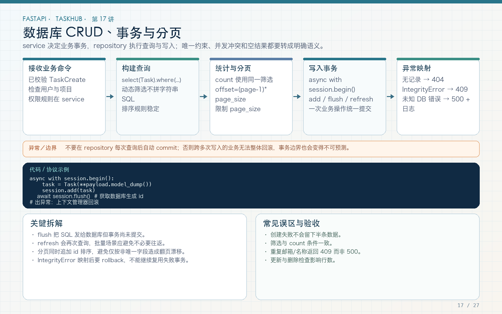

# 第 17 讲：数据库 CRUD、事务、唯一冲突与分页

学习路线位置：第 6 周  
前置章节：第 05、06、15、16 讲  
本讲核心文件：`app/db/transaction.py`、`app/services/task_service.py`、`app/repositories/task_repository.py`



> 可编辑矢量版本：`images/17-database-crud.svg`。一次业务操作必须在明确事务边界内完成；查询权限、稳定排序和总数分页与 SQL 本身同样重要。

---

## 1. 本讲完成的完整链路

```text
POST /tasks
  → 校验 TaskCreate
  → get_current_user 查询用户
  → 检查项目 member 权限
  → 查询或创建标签
  → 插入任务及 task_tags
  → flush 获得 task.id
  → commit
  → 带关系重新查询
  → TaskRead 响应
```

任何一步失败都应回滚当前数据库事务，不能留下半个任务、孤立的关联或错误的成功响应。

---

## 2. autobegin：本工程真实遇到的问题

当前用户依赖：

```python
user = await db.get(User, user_id)
```

SELECT 会让 Session 自动开启事务。服务层随后：

```python
async with session.begin():
    ...
```

可能报：

```text
sqlalchemy.exc.InvalidRequestError:
A transaction is already begun on this Session.
```

原因不是“异步数据库不能嵌套所有操作”，而是当前 Session 已经存在事务，又调用了一个要求新事务的 `begin()`。

本工程选择统一“提交或回滚当前事务”的边界，而不是在依赖中提前 commit 一次用户查询，也不是删除事务管理。

---

## 3. 完整事务辅助器

文件：`app/db/transaction.py`

```python
from collections.abc import AsyncIterator
from contextlib import asynccontextmanager

from sqlalchemy.ext.asyncio import AsyncSession


@asynccontextmanager
async def transaction(
    session: AsyncSession,
) -> AsyncIterator[AsyncSession]:
    """提交当前事务；任何异常都回滚，兼容 autobegin。"""
    try:
        yield session
        await session.commit()
    except Exception:
        await session.rollback()
        raise
```

### 3.1 正常路径

业务代码执行到块末尾后 `commit`。提交成功才返回。

### 3.2 异常路径

权限异常、唯一冲突、数据库错误都会进入 `rollback`，然后保留原异常继续向上，由统一错误处理器转换。

### 3.3 为什么不吞异常

如果 `except Exception: return None`，调用方可能把失败当成功。回滚后必须 `raise`。

### 3.4 为什么不在每次 SELECT 后 commit

只读操作不需要通过 commit 来“腾位置”。统一工作单元可以包含当前用户查询和后续业务写入，避免无意义的事务碎片。

---

## 4. flush、commit、rollback 的区别

| 操作 | 作用 | 是否让事务永久生效 |
|---|---|---|
| `session.add(obj)` | 将对象纳入 Session 管理 | 否 |
| `await session.flush()` | 将待处理 SQL 发到当前事务，获得生成 ID | 否，仍可回滚 |
| `await session.commit()` | 提交当前事务 | 是 |
| `await session.rollback()` | 回滚当前事务未提交修改 | 撤销 |

创建任务时需要 `task.id` 用于返回值和后台任务，因此 repository 在 commit 前 flush：

```python
async def create(session: AsyncSession, **values) -> Task:
    task = Task(**values)
    session.add(task)
    await session.flush()
    return task
```

flush 成功不代表 commit 成功。响应必须在事务边界成功结束后返回。

---

## 5. 创建任务完整代码

```python
async def create_task(
    session: AsyncSession,
    user: User,
    payload: TaskCreate,
) -> Task:
    async with transaction(session):
        await require_project_role(
            session,
            user,
            payload.project_id,
            "member",
        )
        tags = await resolve_tags(
            session,
            payload.project_id,
            payload.tags,
        )
        task = await task_repository.create(
            session,
            project_id=payload.project_id,
            owner_id=user.id,
            title=payload.title,
            description=payload.description,
            status=payload.status.value,
            priority=payload.priority.value,
            tags=tags,
        )
        task_id = task.id

    return await get_existing_task(session, task_id)
```

### 5.1 权限为什么在事务内

权限查询和业务写入属于同一个工作单元。更重要的是，所有写操作都必须先经过权限判断，不能在 endpoint 外另写一条无权限的“内部方便路径”。

### 5.2 为什么重新查询

`get_existing_task` 使用 selectinload/joinedload，保证 tags、owner、project 在响应序列化前已加载。

### 5.3 为什么只把 task.id 给后台任务

后台任务不共享请求 Session。最终 endpoint 在事务成功后登记 `log_task_created(task.id)`。

---

## 6. 标签查询与重复处理

```python
normalized = [item.name.lower() for item in inputs]
if len(normalized) != len(set(normalized)):
    raise ConflictError("Tag names must be unique within a task")
```

这防止一次请求里同时提交 `Backend` 和 `backend` 造成业务重复。

数据库还保存 `Tag.name` 的原始小写形式（schema validator 负责 strip/lower），并通过 `(project_id, name)` 唯一约束防止跨请求重复。

高并发下，两个事务仍可能同时查不到后插入。真实高并发场景要捕获 IntegrityError，或采用数据库支持的 upsert，并处理唯一冲突后的重新查询。

---

## 7. 更新任务：部分更新与授权

```python
async with transaction(session):
    task = await get_existing_task(session, task_id)
    _, project_role = await require_project_role(
        session,
        user,
        task.project_id,
        "member",
    )
    if (
        user.role != "admin"
        and project_role != "owner"
        and task.owner_id != user.id
    ):
        raise ForbiddenError(
            "Only the task owner or project owner can update this task"
        )

    changes = payload.model_dump(
        exclude_unset=True,
        exclude={"tags"},
    )
    ...
    for name, value in changes.items():
        setattr(task, name, value)

    if "tags" in payload.model_fields_set:
        task.tags = await resolve_tags(
            session,
            task.project_id,
            payload.tags or [],
        )
    await session.flush()
```

### 7.1 `exclude_unset=True`

PATCH 只更新客户端明确提供的字段。未提供的 description 不应被默认值清空。

### 7.2 为什么单独检查 tags 是否出现

`"tags": []` 表示明确清空标签；未提供 tags 表示不变。这两件事不能用同一个 falsy 判断：

```python
# 错误：空列表会被当作“没有更新”
if payload.tags:
    ...
```

### 7.3 空 PATCH

`TaskUpdate` 的 model validator 拒绝一个字段都没提供的请求，返回 422，避免无意义 UPDATE。

---

## 8. 删除任务与 204

```python
@router.delete("/{task_id}", status_code=204)
async def delete_task(...):
    await task_service.delete_task(db, current_user, task_id)
    return Response(status_code=204)
```

204 表示成功且无响应体。不要一边设置 204，一边返回 `{"message":"deleted"}`，这会造成协议和客户端处理不一致。

权限：任务创建者、项目 owner 或系统 admin；普通 member 和 viewer 不能任意删除他人任务。

---

## 9. 可见任务筛选 SQL

```python
conditions = []
if user_id is not None:
    visible_projects = select(
        ProjectMembership.project_id
    ).where(ProjectMembership.user_id == user_id)
    conditions.append(Task.project_id.in_(visible_projects))

if status:
    conditions.append(Task.status == status)
if priority:
    conditions.append(Task.priority == priority)
if project_id:
    conditions.append(Task.project_id == project_id)
if keyword:
    pattern = f"%{keyword}%"
    conditions.append(
        Task.title.ilike(pattern)
        | Task.description.ilike(pattern)
    )
```

管理员调用时 `user_id=None`，不加可见项目限制；普通用户必须限制在自己加入的项目。

### 9.1 为什么不能先查全部再在 Python 过滤

这会把无权数据先读进应用，分页总数也会错误，还增加内存和网络开销。可见性应进入 SQL 查询条件。

### 9.2 参数化查询

`Task.title.ilike(pattern)` 由 SQLAlchemy 绑定参数，不是把 keyword 拼进 SQL 字符串。不要写：

```python
text(f"SELECT * FROM tasks WHERE title LIKE '%{keyword}%'")
```

---

## 10. 总数与分页

```python
total = await session.scalar(
    select(func.count(Task.id)).where(*conditions)
) or 0

statement = (
    select(Task)
    .options(*task_options())
    .where(*conditions)
    .order_by(Task.created_at.desc(), Task.id.desc())
    .offset((page - 1) * page_size)
    .limit(page_size)
)
```

`total` 使用同一组过滤条件，但不带 offset/limit；列表查询再分页。

### 10.1 为什么排序加 `id.desc()`

`created_at` 可能相同。只按时间排序时，分页之间顺序可能不稳定，出现重复或遗漏。加唯一 ID 作为第二排序键，得到确定顺序。

### 10.2 page_size 限制

endpoint 使用 `Query(ge=1, le=100)`，防止调用方一次请求无限数据。

### 10.3 大 offset 的边界

深分页 `OFFSET 1000000` 仍可能昂贵。数据量大时可采用游标分页 `(created_at, id)`，但那是另一种 API 合约，不是简单去掉 OFFSET。

---

## 11. 分页响应模型

```python
class PageMeta(BaseModel):
    page: int
    page_size: int
    total: int
    total_pages: int
    has_next: bool
    has_prev: bool


def page_meta(page: int, page_size: int, total: int) -> PageMeta:
    total_pages = (
        (total + page_size - 1) // page_size
        if total
        else 0
    )
    return PageMeta(
        page=page,
        page_size=page_size,
        total=total,
        total_pages=total_pages,
        has_next=page < total_pages,
        has_prev=page > 1 and total_pages > 0,
    )
```

总数为 0 时 total_pages 为 0，而不是 1。`has_prev` 在空结果时保持 False。边界定义应固定并有测试，避免前端各自猜测。

---

## 12. 唯一冲突转 409

项目创建：

```python
try:
    async with transaction(session):
        return await project_repository.create(...)
except IntegrityError as exc:
    raise ConflictError(
        "You already have a project with this name"
    ) from exc
```

数据库唯一约束是最后防线，`IntegrityError` 被转换为统一业务 409。事务辅助器已先 rollback。

不要把所有 IntegrityError 都模糊当 500，也不要把数据库原始 SQL、约束值和堆栈直接返回客户端。

---

## 13. 验证命令

创建任务后：

```bash
curl -s 'http://127.0.0.1:8000/api/v1/tasks?page=1&page_size=10&status=doing' \
  -H "Authorization: Bearer $TOKEN"
```

检查：

- `meta.total` 与过滤结果一致；
- 返回的都是当前用户可见项目；
- page_size 超过 100 返回 422；
- 创建过程中权限失败不会留下任务或标签；
- 删除成功响应体为空；
- 非成员查询任务返回 403。

自动化主测试：

```bash
pytest tests/test_tasks.py -q
```

---

## 14. 常见错误

### 错误 1：flush 后就返回成功

flush 仍可回滚，必须等 commit 成功。

### 错误 2：异常只记录不回滚

失败事务可能污染后续操作。统一事务辅助器回滚并抛出。

### 错误 3：列表先全查再 Python 过滤

权限、分页和性能都可能错误。

### 错误 4：分页只按 created_at 排序

同时间数据可能跨页漂移，增加唯一 ID。

### 错误 5：用 tags 是否为空判断是否更新

空数组是明确清空，应看字段是否 provided。

### 错误 6：唯一冲突直接返回数据库异常

应回滚并映射 409，隐藏内部细节。

---

## 15. 练习、自测与验收

### 练习

1. 在创建任务时注入标签唯一冲突，确认没有任务残留。
2. 连续创建多个同时间任务，验证分页排序稳定。
3. 为 `page=2&page_size=1` 增加 has_next/has_prev 测试。
4. 用 Bob 的非成员 token 查询 Alice 的任务列表，确认 total 不包含 Alice 数据。
5. 为标签创建编写 upsert 方案，说明并发冲突如何处理。

### 自测

1. flush 和 commit 有什么区别？
2. 为什么 SELECT 后 session.begin 可能冲突？
3. 为什么权限过滤应进入 SQL？
4. 为什么分页需要第二排序键？
5. PATCH 中未提供 tags 与 tags=[] 有什么区别？
6. 为什么唯一约束和 IntegrityError 映射都需要？

### 验收

- [ ] 写操作有明确 commit/rollback。
- [ ] 权限失败和数据库失败都会回滚。
- [ ] 任务创建后能安全序列化关系。
- [ ] PATCH 区分未提供和清空。
- [ ] 列表过滤、总数和分页条件一致。
- [ ] 排序稳定，page_size 有上限。
- [ ] 唯一冲突返回统一 409。
- [ ] 删除返回无内容 204。

---

## 16. 下一讲预告

模型和 CRUD 已经能运行，但数据库表结构不能靠手改和 create_all 长期维护。第 18 讲将使用 Alembic 创建可审查、可重复执行的迁移，并实际验证空库升级、版本检查、autogenerate 和回滚边界。
