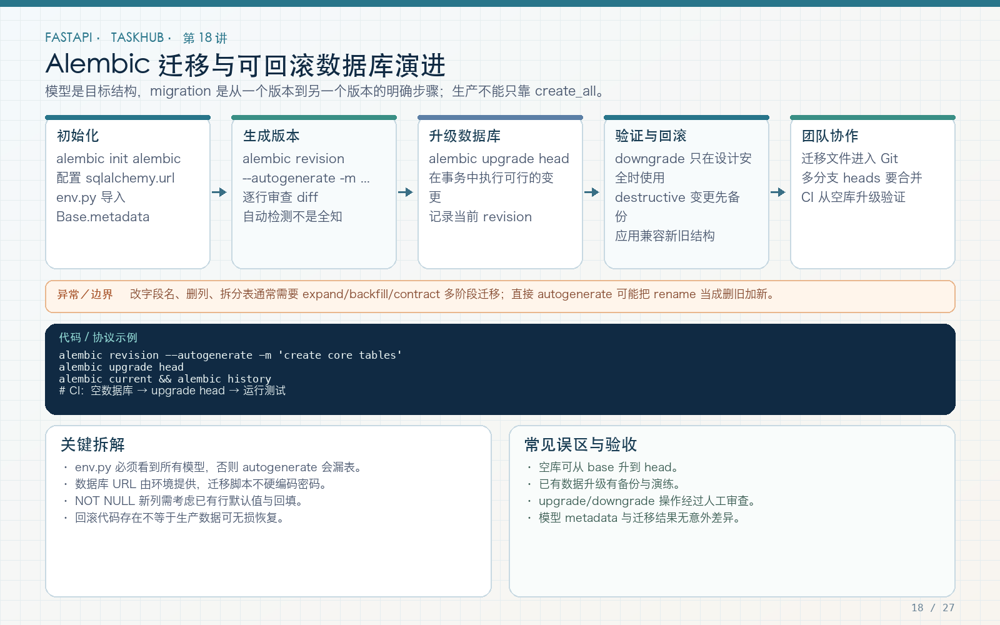

# 第 18 讲：Alembic 数据库迁移与版本管理

学习路线位置：第 6 周  
前置章节：第 15～17 讲  
本讲核心文件：`alembic.ini`、`alembic/env.py`、`alembic/versions/0001_initial.py`



> 可编辑矢量版本：`images/18-alembic.svg`。ORM 模型是目标结构，迁移文件是从一个版本到另一个版本的执行步骤；两者都要审查和测试。

---

## 1. 为什么 create_all 不能代替迁移

`Base.metadata.create_all` 擅长在空库创建当前不存在的表，但它不会可靠处理：

- 已有表新增/删除列；
- 修改列类型和默认值；
- 添加或删除索引；
- 重命名表和列；
- 数据回填、拆分和清洗；
- 多环境按顺序升级；
- 明确回滚到某个版本。

真实项目需要回答：“当前数据库在哪个版本？下一个版本要执行什么？失败如何恢复？”这就是 Alembic 的职责。

---

## 2. 迁移涉及的三份事实

```text
ORM metadata：代码希望数据库最终是什么样
migration scripts：每个版本具体执行哪些 DDL/DML
真实数据库：当前实际表结构与 alembic_version
```

只改 ORM 不写迁移，部署数据库不会自动跟上；只写迁移不改 ORM，应用查询会与表结构脱节；手工改数据库但不记录版本，会产生漂移。

---

## 3. 初始化与目录

在已有工程中初始化：

```bash
cd taskhub_api
alembic init alembic
```

本仓库已经提供：

```text
alembic.ini
alembic/
  env.py
  script.py.mako
  versions/
    0001_initial.py
```

不要每次拉取代码后重新 `alembic init`，这会覆盖或混淆已有配置。初始化只在第一次建立迁移体系时执行。

---

## 4. alembic.ini 的关键配置

```ini
[alembic]
script_location = alembic
prepend_sys_path = .
timezone = UTC
```

- `script_location`：迁移脚本目录；
- `prepend_sys_path=.`：确保从项目根运行时能导入 `app`；
- `timezone=UTC`：生成迁移时间使用 UTC。

数据库 URL 不写死在 ini，而由 `Settings` 从环境变量读取。这样同一份代码可用于开发、测试和生产，不需要把真实密码提交到 Git。

---

## 5. 完整 env.py 异步接入

```python
import asyncio
from logging.config import fileConfig

from alembic import context
from sqlalchemy.ext.asyncio import create_async_engine

from app import models  # 注册所有模型
from app.core.config import get_settings
from app.db.base import Base

config = context.config
if config.config_file_name is not None:
    fileConfig(config.config_file_name)

target_metadata = Base.metadata


def run_migrations_offline() -> None:
    context.configure(
        url=get_settings().database_url,
        target_metadata=target_metadata,
        literal_binds=True,
        compare_type=True,
    )
    with context.begin_transaction():
        context.run_migrations()


def do_run_migrations(connection) -> None:
    context.configure(
        connection=connection,
        target_metadata=target_metadata,
        compare_type=True,
    )
    with context.begin_transaction():
        context.run_migrations()


async def run_migrations_online() -> None:
    engine = create_async_engine(get_settings().database_url)
    async with engine.connect() as connection:
        await connection.run_sync(do_run_migrations)
    await engine.dispose()


if context.is_offline_mode():
    run_migrations_offline()
else:
    asyncio.run(run_migrations_online())
```

### 5.1 为什么导入 `app.models`

Alembic autogenerate 根据 Base.metadata 比较。没有导入模型模块时，它可能误以为数据库里所有业务表都应删除。

执行 autogenerate 前，先确认 `target_metadata.tables` 包含 users/projects/tasks 等表，这是防止“空 metadata 生成全删迁移”的关键检查。

### 5.2 为什么 `run_sync`

Alembic 的迁移操作本身使用同步连接接口。通过异步 Engine 建立连接，再在连接上运行同步迁移函数，兼顾异步驱动与 Alembic API。

### 5.3 online 与 offline

online 连接数据库执行迁移；offline 生成 SQL 脚本，适合 DBA 审查。offline 模式下某些需要查询实际数据的操作不能照常执行，应额外审查。

### 5.4 compare_type

自动生成时比较列类型变化。它不会替开发者判断类型转换是否安全，例如字符串转整数仍需数据清洗和转换策略。

---

## 6. 创建第一份迁移

本工程提供手写的初始迁移 `0001_initial.py`，包含：

- users；
- projects；
- project_memberships；
- tasks；
- tags；
- task_tags；
- comments；
- attachments；
- 主键、外键、唯一约束和索引。

如果从零开始，可用：

```bash
alembic revision --autogenerate -m "create taskhub core tables"
```

自动生成后必须逐行检查：

1. 是否误删表；
2. 是否漏表；
3. 外键 ondelete 是否正确；
4. 唯一约束是否联合列而非单列；
5. 索引是否重复；
6. 默认值是否符合模型；
7. downgrade 是否合理；
8. 是否需要额外数据迁移。

`--autogenerate` 是辅助工具，不是无需审查的发布按钮。

---

## 7. upgrade 与 downgrade

迁移文件核心：

```python
revision = "0001_initial"
down_revision = None


def upgrade() -> None:
    op.create_table(...)
    op.create_index(...)


def downgrade() -> None:
    for table in [
        "attachments",
        "comments",
        "task_tags",
        "tags",
        "tasks",
        "project_memberships",
        "projects",
        "users",
    ]:
        op.drop_table(table)
```

升级按依赖顺序创建 users → projects → tasks → 子表；回滚按相反顺序删除，避免外键依赖冲突。

初始迁移 downgrade 会删除全部业务表和数据，只适合空教学库或明确测试，不能在未备份的生产库随意执行。

---

## 8. 常用命令

查看当前版本：

```bash
alembic current
```

查看历史：

```bash
alembic history --verbose
```

升级到最新：

```bash
alembic upgrade head
```

升级一个版本：

```bash
alembic upgrade +1
```

回滚一个版本：

```bash
alembic downgrade -1
```

检查模型和数据库是否有未迁移差异（当前 Alembic 版本支持时）：

```bash
alembic check
```

离线生成 SQL：

```bash
alembic upgrade head --sql
```

命令都应从 `taskhub_api/` 目录运行，并确保 `DATABASE_URL` 指向预期环境。执行生产命令前打印并核对环境名，不要在 Shell 历史或 CI 日志中泄露完整密码。

---

## 9. 空库、重复执行和回滚测试

最低验证流程：

```bash
# 使用一个明确用于测试的空数据库
export DATABASE_URL='sqlite+aiosqlite:////tmp/taskhub-migration-test.db'

alembic upgrade head
alembic current
alembic check
```

然后检查表是否存在、版本是否为 head。再执行 downgrade/base 和重新 upgrade，验证脚本的依赖顺序。

注意：SQLite 的 ALTER 能力与 PostgreSQL 不完全相同。初始建表测试通过不代表后续复杂 ALTER 在 PostgreSQL 一定正确，目标数据库测试不可省略。

---

## 10. 新增字段的标准流程

假设 Task 增加 `due_at`：

1. 修改 ORM 模型：

```python
due_at: Mapped[datetime | None] = mapped_column(
    DateTime(timezone=True),
    nullable=True,
)
```

2. 生成迁移：

```bash
alembic revision --autogenerate -m "add task due date"
```

3. 审查生成文件：

```python
def upgrade():
    op.add_column(
        "tasks",
        sa.Column("due_at", sa.DateTime(timezone=True), nullable=True),
    )


def downgrade():
    op.drop_column("tasks", "due_at")
```

4. 在空库升级到 head；
5. 在“上一版本 + 代表性数据”的副本升级；
6. 跑应用测试；
7. 验证 downgrade 是否安全；
8. 再部署。

对大表直接加非空字段或改类型可能锁表、重写数据，需要分批和在线迁移策略，不能只在空库测试。

---

## 11. 数据迁移与结构迁移的区别

加 `display_name` 后需要把旧 username 复制进去，这是数据迁移：

```python
op.execute(
    "UPDATE users SET display_name = username "
    "WHERE display_name IS NULL"
)
```

数据迁移要回答：

- 是否可重复执行？
- 是否分批？
- 是否会产生锁和长事务？
- 回滚时数据如何恢复？
- 新旧应用并存时是否兼容？

高风险变更通常采用 expand/contract：

```text
先加兼容结构（expand）
→ 双写/回填
→ 验证
→ 切换读取
→ 最后删除旧结构（contract）
```

不要在一次发布中同时改结构、改代码、删旧列，让旧版本完全无法回滚。

---

## 12. Docker Compose 中的迁移

本工程 API 启动命令：

```yaml
command: sh -c "alembic upgrade head && uvicorn app.main:app --host 0.0.0.0 --port 8000"
```

数据库健康后才启动 API：

```yaml
depends_on:
  db:
    condition: service_healthy
```

这解决的是“数据库进程可接受连接”，不解决所有迁移并发问题。如果多个 API 副本同时启动并执行迁移，可能竞争。生产环境更适合独立 migration Job，在应用副本启动前完成一次迁移。

---

## 13. 常见错误

### 错误 1：只改模型不生成迁移

部署库没有对应列，运行时报 undefined column。

### 错误 2：autogenerate 后直接提交

可能包含误删、类型误判和不必要索引变化，必须审查。

### 错误 3：把生产数据库 URL 写入 alembic.ini

改为 Settings 环境变量和 secret 管理。

### 错误 4：在多个副本启动时同时迁移

使用独立迁移步骤或明确的并发控制。

### 错误 5：只测试空库

旧版本数据、默认值、约束和长事务问题只有代表性数据才能暴露。

### 错误 6：随意 downgrade 生产库

downgrade 可能删列删表，必须备份、审查并有恢复方案。

---

## 14. 练习、自测与验收

### 练习

1. 给 Task 添加 nullable due_at，生成并审查第二份迁移。
2. 在旧版本数据库插入几条任务，再升级，确认数据仍在。
3. 执行 `alembic check`，解释检测到的差异。
4. 把 metadata 导入临时注释，观察 autogenerate 风险后恢复，不执行危险迁移。
5. 设计将 username 拆成 first/last name 的 expand/contract 流程。

### 自测

1. ORM metadata、迁移脚本和真实数据库分别是什么？
2. 为什么 create_all 不能维护列变化？
3. 为什么 env.py 必须导入所有模型？
4. 为什么 autogenerate 必须审查？
5. 空库测试与旧数据测试分别发现什么？
6. 为什么多副本启动不适合各自迁移？

### 验收

- [ ] 数据库 URL 来自环境配置。
- [ ] env.py 能注册完整 metadata。
- [ ] 初始迁移包含所有表、约束和索引。
- [ ] 空库可升级到 head。
- [ ] 迁移版本与模型差异经过检查。
- [ ] downgrade 只在可丢弃测试库验证。
- [ ] Compose 启动顺序清晰。
- [ ] 理解生产迁移需要独立步骤和备份。

---

## 15. 下一讲预告

数据库 users 表已经存在，但还不能保存明文密码。第 19 讲将实现 Argon2 密码哈希、注册输入规则、邮箱/用户名唯一约束、重复注册 409 和防用户枚举，并完成第一条安全用户链路。
