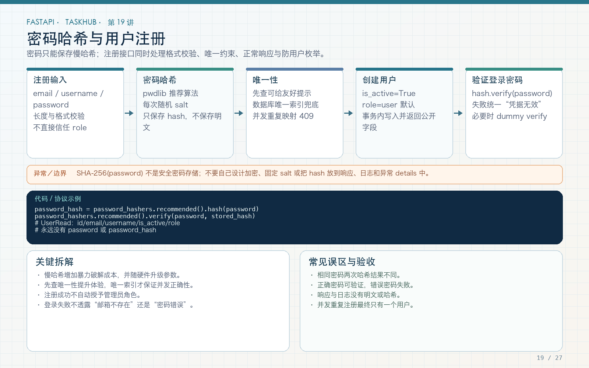

# 第 19 讲：Argon2 密码哈希、注册与用户唯一性

学习路线位置：第 7 周  
前置章节：第 03、06、17、18 讲  
本讲核心文件：`app/core/security.py`、`app/schemas/user.py`、`app/services/auth_service.py`



> 可编辑矢量版本：`images/19-password-registration.svg`。数据库绝不保存明文密码；密码哈希、输入规范化、唯一约束和错误响应共同组成注册安全边界。

---

## 1. 为什么不能保存明文或可逆加密密码

如果数据库泄露，明文密码会立即暴露；可逆加密只要密钥也泄露，同样能还原。用户还可能在其他网站复用密码，影响会扩散。

正确方式：

```text
用户密码 + 每个密码独立的随机 salt
  → 专用慢速密码哈希算法
  → 保存完整 hash 字符串
```

登录时不“解密密码”，而是对输入重新验证：

```text
输入密码 + 已保存 hash
  → password_hashers.verify
  → 通过或失败
```

本工程使用 pwdlib 提供的 Argon2 实现。Argon2 是面向密码哈希的算法，可通过内存、迭代和并行参数提高暴力破解成本。

MD5、SHA-1、单次 SHA-256 都不适合直接做密码哈希；它们太快，且没有为密码存储提供完整参数和 salt 管理。

---

## 2. 完整安全函数

文件：`app/core/security.py`

```python
from pwdlib import PasswordHash

password_hashers = PasswordHash.recommended()


def hash_password(password: str) -> str:
    return password_hashers.hash(password)


def verify_password(
    plain_password: str,
    password_hash: str,
) -> bool:
    return password_hashers.verify(
        plain_password,
        password_hash,
    )
```

保存到 `users.password_hash` 的是类似以下结构的编码字符串：

```text
$argon2id$v=19$m=... ,t=...,p=...$<salt>$<hash>
```

具体参数由库版本和推荐配置决定，不要在教程里硬编码成永远不变的数值。算法、参数和 salt 都编码在 hash 中，便于未来升级。

---

## 3. 同步哈希与 async endpoint

密码哈希有意消耗 CPU 和内存，它不是数据库 I/O。简单教程代码直接在 async 服务中调用：

```python
password_hash = hash_password(payload.password)
```

在注册量较小的学习项目中可用，但高并发注册/登录时不能忽略它会占用事件循环线程。生产可考虑：

- 放入受控线程池；
- 限制认证接口并发和速率；
- 根据服务器能力基准测试 Argon2 参数；
- 使用专门认证服务。

把哈希写成 `async def` 并不会让它变成非阻塞，关键是实际执行位置和资源控制。

---

## 4. 注册 Schema：约束在入口生效

文件：`app/schemas/user.py` 节选

```python
from pydantic import BaseModel, ConfigDict, EmailStr, Field


class UserCreate(BaseModel):
    model_config = ConfigDict(
        extra="forbid",
        str_strip_whitespace=True,
    )

    email: EmailStr
    username: str = Field(
        min_length=3,
        max_length=50,
        pattern=r"^[a-zA-Z0-9_]+$",
    )
    display_name: str = Field(min_length=1, max_length=80)
    password: str = Field(min_length=8, max_length=128)
```

### 4.1 字符串清理与邮箱规范化

`str_strip_whitespace=True` 会清理字符串两端空白，`extra="forbid"` 拒绝客户端额外套入的字段。注册服务再把 email 转为小写，使 ` Alice@Example.com ` 和 `alice@example.com` 走同一套存储规则。真实邮箱本地部分的标准存在大小写细节，但多数应用选择统一小写作为产品规则；一旦采用，就要在所有入口一致执行。

### 4.2 用户名白名单

允许大小写 ASCII 字母、数字、下划线，避免空格、控制字符、斜杠和显示混淆。当前实现对 username 保留大小写，因此 `Alice` 与 `alice` 是两个不同字符串；如果产品希望用户名不区分大小写，应在注册、登录和唯一查询中统一规范化，并考虑数据库 collation。中文显示名由 `display_name` 承担。

### 4.3 密码长度

最小 8 位只是课程下限，不代表“8 位就安全”。生产可鼓励更长密码、检查常见泄露密码，并配合 MFA、限流和告警。

最大 128 防止异常超长输入造成无意义哈希开销，同时避免旧 bcrypt 72 字节限制。Argon2 仍需限制输入大小。

---

## 5. 为什么响应模型中没有密码

```python
class UserRead(BaseModel):
    model_config = ConfigDict(from_attributes=True)

    id: int
    email: EmailStr
    username: str
    display_name: str
    role: str
    is_active: bool
```

没有：

- password；
- password_hash；
- 内部安全备注；
- 登录失败计数（除非专门管理接口）。

Pydantic 响应模型是白名单。不要直接返回 ORM User 对象并依赖“前端不会显示”，因为 JSON 仍可能包含敏感字段。

---

## 6. 注册完整服务代码

文件：`app/services/auth_service.py`

```python
async def register(
    session: AsyncSession,
    payload: UserCreate,
) -> User:
    duplicate = await user_repository.find_duplicate(
        session,
        payload.email,
        payload.username,
    )
    if duplicate:
        raise ConflictError(
            "Email or username is already registered"
        )

    try:
        async with transaction(session):
            return await user_repository.create(
                session,
                email=str(payload.email).lower(),
                username=payload.username,
                display_name=payload.display_name,
                password_hash=hash_password(payload.password),
                role="user",
                is_active=True,
            )
    except IntegrityError as exc:
        raise ConflictError(
            "Email or username is already registered"
        ) from exc
```

### 6.1 为什么先查一次

提前查可以给用户友好的 409，而不必让所有重复请求都走到数据库异常。

### 6.2 为什么先查还不够

两个并发请求可能都查不到，然后都尝试插入。`users.email` 和 `users.username` 的唯一索引是最终防线。

最终服务还捕获 `IntegrityError`，转成统一 409。异常发生时事务辅助器会 rollback。

### 6.3 为什么不返回 token

本教程将“注册”和“登录”分开，注册 201 返回用户资料，客户端再调用 OAuth2 token endpoint。这样职责清晰，也便于讲解两条链路。真实产品可以注册后直接登录，但安全策略应明确。

---

## 7. 注册 endpoint

```python
@router.post(
    "/register",
    response_model=DataResponse[UserRead],
    status_code=201,
)
async def register(payload: UserCreate, db: DbDep):
    user = await auth_service.register(db, payload)
    return {
        "data": UserRead.model_validate(user),
        "message": "user registered",
    }
```

成功 201，输入不合法 422，重复 409。数据库故障不能被误报成“用户已存在”，因此只在 IntegrityError 分支做冲突映射。

---

## 8. 防用户枚举的边界

注册时返回“Email or username is already registered”没有指出具体哪一个，能减少一部分信息拆分，但重复注册本身仍可能暴露账号是否存在。

登录使用统一：

```text
Invalid username or password
```

而不是分别返回：

- 用户不存在；
- 密码错误。

如果所有注册和登录响应都需要进一步防枚举，可统一更通用的文案，并结合限流、验证码、监控和相同响应时间策略。只修改文案不能消除所有时序侧信道。

---

## 9. 登录时如何验证密码

```python
DUMMY_HASH = hash_password("not-a-real-user-password")


async def authenticate(
    session: AsyncSession,
    settings: Settings,
    login: str,
    password: str,
) -> tuple[str, int]:
    user = await user_repository.find_by_login(session, login)
    if user is None:
        verify_password(password, DUMMY_HASH)
        raise UnauthorizedError("Invalid username or password")
    if not verify_password(password, user.password_hash) or not user.is_active:
        raise UnauthorizedError("Invalid username or password")
    return create_access_token(user.id, settings)
```

`is_active=False` 与密码错误使用同一认证失败响应，避免泄露账户状态。登录名可以是 username 或 email，由 repository 在同一个查询中匹配。

本工程还对不存在用户执行一次固定 `DUMMY_HASH` 验证，减小“用户不存在立即返回”与“存在则慢哈希”的时间差。这个 dummy hash 在模块加载时生成一次，不是每个失败请求重新生成；它只能降低一种时序差异，仍需配合限流、统一响应和监控。

---

## 10. curl 验证

注册：

```bash
curl -i http://127.0.0.1:8000/api/v1/auth/register \
  -H 'Content-Type: application/json' \
  -d '{
    "email":"Alice@Example.com",
    "username":"alice_01",
    "display_name":"Alice",
    "password":"course-password-123"
  }'
```

预期：

- 状态码 201；
- email 已小写；
- 响应无 password/password_hash。

重复注册应 409；短密码、非法 username 应 422。

登录使用表单而不是 JSON，第 20 讲详述：

```bash
curl -i http://127.0.0.1:8000/api/v1/auth/token \
  -X POST \
  -d 'username=alice_01&password=course-password-123'
```

错误密码与不存在用户名都应得到同样的 401 主体。

---

## 11. 自动化测试

```python
def test_register_and_duplicate(client):
    payload = {
        "email": "alice@example.com",
        "username": "alice",
        "display_name": "Alice",
        "password": "correct-horse-123",
    }
    response = client.post("/api/v1/auth/register", json=payload)
    assert response.status_code == 201
    assert "password_hash" not in response.text
    assert "correct-horse-123" not in response.text

    duplicate = client.post("/api/v1/auth/register", json=payload)
    assert duplicate.status_code == 409
    assert duplicate.json()["code"] == "CONFLICT"
```

错误登录：

```python
def test_wrong_password_and_bad_token(client):
    register(client)
    response = client.post(
        "/api/v1/auth/token",
        data={"username": "alice", "password": "wrong"},
    )
    assert response.status_code == 401
    assert response.json()["code"] == "UNAUTHORIZED"
```

还应检查数据库中保存值不等于原密码，且以 Argon2 标识开头，而不是仅测试 API 成功。

---

## 12. 密码重置与修改的扩展边界

本讲不伪造“忘记密码”完整实现。真实功能需要：

1. 一次性、短时效、安全随机 reset token；
2. 服务端只存 token hash；
3. 使用后失效；
4. 重置后撤销旧会话；
5. 邮件发送可追踪；
6. 防枚举和限流；
7. 不在 URL 日志中长期保留秘密。

修改密码应验证旧密码，并使其他 token/session 失效。单纯新增 `/reset-password?new_password=...` 是严重安全漏洞。

---

## 13. 常见错误

### 错误 1：数据库保存 SHA256(password)

普通快速哈希不适合密码存储，使用专用 Argon2/bcrypt 等。

### 错误 2：所有用户使用固定 salt

使用库生成的独立随机 salt，不自己设计编码格式。

### 错误 3：响应包含 password_hash

通过 UserRead 白名单输出。

### 错误 4：只做先查唯一，不做数据库约束

并发下仍会重复。

### 错误 5：登录提示“用户不存在”

统一无效凭证响应，减少枚举。

### 错误 6：认为 Argon2 越慢越好

参数应基于服务容量和基准测试，同时限流；过慢会形成拒绝服务风险。

---

## 14. 练习、自测与验收

### 练习

1. 添加数据库断言：password_hash 不含明文且以 Argon2 格式保存。
2. 比较不存在用户与错误密码的响应主体，确保不可区分。
3. 为大小写、空格、斜杠和中文 username 添加测试，明确当前保留大小写时的预期；再设计不区分大小写的规范化方案。
4. 设计密码修改接口，列出撤销旧 token 所需改动。
5. 用小型基准测试测量一次哈希耗时，讨论登录限流。

### 自测

1. 为什么不能用可逆加密保存密码？
2. Argon2 hash 中为什么能包含算法参数和 salt？
3. 为什么先查唯一仍需唯一索引？
4. 为什么响应模型不能包含 password_hash？
5. 为什么登录错误信息要统一？
6. 为什么 async 不自动解决哈希阻塞？

### 验收

- [ ] 明文密码不进入数据库和响应。
- [ ] 使用 pwdlib Argon2 推荐配置。
- [ ] 邮箱和用户名规范化一致。
- [ ] 密码和 username 有输入约束。
- [ ] 唯一索引存在，重复注册返回 409。
- [ ] 登录错误不区分用户不存在和密码错误。
- [ ] 注册、重复注册和错误登录测试通过。

---

## 15. 下一讲预告

注册和密码验证解决了“你是谁”的第一次确认。第 20 讲将把登录结果签发到 JWT：sub、iss、aud、exp、iat、OAuth2 Password form、Bearer 解析和 active 用户检查，完成受保护用户接口。
