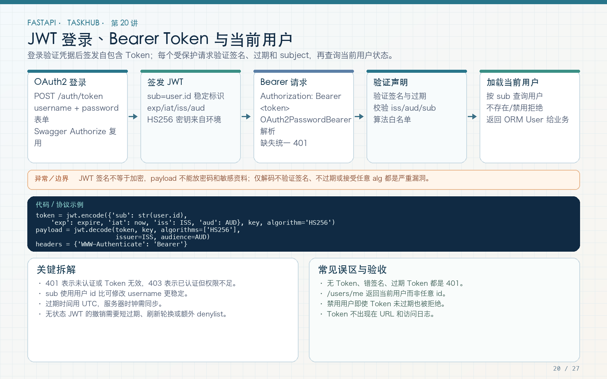

# 第 20 讲：JWT、OAuth2 Password Form 与登录鉴权

学习路线位置：第 7 周  
前置章节：第 07、10、19 讲  
本讲核心文件：`app/core/security.py`、`app/api/v1/endpoints/auth.py`、`app/core/dependencies.py`



> 可编辑矢量版本：`images/20-jwt-auth.svg`。JWT 默认是签名而非加密；服务端验签后还要检查 issuer、audience、过期时间和用户当前状态。

---

## 1. 登录之后为什么要发 token

HTTP 请求彼此独立。登录时验证密码成功后，客户端需要一种凭证在后续请求中证明身份。

本教程流程：

```text
POST /auth/token（OAuth2 form）
  → 查 username
  → 验证密码与 active
  → 生成带 sub/iss/aud/iat/exp 的 JWT
  → 返回 access_token + token_type + expires_in

后续请求 Authorization: Bearer <token>
  → OAuth2PasswordBearer 提取
  → PyJWT 验签和声明校验
  → 查询用户
  → 检查 active
  → CurrentUser 注入
```

JWT 适合无状态验证签名，但不等于“永远不用数据库”。本工程仍查询用户，确保被禁用用户不能继续访问。

---

## 2. JWT 的结构与风险

JWT 通常由三段 Base64URL 文本组成：

```text
header.payload.signature
```

header 描述算法和类型；payload 放声明；signature 验证完整性。

默认 JWS 的 payload 只是编码，不是加密。任何拿到 token 的人都可能读取 payload，因此不要放：

- 密码；
- 密码 hash；
- 身份证、私密资料；
- 无必要的敏感权限细节；
- 数据库秘密。

签名防止篡改，不防止阅读，也不防止 token 被复制后重放。

---

## 3. 配置签名参数

```python
jwt_secret_key: SecretStr = SecretStr(
    "development-only-change-this-secret-key-32bytes"
)
jwt_algorithm: str = "HS256"
jwt_issuer: str = "taskhub-api"
jwt_audience: str = "taskhub-client"
jwt_expire_minutes: int = 60
```

生产校验：

```python
if self.environment == "production":
    if "development" in self.jwt_secret_key.get_secret_value():
        raise ValueError("Production JWT secret must be changed")
    if self.api_key_enabled and self.api_key is None:
        raise ValueError("API_KEY is required when enabled")
```

HS256 是对称密钥算法：签名和验证使用同一秘密，适合单服务教学。多服务且只需资源服务器验签时，可考虑 RS256/ES256 公私钥体系，但密钥管理也更复杂。

不要把密钥硬编码进前端、公开仓库或 Docker 镜像。

---

## 4. 完整 JWT 创建代码

```python
def create_access_token(
    user_id: int,
    settings: Settings,
) -> tuple[str, int]:
    now = datetime.now(UTC)
    expires_in = settings.jwt_expire_minutes * 60
    payload = {
        "sub": str(user_id),
        "iat": now,
        "exp": now + timedelta(seconds=expires_in),
        "iss": settings.jwt_issuer,
        "aud": settings.jwt_audience,
    }
    token = jwt.encode(
        payload,
        settings.jwt_secret_key.get_secret_value(),
        algorithm=settings.jwt_algorithm,
    )
    return token, expires_in
```

### 4.1 `sub`

subject，放用户 ID 字符串。不要放 username 作为唯一身份，因为用户名未来可能变化；数据库主键更稳定。

### 4.2 `iat` 与 `exp`

issued-at 和 expiration。使用 UTC。`exp` 是过期边界，不是“建议过期”，验证库会检查。

### 4.3 `iss` 与 `aud`

issuer 表示签发方，audience 表示预期接收方。它们防止把另一个系统签发的 token 误用于 TaskHub。

---

## 5. 完整解码代码

```python
def decode_access_token(
    token: str,
    settings: Settings,
) -> dict:
    try:
        return jwt.decode(
            token,
            settings.jwt_secret_key.get_secret_value(),
            algorithms=[settings.jwt_algorithm],
            issuer=settings.jwt_issuer,
            audience=settings.jwt_audience,
            options={"require": ["sub", "iss", "aud", "exp"]},
        )
    except jwt.PyJWTError as exc:
        raise UnauthorizedError(
            "Invalid or expired token",
            headers={"WWW-Authenticate": "Bearer"},
        ) from exc
```

### 5.1 算法白名单

`algorithms=[...]` 明确允许当前算法，不能从不可信 token header 任意选择。防止算法混淆和配置漂移。

### 5.2 require

要求关键声明存在。没有 exp 的 token 不应被接受为长期有效凭证。

### 5.3 时钟偏差

分布式系统可能存在少量时钟偏差，可按需要设置 leeway，但不能用很大 leeway 掩盖服务器时间错误。

---

## 6. OAuth2 Password Form 登录 endpoint

```python
oauth2_scheme = OAuth2PasswordBearer(
    tokenUrl="/api/v1/auth/token",
    auto_error=False,
)


@router.post("/token", response_model=TokenResponse)
async def login(
    form: Annotated[OAuth2PasswordRequestForm, Depends()],
    db: DbDep,
    settings: SettingsDep,
):
    token, expires_in = await auth_service.authenticate(
        db,
        settings,
        form.username,
        form.password,
    )
    return TokenResponse(
        access_token=token,
        expires_in=expires_in,
    )
```

请求不是 JSON，而是：

```http
Content-Type: application/x-www-form-urlencoded

username=alice_01&password=...
```

`OAuth2PasswordBearer.tokenUrl` 告诉 Swagger Authorize 到哪里获取 token。完整路径与真实路由一致：`/api/v1/auth/token`。

OAuth2 password grant 在现代公共客户端中并非所有场景的首选；本教程使用它是为讲清 FastAPI 表单、Swagger 和 Bearer 链路。生产 Web 应用可采用更完整的授权服务器和授权码 + PKCE 等流程。

---

## 7. 登录响应

```python
class TokenResponse(BaseModel):
    access_token: str
    token_type: str = "bearer"
    expires_in: int
```

不返回 password、password_hash 或 JWT secret。`expires_in` 使用秒，便于客户端安排刷新。

JWT access token 通常短期有效。不要在教程中设置 30 天来“减少麻烦”，否则泄露后的窗口更长。

---

## 8. CurrentUser 完整依赖

```python
async def get_current_user(
    token: Annotated[str | None, Depends(oauth2_scheme)],
    db: DbDep,
    settings: SettingsDep,
) -> User:
    if not token:
        raise UnauthorizedError(
            "Bearer token required",
            headers={"WWW-Authenticate": "Bearer"},
        )
    payload = decode_access_token(token, settings)
    try:
        user_id = int(payload["sub"])
    except (KeyError, TypeError, ValueError) as exc:
        raise UnauthorizedError(
            "Invalid token subject",
            headers={"WWW-Authenticate": "Bearer"},
        ) from exc

    user = await db.get(User, user_id)
    if user is None or not user.is_active:
        raise UnauthorizedError(
            "User is inactive or no longer exists",
            headers={"WWW-Authenticate": "Bearer"},
        )
    return user


CurrentUser = Annotated[User, Depends(get_current_user)]
```

### 8.1 为什么区分缺少与无效 token

便于客户端处理，但两者都是 401，不泄露签名细节。

### 8.2 为什么捕获 sub 转换异常

攻击者可以让 sub 为非数字。`int()` 的 ValueError/TypeError 必须进入 401，不能成为 500。

### 8.3 为什么还要查数据库

- 用户可能已删除；
- 用户可能被禁用；
- 某些实时状态不能只信任 30 分钟前 token。

这也意味着 JWT 并非完全零数据库成本。它是签名凭证，不是用户数据缓存。

---

## 9. 受保护接口

```python
@router.get("/me", response_model=DataResponse[UserRead])
async def read_me(current_user: CurrentUser):
    return {"data": UserRead.model_validate(current_user)}
```

其他项目、任务、上传、外部请求和实时接口复用同一 `CurrentUser`，不再重复解析 token。

curl：

```bash
TOKEN=$(curl -s http://127.0.0.1:8000/api/v1/auth/token \
  -X POST \
  -d 'username=alice_01&password=course-password-123' \
  | python -c 'import json,sys; print(json.load(sys.stdin)["access_token"])')

curl -s http://127.0.0.1:8000/api/v1/users/me \
  -H "Authorization: Bearer $TOKEN"
```

在 Shell 历史中直接写密码有泄露风险，以上仅用于本地教学。真实终端可使用受控输入和 secret 工具。

---

## 10. Swagger 验证

1. 打开 `/docs`；
2. 先调用 `/auth/register`；
3. 点击 Authorize；
4. 输入 username/password；
5. Swagger 调用 `/api/v1/auth/token` 获得 token；
6. 后续请求自动带 Authorization；
7. 点击 Logout 只是清除 Swagger 保存的 token，不等于服务端撤销 JWT。

这点很重要：无状态 JWT 默认在 exp 前仍可被复制使用，客户端“退出”不自动让服务器记住吊销。

---

## 11. 撤销、刷新与权限变化的边界

纯 JWT 的缺点是很难立即撤销。可选策略：

- access token 短期有效；
- refresh token 持久化 hash，支持轮换和撤销；
- 服务端 session 表；
- token version / security stamp；
- 维护吊销列表（会增加状态）；
- 关键操作实时查询用户和权限。

不要同时声称“完全无状态”又要求“任何 token 立即撤销”却不保存任何状态。这是需求与机制的冲突。

本课程只实现短期 access token + 用户 active 检查，没有伪造 refresh token 完整功能。

---

## 12. 自动化测试

成功：

```python
def test_login_and_read_me(client):
    register(client)
    token = login(client)

    me = client.get(
        "/api/v1/users/me",
        headers=auth(token),
    )
    assert me.status_code == 200
    assert me.json()["data"]["username"] == "alice"
```

失败：

```python
response = client.get(
    "/api/v1/users/me",
    headers={"Authorization": "Bearer invalid"},
)
assert response.status_code == 401
```

还应增加：

- 缺 Authorization；
- 错误签名；
- 错误 issuer；
- 错误 audience；
- 缺少 exp；
- 过期 token；
- sub 非数字；
- 用户 inactive。

测试时间时可用非常短过期配置或受控时间，不要 sleep 30 分钟。

---

## 13. 常见错误

### 错误 1：把 JWT 当加密

payload 可读，不放敏感信息。

### 错误 2：不限制 algorithms

固定算法白名单。

### 错误 3：只验签不检查 exp/iss/aud

签名正确不代表 token 为本系统、在有效期内签发。

### 错误 4：生产仍用 development 密钥

Settings 在生产启动时拒绝。

### 错误 5：登出就认为 JWT 被撤销

需要短期 token、刷新机制或服务端状态。

### 错误 6：把长期 token 放 localStorage 后忽视 XSS

前端存储方案要综合 XSS、CSRF、Cookie 属性和威胁模型，本教程不宣称某一种永远安全。

---

## 14. 练习、自测与验收

### 练习

1. 生成错误 issuer 的 token，确认 401。
2. 生成缺少 exp 的 token，确认 401。
3. 把用户 is_active 改为 False，使用旧 token 请求，确认 401。
4. 设计 refresh token 表，包含 token_hash、expires_at、revoked_at 和 rotated_from。
5. 为 `/users/me` 增加缺失 Bearer 测试并检查 WWW-Authenticate。

### 自测

1. JWT 签名和加密有什么区别？
2. sub/iss/aud/iat/exp 分别表示什么？
3. 为什么还要查询 active 用户？
4. OAuth2PasswordBearer 的 tokenUrl 起什么作用？
5. 为什么 Swagger Logout 不等于服务端撤销？
6. 为什么刷新 token 轮换需要服务端状态？

### 验收

- [ ] 登录使用 OAuth2 form，不是 JSON。
- [ ] JWT 使用 HS256 和显式算法白名单。
- [ ] sub/iss/aud/exp 必填并校验。
- [ ] 无效、过期和缺失 token 统一 401。
- [ ] 每次受保护请求检查 active 用户。
- [ ] 生产默认密钥无法通过配置校验。
- [ ] `/users/me` 不泄露敏感字段。
- [ ] 能说明 access token 撤销边界。

---

## 15. 下一讲预告

登录只解决“你是谁”，还没有解决“你能不能修改这个项目或删除这条任务”。第 21 讲将实现系统 admin、项目 viewer/member/owner 和任务所有者四层规则，并用 Alice、Bob 两个账号验证横向越权。
