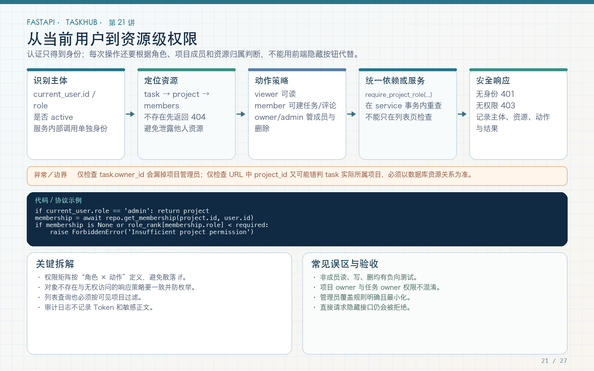

# 第 21 讲：项目角色、资源级授权与横向越权防护

学习路线位置：第 7 周  
前置章节：第 16～20 讲  
本讲核心文件：`app/services/permission_service.py`、`app/services/task_service.py`、`app/api/v1/endpoints/projects.py`



> 可编辑矢量版本：`images/21-authorization.svg`。401 处理“身份是否可信”，403 处理“可信身份是否有权操作这个资源”。每个修改接口都必须检查资源归属，不能只检查登录。

---

## 1. 认证通过不等于可以操作所有数据

Alice 登录后，下面请求仍应被拒绝：

```text
读取 Bob 的私有项目
修改 Bob 创建的任务
向 Bob 的项目添加自己的账号
下载 Bob 项目的附件
连接 Bob 项目的 WebSocket
```

这就是横向越权：两个同级用户，A 试图访问 B 的资源。

TaskHub 的授权链：

```text
CurrentUser
  → 资源是否存在
  → 是否系统 admin
  → 是否项目成员
  → 项目角色是否达到最低要求
  → 对任务更新/删除再检查任务所有者或项目 owner
```

不能只在前端隐藏按钮，因为攻击者可以直接调用 API。

---

## 2. 角色模型

### 2.1 系统角色

`users.role`：

- `user`：普通用户；
- `admin`：系统管理员，可跨项目管理。

系统 admin 是最高权限账号，不能通过普通注册接口任意指定。注册服务固定 `role="user"`，管理员应由受控初始化或运维流程创建。

### 2.2 项目角色

`project_memberships.role`：

| 角色 | 查看 | 创建任务/上传 | 修改自己的任务 | 管理成员 | 修改任意项目任务 |
|---|---:|---:|---:|---:|---:|
| viewer | 是 | 否 | 否 | 否 | 否 |
| member | 是 | 是 | 是 | 否 | 否 |
| owner | 是 | 是 | 是 | 是 | 是 |

任务创建者即使只是 member，也能修改/删除自己的任务；项目 owner 可以管理项目内任务；系统 admin 作为管理例外。

这张表是业务规则，不应只写在文档里，必须落到 service 与测试。

---

## 3. 角色等级不是随意比较字符串

文件：`app/services/permission_service.py`

```python
ROLE_RANK = {
    "viewer": 1,
    "member": 2,
    "owner": 3,
}
```

判断：

```python
ROLE_RANK[membership.role] >= ROLE_RANK[minimum_role]
```

这样“至少 member”会允许 member 和 owner，而 viewer 被拒绝。

如果角色将来不是简单线性层级，例如 auditor 与 editor 各有独立能力，就不应继续硬套数字等级，而应拆成权限集合：

```text
project:read
project:manage_members
task:create
task:update_any
```

本教程三种角色是线性层级，使用 rank 足够简单明确。

---

## 4. 完整项目授权函数

```python
async def require_project_role(
    session: AsyncSession,
    user: User,
    project_id: int,
    minimum_role: str = "viewer",
) -> tuple[Project, str]:
    project = await project_repository.get(
        session,
        project_id,
    )
    if project is None:
        raise NotFoundError(
            "Project not found",
            details={"project_id": project_id},
        )

    if user.role == "admin":
        return project, "owner"

    membership = await project_repository.get_membership(
        session,
        project_id,
        user.id,
    )
    if membership is None:
        raise ForbiddenError(
            "You are not a member of this project"
        )
    if ROLE_RANK[membership.role] < ROLE_RANK[minimum_role]:
        raise ForbiddenError(
            f"Project role {minimum_role} or above is required"
        )
    return project, membership.role
```

### 4.1 返回 Project 和实际角色

调用方不只获得 True/False，还可以继续使用 Project，或根据实际 role 做更细判断，避免重复查询。

### 4.2 admin 分支

admin 被视为项目 owner 级能力，但不伪造一条 membership 数据。返回的 `"owner"` 是有效权限等级，不表示数据库里真有这条成员记录。

### 4.3 非成员与角色不足都是 403

身份有效但资源权限不足，返回 403。与无效 token 的 401 区分。

---

## 5. 404 与 403 的信息泄露取舍

本教程对不存在项目返回 404，对存在但无权项目返回 403。这清晰易学，但可能让非成员通过响应差异判断某个项目 ID 是否存在。

更私密的系统可以对“不存在”和“无权”统一返回 404：

```text
资源不存在 → 404
资源存在但当前用户不可见 → 404
```

这称为隐藏资源存在性。缺点是调试和错误提示不如 403 直观。

关键不是背“永远返回哪一个”，而是明确产品威胁模型并保持一致。不要有的接口 403、有的接口 404、有的接口把项目名放进错误消息，无意中形成更明显的信息泄露。

---

## 6. 创建项目时建立 owner 成员关系

文件：`app/repositories/project_repository.py` 核心逻辑

```python
async with transaction(session):
    project = Project(
        name=payload.name,
        description=payload.description,
        owner_id=user.id,
    )
    session.add(project)
    await session.flush()

    membership = ProjectMembership(
        project_id=project.id,
        user_id=user.id,
        role="owner",
    )
    session.add(membership)
    await session.flush()
```

为什么两步都要：

- `Project.owner_id` 表达所有权和唯一约束；
- `ProjectMembership` 让权限查询对所有角色走同一张表。

只写 owner_id 不写 membership，会导致创建者调用 `require_project_role` 时反而被判定非成员。两条记录应在同一事务内，失败一起回滚。

---

## 7. 项目列表也必须在 SQL 层过滤

普通用户：

```python
statement = (
    select(Project)
    .join(
        ProjectMembership,
        ProjectMembership.project_id == Project.id,
    )
    .where(ProjectMembership.user_id == user.id)
    .order_by(Project.created_at.desc(), Project.id.desc())
)
```

管理员才走不加用户条件的分支。

错误做法：

```python
projects = await session.execute(select(Project))
return [p for p in projects if is_member(p)]
```

这会把全表先读出来，数据量大时性能差，而且后续分页、总数和导出很容易漏掉过滤。

---

## 8. 添加成员：owner 才能管理

文件：`app/services/project_service.py`

```python
async def add_member(
    session: AsyncSession,
    current_user: User,
    project_id: int,
    user_id: int,
    role: str,
) -> ProjectMembership:
    await require_project_role(
        session,
        current_user,
        project_id,
        "owner",
    )

    target = await user_repository.get_by_id(session, user_id)
    if target is None or not target.is_active:
        raise NotFoundError(
            "Active user not found",
            details={"user_id": user_id},
        )
    if await project_repository.get_membership(
        session,
        project_id,
        user_id,
    ):
        raise ConflictError("User is already a project member")

    async with transaction(session):
        return await project_repository.add_member(
            session,
            project_id,
            user_id,
            role,
        )
```

请求 schema 限定：

```python
role: Literal["viewer", "member", "owner"]
```

这里允许 owner 添加另一个 owner，因此要有明确产品意图。真实项目常要求：

- 转交所有权与添加 owner 分开；
- 至少保留一个 owner；
- 管理员操作写审计日志；
- 被邀请用户接受后才生效；
- 不能通过自定义 role 变成系统 admin。

项目 owner 与系统 admin 是不同命名空间，添加项目成员绝不能修改 `users.role`。

---

## 9. 任务级授权：项目角色还不够

创建任务：

```python
await require_project_role(
    session,
    user,
    payload.project_id,
    "member",
)
```

viewer 不能创建，member/owner 可以。

更新和删除：

```python
task = await get_existing_task(session, task_id)
_, project_role = await require_project_role(
    session,
    user,
    task.project_id,
    "member",
)
if (
    user.role != "admin"
    and project_role != "owner"
    and task.owner_id != user.id
):
    raise ForbiddenError(
        "Only the task owner or project owner can update this task"
    )
```

条件读法：

```text
不是 admin
并且不是项目 owner
并且不是任务 owner
→ 三个都不满足才拒绝
```

member Bob 可以修改自己的任务，但不能修改同项目 Alice 的任务；项目 owner 可以处理项目内任务。

删除服务使用同一授权规则，但错误消息是 delete，不能复制成 update 造成误导。

---

## 10. 评论、附件和 WebSocket 同样走资源权限

| 操作 | 最低角色 |
|---|---|
| 查看评论 | viewer |
| 添加评论 | member |
| 上传附件 | member |
| 下载附件 | viewer |
| WebSocket 加入项目频道 | viewer |
| 外部聚合请求 | 登录即可，另有上游资源限制 |

权限不能只集中在 TaskController。只要资源属于项目，就要通过任务/附件找到 project_id，再调用相同授权函数。

WebSocket 认证后也必须查项目，不能因长连接而绕过。

---

## 11. 两个账号的完整手工验证

注册 Alice、Bob，分别获得 token。Alice 创建项目，响应得到项目 ID 和 Alice 用户 ID。

Bob 未加入时：

```bash
curl -i http://127.0.0.1:8000/api/v1/projects/1 \
  -H "Authorization: Bearer $BOB_TOKEN"
```

预期 403。

Alice 添加 Bob 为 viewer：

```bash
curl -i http://127.0.0.1:8000/api/v1/projects/1/members \
  -H "Authorization: Bearer $ALICE_TOKEN" \
  -H 'Content-Type: application/json' \
  -d '{"user_id":2,"role":"viewer"}'
```

Bob 现在可以查看，但创建任务应 403。

Alice 将 Bob 角色设计为 member 后（本工程通过新成员/测试数据演示角色；生产需要专门更新角色接口），Bob 可创建自己的任务，但仍不能修改 Alice 的任务。

不要通过直接改数据库绕过 API 后就声称“成员管理接口已覆盖全部角色更新”。当前教程明确展示添加成员和不同角色测试，角色变更/移除是练习扩展。

---

## 12. 自动化负向测试

文件：`tests/test_tasks.py` 中的核心场景

```python
def test_non_member_cannot_read_or_create_task(client):
    register(client)
    alice = login(client)
    project = create_project(client, alice)

    bob_user = register(
        client,
        username="bob",
        email="bob@example.com",
    )
    bob = login(client, username="bob")

    denied = client.post(
        "/api/v1/tasks",
        headers=auth(bob),
        json={
            "title": "unauthorized",
            "project_id": project["id"],
        },
    )
    assert denied.status_code == 403
```

viewer 测试通过 owner 添加成员：

```python
member = client.post(
    f"/api/v1/projects/{project['id']}/members",
    headers=auth(alice),
    json={"user_id": bob_user["id"], "role": "viewer"},
)
assert member.status_code == 201

response = client.post(
    "/api/v1/tasks",
    headers=auth(bob),
    json={"title": "viewer write", "project_id": project["id"]},
)
assert response.status_code == 403
```

负向测试不能只断言“不是 200”，否则 500 也会被错误接受。必须精确断言 401/403/404 和业务 code。

---

## 13. 权限测试矩阵

| 场景 | 预期 |
|---|---:|
| 未登录读取项目 | 401 |
| 非成员读取项目 | 403（本课程策略） |
| viewer 读取项目 | 200 |
| viewer 创建任务 | 403 |
| member 创建任务 | 201 |
| member 修改自己的任务 | 200 |
| member 修改他人任务 | 403 |
| owner 修改项目内任务 | 200 |
| member 添加项目成员 | 403 |
| owner 添加项目成员 | 201 |
| admin 跨项目管理 | 按管理规则通过 |
| 非成员下载附件/连接频道 | 403/WS 1008 |

测试账号的 role 和项目关系要在 fixture 中清晰可见，避免“测试通过只是因为前一个测试意外改了共享数据”。每个测试独立数据库。

---

## 14. 常见错误

### 错误 1：只检查登录

登录用户可以改 URL ID 访问别人资源。必须资源级授权。

### 错误 2：只检查项目存在

项目存在不代表当前用户是成员。

### 错误 3：普通注册接受 role=admin

注册固定普通角色，管理员走受控流程。

### 错误 4：member 可以修改同项目所有任务

本业务还需任务 owner 或项目 owner。

### 错误 5：列表先查全部再 Python 过滤

过滤应进入 SQL，并与分页一致。

### 错误 6：负向测试只检查非 200

500 也会“非 200”，必须精确断言。

### 错误 7：WebSocket/下载忘记授权

所有资源入口都使用同一权限服务。

---

## 15. 练习、自测与验收

### 练习

1. 完成 member 修改他人任务返回 403 的测试。
2. 增加 owner 修改他人任务返回 200 的测试。
3. 增加 viewer 下载允许、上传拒绝的矩阵测试。
4. 设计 `PATCH /projects/{id}/members/{user_id}`，防止移除最后一个 owner。
5. 讨论把非成员响应统一为 404 的优缺点，并写一组测试。

### 自测

1. 认证和授权有什么区别？
2. viewer、member、owner 的权限边界是什么？
3. 为什么项目 owner 还要有 membership？
4. 为什么 member 不能默认修改所有任务？
5. 为什么权限过滤要进入 SQL？
6. 为什么非成员有时返回 404 而不是 403？

### 验收

- [ ] 系统角色与项目角色分开。
- [ ] 普通注册无法获得 admin。
- [ ] 项目访问检查 membership。
- [ ] 创建/上传要求 member。
- [ ] 任务修改/删除检查任务 owner 或项目 owner。
- [ ] 列表在 SQL 中过滤可见项目。
- [ ] 附件和 WebSocket 使用同一资源权限。
- [ ] Alice/Bob 负向测试精确验证 403。

---

## 16. 下一讲预告

权限规则只有自动化测试才能长期保持。第 22 讲将系统学习 pytest、FastAPI TestClient、fixture、参数化、状态码与响应体断言，把“手工点过 Swagger”升级为可重复的 API 回归测试。
