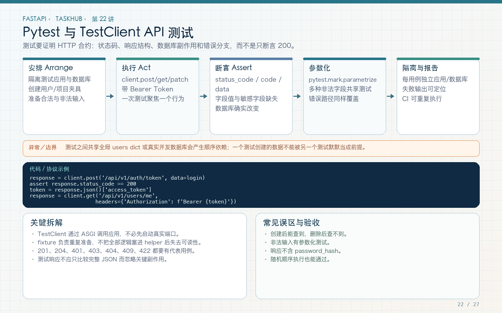

# 第 22 讲：pytest、TestClient 与 API 回归测试

学习路线位置：第 8 周  
前置章节：第 09～21 讲  
本讲核心文件：`tests/conftest.py`、`tests/test_auth.py`、`tests/test_tasks.py`



> 可编辑矢量版本：`images/22-pytest-api.svg`。测试不是把 200 断言一遍，而是验证请求、状态码、业务错误、响应体、权限和副作用，并且能独立重复运行。

---

## 1. 为什么不能只依赖 Swagger 手工验证

Swagger 适合开发时探索，但手工点击存在几个问题：

- 步骤难重复，容易漏掉前置数据；
- 修改代码后不会自动回归；
- 负向权限和异常路径很少点全；
- 团队协作时无法作为统一门禁；
- 不能证明测试之间没有数据污染。

自动化测试把验证写成可执行合约：

```text
准备独立环境
  → 执行真实 HTTP 请求
  → 断言状态码/头部/响应体
  → 必要时检查数据库和文件副作用
  → 清理资源
```

本工程使用 FastAPI `TestClient`，它在测试中走 ASGI 应用、路由、依赖、中间件和异常处理，不需要先手工启动 uvicorn。

---

## 2. 安装与基本命令

```bash
pip install pytest pytest-asyncio httpx
```

运行全部：

```bash
cd taskhub_api
pytest -q
```

运行单文件：

```bash
pytest tests/test_tasks.py -q
```

运行单个测试：

```bash
pytest tests/test_tasks.py::test_full_task_flow -q
```

按名称过滤：

```bash
pytest -k 'permission or api_key' -q
```

失败时显示完整输出：

```bash
pytest -x -vv
```

`-x` 遇到第一个失败停止，适合调试；完整 CI 应运行全部，避免只看到第一个问题。

---

## 3. 测试目录与发现规则

```text
tests/
  conftest.py
  test_auth.py
  test_tasks.py
  test_files.py
  test_realtime.py
  test_middleware_and_api_key.py
  test_external_service.py
```

默认发现 `test_*.py` 文件和 `test_*` 函数。辅助函数不要命名为 `test_*`，否则 pytest 会把它们当测试执行。

`pyproject.toml`：

```toml
[tool.pytest.ini_options]
testpaths = ["tests"]
addopts = "-ra"
```

`testpaths` 限定目录，`-ra` 在结束时显示除通过外的额外摘要。

---

## 4. fixture 是什么

fixture 为测试准备可复用资源。本工程最核心的是 `client`：

```python
@pytest.fixture
def client(tmp_path):
    app = create_app(make_settings(tmp_path))
    with TestClient(app) as test_client:
        yield test_client
```

执行顺序：

```text
pytest 请求 client fixture
  → 创建独立 Settings
  → create_app
  → 进入 TestClient 上下文，运行 lifespan
  → yield 给测试函数
  → 测试结束，退出上下文，运行关闭逻辑
```

### 4.1 为什么使用 yield

yield 后可以做清理。这里退出 `with` 会关闭 HTTP Client、dispose Engine，避免测试间资源泄露。

### 4.2 为什么不用模块级全局 TestClient

全局客户端会共享数据库、上传目录、应用状态和可能的事务，测试顺序会影响结果。默认函数级 fixture 让每个测试独立。

### 4.3 为什么一定要 `with TestClient(app)`

没有进入上下文就不能假设 lifespan 已执行。本工程的自动建表和 `app.state.http_client` 都在 lifespan 初始化。

---

## 5. 测试配置工厂

```python
def make_settings(
    tmp_path: Path,
    **overrides,
) -> Settings:
    values = {
        "database_url": (
            f"sqlite+aiosqlite:///{tmp_path / 'test.db'}"
        ),
        "jwt_secret_key": (
            "test-secret-key-with-at-least-32-characters"
        ),
        "auto_create_tables": True,
        "upload_dir": tmp_path / "uploads",
        "max_upload_bytes": 1024,
    }
    values.update(overrides)
    return Settings(**values)
```

### 5.1 `tmp_path`

pytest 为每个测试提供独立临时目录。数据库和上传文件都放进去，避免读写开发者的 `taskhub.db` 和 `var/uploads`。

### 5.2 独立测试密钥

测试 key 明确只用于测试，不与生产共享。生产 secret 不应出现在测试仓库。

### 5.3 overrides

API Key 测试可覆盖：

```python
make_settings(
    tmp_path,
    api_key_enabled=True,
    api_key="test-api-key",
)
```

同一个工厂可以构造不同场景，不需要复制整套应用。

---

## 6. 测试辅助函数与 fixture 的区别

```python
def register(
    client: TestClient,
    username="alice",
    email=None,
    password="correct-horse-123",
):
    response = client.post(
        "/api/v1/auth/register",
        json={...},
    )
    assert response.status_code == 201, response.text
    return response.json()["data"]


def login(client, username="alice", password="correct-horse-123"):
    response = client.post(
        "/api/v1/auth/token",
        data={"username": username, "password": password},
    )
    assert response.status_code == 200, response.text
    return response.json()["access_token"]
```

这些是普通辅助函数，负责重复业务步骤。它们不是 fixture，因为不是所有测试都需要先注册。

### 6.1 为什么断言中带 `response.text`

失败时直接显示服务器响应，便于定位是 422、500 还是数据结构变化：

```python
assert response.status_code == 201, response.text
```

比只写 `assert response.status_code == 201` 更有诊断价值。

### 6.2 为什么 `auth` 单独抽取

```python
def auth(token: str) -> dict[str, str]:
    return {"Authorization": f"Bearer {token}"}
```

统一格式，减少每个测试重复字符串拼接和拼写错误。

---

## 7. 一条完整 API 测试

```python
def test_full_task_flow(client):
    register(client)
    token = login(client)
    project = create_project(client, token)
    task = create_task(client, token, project["id"])

    assert task["title"] == "Write tests"
    assert task["tags"][0]["name"] == "backend"

    response = client.get(
        f"/api/v1/tasks/{task['id']}",
        headers=auth(token),
    )
    assert response.status_code == 200, response.text
    body = response.json()
    assert body["code"] == "OK"
    assert body["data"]["id"] == task["id"]

    patch = client.patch(
        f"/api/v1/tasks/{task['id']}",
        headers=auth(token),
        json={"status": "done", "tags": []},
    )
    assert patch.status_code == 200
    assert patch.json()["data"]["status"] == "done"
    assert patch.json()["data"]["tags"] == []

    deleted = client.delete(
        f"/api/v1/tasks/{task['id']}",
        headers=auth(token),
    )
    assert deleted.status_code == 204
    assert deleted.content == b""
```

这条测试覆盖注册、登录、项目、创建、详情、PATCH 清空 tags 和 204 删除。它不是只测一个函数，而是验证多个模块协作。

---

## 8. 应该断言哪些内容

### 8.1 状态码

201 创建、200 读取/更新、204 删除、400 业务错误、401 未认证、403 无权限、404 不存在、409 冲突、413 文件过大、422 输入校验、502 上游失败。

不要写：

```python
assert response.status_code != 200
```

因为 500 也会通过。负向测试必须精确。

### 8.2 响应体结构

```python
assert set(response.json()) == {
    "code",
    "message",
    "details",
    "request_id",
}
```

统一错误测试不仅看 message，还检查 code 和 Request ID，防止协议悄悄变化。

### 8.3 响应头

```python
assert response.headers["X-Request-ID"] == supplied_id
assert "text/event-stream" in response.headers["content-type"]
assert response.headers["WWW-Authenticate"] == "Bearer"
```

### 8.4 副作用

文件上传后下载字节一致；删除后详情 404；权限失败不应创建记录。只检查“接口返回失败”不一定证明没有部分写入，必要时查数据库或后续列表。

---

## 9. 参数化测试

适合同一逻辑的多组输入：

```python
@pytest.mark.parametrize(
    "username",
    ["ab", "has space", "slash/name", "中文名"],
)
def test_invalid_usernames(client, username):
    response = client.post(
        "/api/v1/auth/register",
        json={
            "email": "person@example.com",
            "username": username,
            "display_name": "Person",
            "password": "correct-horse-123",
        },
    )
    assert response.status_code == 422
```

每组参数独立执行，失败报告会显示具体输入。不要把多组输入塞进一个循环，否则第一组失败后后面的组不再执行，报告也不清晰。

---

## 10. 测试异常与异步函数

普通 API 测试通过 TestClient 是同步函数；直接测试异步 service 时：

```python
@pytest.mark.asyncio
async def test_external_requests_succeed():
    ...
```

`pytest-asyncio` 负责运行 async 测试。不要忘记 marker，否则可能只创建协程而没有真正执行。

预期异常：

```python
with pytest.raises(UpstreamError) as error:
    await fetch_json_pair(...)

assert error.value.status_code == 502
assert error.value.code == "UPSTREAM_ERROR"
```

只写 `pytest.raises` 不断言异常内容，可能让另一种同类型异常通过。

---

## 11. 好测试与脆弱测试

脆弱写法：

```python
assert response.json() == {...几十个字段和动态时间...}
```

动态 ID、时间戳和完整字典稍有新增字段就失败，且难以看出业务意图。

更稳写法：

```python
body = response.json()
assert body["data"]["id"] == task["id"]
assert body["data"]["title"] == "Write tests"
assert "password_hash" not in body["data"]
```

但对于统一错误协议、权限矩阵等明确公共合约，可以使用更严格结构断言。稳定性不等于只断言一个 200。

---

## 12. 测试之间如何保持独立

- 每个测试新数据库文件；
- 每个测试新上传目录；
- 不使用全局 Session；
- 不依赖测试执行顺序；
- 辅助函数每次显式注册需要的数据；
- 外部网络使用 MockTransport；
- 时间相关逻辑使用短配置或受控时间，不长时间 sleep。

运行顺序改变或单测独立执行，结果都应一致：

```bash
pytest tests/test_tasks.py::test_full_task_flow -q
pytest tests/test_tasks.py -q
pytest -q
```

---

## 13. 常见错误

### 错误 1：没有触发 lifespan

使用 `with TestClient(app)`。

### 错误 2：测试连接开发数据库

所有环境路径来自 `tmp_path`。

### 错误 3：只断言 200

检查业务数据、头部、权限和副作用。

### 错误 4：负向测试接受任意非 200

精确断言 401/403/422 等。

### 错误 5：测试依赖公网

外部请求 mock，CI 才能稳定。

### 错误 6：共享应用状态导致顺序依赖

函数级 fixture，独立资源。

### 错误 7：辅助函数隐藏所有错误

准备步骤断言中带响应文本，失败可诊断。

---

## 14. 练习、自测与验收

### 练习

1. 为缺少 Bearer 增加参数化测试，检查 401 和 WWW-Authenticate。
2. 为 page_size=0、101 增加参数化 422 测试。
3. 给权限失败增加“列表中没有新任务”的副作用断言。
4. 单独运行每个测试文件，再全量运行，确认无顺序依赖。
5. 给 204 删除增加空响应体断言。

### 自测

1. fixture 和普通辅助函数分别适合什么？
2. 为什么 TestClient 要使用上下文管理器？
3. 为什么准备步骤断言要包含 response.text？
4. 为什么 `!=200` 不是好的负向断言？
5. 参数化相比 for 循环有什么优势？
6. 怎样避免测试依赖执行顺序？

### 验收

- [ ] 每个测试使用独立应用和临时目录。
- [ ] lifespan 启动和关闭真实执行。
- [ ] 正常与负向路径均有测试。
- [ ] 状态码、错误 code、响应体和关键头部有断言。
- [ ] 异步 service 测试正确使用 pytest.mark.asyncio。
- [ ] 测试不依赖真实公网。
- [ ] 单测和全量测试都可重复运行。

---

## 15. 下一讲预告

本讲使用了独立 SQLite 文件，但还没系统解释为什么不用内存全局库、为什么连接不能跨事件循环复用，以及怎样区分单元测试和数据库集成测试。第 23 讲将专门解决测试数据库隔离与事务清理。
