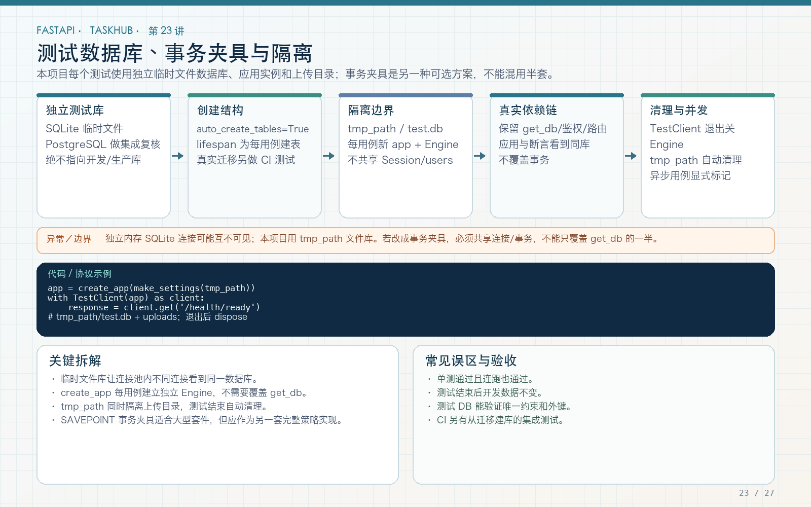

# 第 23 讲：测试数据库隔离、事件循环与事务清理

学习路线位置：第 8 周  
前置章节：第 15～18、22 讲  
本讲核心文件：`tests/conftest.py`、`app/main.py`、`app/db/transaction.py`



> 可编辑矢量版本：`images/23-test-database.svg`。测试数据库的目标不是“越快越好”，而是独立、可重复、接近真实行为，并且绝不误连开发或生产数据。

---

## 1. 测试数据库最容易踩的三个坑

1. 测试误连开发库，清理时删了真实数据；
2. 多个测试共享状态，执行顺序影响结果；
3. 异步连接跨事件循环复用，出现 `attached to a different loop`。

TaskHub 选择：

```text
每个测试函数
  → 独立 tmp_path
  → 独立 SQLite 文件
  → 独立应用实例
  → 独立 TestClient 生命周期
  → 测试后关闭应用资源
```

这不是唯一方案，但对教学项目简单、可靠、易理解。

---

## 2. 独立文件 SQLite 配置

```python
def make_settings(tmp_path: Path, **overrides) -> Settings:
    values = {
        "database_url": (
            f"sqlite+aiosqlite:///{tmp_path / 'test.db'}"
        ),
        "jwt_secret_key": (
            "test-secret-key-with-at-least-32-characters"
        ),
        "auto_create_tables": True,
        "upload_dir": tmp_path / "uploads",
        "max_upload_bytes": 1024,
    }
    values.update(overrides)
    return Settings(**values)
```

每个测试的 `tmp_path` 不同，因此数据库文件不同。即使测试名重复、并行执行或单独运行，也不会共享业务记录。

### 2.1 为什么不直接使用仓库里的 taskhub.db

开发库可能包含你手工创建的数据，测试可能删除任务、改变权限、触发唯一冲突。测试配置必须显式注入，不依赖当前 `.env`。

### 2.2 为什么文件而不是全局内存库

`sqlite:///:memory:` 的生命周期和连接范围更复杂：不同连接可能看到不同内存数据库，连接池和事件循环管理也更容易出错。独立文件更符合本工程 Engine/Session 结构。

---

## 3. 建表发生在 lifespan

```python
app = create_app(make_settings(tmp_path))
with TestClient(app) as client:
    yield client
```

进入上下文时：

```python
if settings.auto_create_tables:
    async with app.state.engine.begin() as connection:
        await connection.run_sync(Base.metadata.create_all)
```

这保证测试请求开始前表已创建。关闭时 Engine dispose，不留下可被下一个事件循环误用的连接。

生产 `auto_create_tables=False`，通过 Alembic 建表；测试自动建表是为了验证当前模型和 API 逻辑。另用第 18 讲迁移测试验证迁移文件本身，两者不能互相替代。

---

## 4. `attached to a different loop` 是什么

异步资源常绑定创建或使用它的事件循环。TestClient 在不同测试、不同上下文中可能使用不同事件循环。

如果把全局 aiosqlite 连接或 AsyncSession 留着复用：

```text
测试 A 的 loop 创建连接
  → 测试 A 结束，loop 关闭
  → 测试 B 的新 loop 复用旧连接
  → attached to a different loop
```

本工程通过应用工厂和函数级 fixture，让 Engine、Session factory、Session 和 TestClient 生命周期一致，避免跨测试复用异步连接。

不要为了绕过错误而全局使用 `NullPool` 或不断 `asyncio.run` 包所有操作。先找出谁拥有连接、谁关闭连接、哪个循环使用它。

---

## 5. 单元测试、集成测试和端到端测试

| 类型 | 本工程例子 | 数据库 |
|---|---|---|
| 单元测试 | `fetch_json_pair` + MockTransport | 不需要 |
| API 集成测试 | 注册 → 登录 → 项目 → 任务 | 独立 SQLite |
| 迁移测试 | Alembic upgrade/check/downgrade | 独立临时库 |
| 目标数据库集成 | PostgreSQL 约束、并发、迁移 | 专用测试 PostgreSQL |
| 部署冒烟 | Compose 启动后 /health/ready | 容器内专用库 |

测试金字塔不是只允许一种。快速单元测试多，集成测试验证协作，少量真实环境测试验证部署。

只 Mock 所有数据库，会错过 SQL、约束和事务问题；完全不 Mock 外部服务，又会让 CI 慢且不稳定。按边界选择。

---

## 6. 为什么本教程不用“每测试包一个事务再回滚”作为默认

常见方案：

```text
测试开始事务
  → 应用在这个事务里运行
  → 测试结束 rollback
```

优点是清理快，缺点是应用里的 commit/rollback、嵌套事务和连接管理更复杂。若应用自己 commit，外层回滚策略可能失效；若强制阻止 commit，又没有测试真实提交路径。

本教程每个测试独立文件：

- 应用可以真实 commit；
- 事务冲突能被暴露；
- 上传文件和数据库天然独立；
- 小项目速度足够。

大型套件可在理解 savepoint、连接绑定和并发后采用事务回滚优化，但不应为了速度牺牲真实性。

---

## 7. 事务辅助器为什么值得专门测试

```python
@asynccontextmanager
async def transaction(session):
    try:
        yield session
        await session.commit()
    except Exception:
        await session.rollback()
        raise
```

必须验证：

1. 成功时数据在后续查询可见；
2. 业务异常时数据不可见；
3. IntegrityError 时事务已回滚；
4. 当前用户 SELECT autobegin 后仍可写；
5. 异常类型和 message 没被吞掉。

示例思路：

```python
with pytest.raises(ForbiddenError):
    await create_task_as_non_member(...)

visible = await list_tasks_as_owner(...)
assert unauthorized_title_not_in(visible)
```

应用测试通过真实 API 验证事务副作用，比 Mock 一个 `commit.called` 更有价值。

---

## 8. 数据库唯一约束的测试价值

重复注册测试：

```python
first = client.post("/api/v1/auth/register", json=payload)
second = client.post("/api/v1/auth/register", json=payload)

assert first.status_code == 201
assert second.status_code == 409
```

如果只 Mock repository，就不会真正验证 users 唯一索引。真实 SQLite 集成测试能发现：

- 唯一约束漏建；
- email 规范化不一致；
- IntegrityError 未映射；
- 回滚后 Session 状态错误。

但 SQLite 与 PostgreSQL 对大小写、null、部分索引等语义可能不同。产品依赖特定数据库行为时，要在 PostgreSQL 再测。

---

## 9. 测试数据应该怎样创建

推荐通过公开 API 创建：

```python
register(client)
token = login(client)
project = create_project(client, token)
task = create_task(client, token, project["id"])
```

优点：同时验证真实前置链路，数据满足业务约束。

缺点：测试涉及多个模块，失败定位链路更长。因此可以：

- 主流程测试用 API；
- 针对某个 SQL 的细粒度测试用 repository 直接造数据；
- 复杂权限矩阵用明确 factory；
- 不在多个文件复制大段 ORM 插入。

测试数据要只包含必要字段，避免依赖无关默认值和随机值。

---

## 10. 上传目录也必须隔离

测试数据库独立但上传目录共享，仍可能相互删除或覆盖文件。

```python
"upload_dir": tmp_path / "uploads"
```

文件测试同时验证：

- 正式存储名唯一；
- 临时文件失败清理；
- 原名不影响路径；
- 下载字节一致；
- 测试结束目录位于 pytest 临时区。

绝不在测试中清空固定系统目录或用户上传目录。清理只针对本测试创建的临时路径。

---

## 11. 并行测试与资源边界

使用 pytest-xdist 并行时：

```bash
pytest -n auto
```

独立 tmp_path 能避免大部分文件冲突，但仍需检查：

- 是否共享固定端口；
- 是否共享 Redis 数据库编号；
- 是否共用 PostgreSQL database；
- 是否有全局随机名或时间 ID 冲突；
- 外部 Mock 是否线程/进程安全。

本课程不强制安装 xdist。先保证串行独立，再引入并行；不要只凭“本地跑得快”修改共享资源策略。

---

## 12. PostgreSQL 专用测试建议

Compose 可启动独立 PostgreSQL，测试时使用另一个数据库名，例如 `taskhub_test`：

```text
taskhub       开发数据
taskhub_test  自动化测试，允许重建
```

CI 使用 service container，每次 job 新实例。测试前：

```bash
alembic upgrade head
pytest -q
```

测试结束由 CI 销毁环境。不要用生产实例中的一个 schema 充当“测试库”，权限和网络也应隔离。

---

## 13. 常见错误

### 错误 1：测试读取当前 `.env` 连接开发库

显式构造测试 Settings，覆盖 database_url。

### 错误 2：所有测试共享一个 AsyncSession

按应用和请求生命周期创建，函数级 fixture。

### 错误 3：跨事件循环复用连接

让 TestClient、Engine 和连接生命周期一致。

### 错误 4：为了快而完全跳过 commit

独立数据库允许测试真实事务。

### 错误 5：只 Mock 数据库就认为迁移正确

迁移和真实约束需要独立集成验证。

### 错误 6：只隔离数据库，不隔离文件和外部服务

所有有状态资源都要考虑测试边界。

---

## 14. 练习、自测与验收

### 练习

1. 单独运行权限测试，再与文件测试一起运行，确认结果一致。
2. 打印两个测试的 database_url，确认路径不同。
3. 在重复注册 409 后再次注册一个新用户，确认 Session 仍可正常使用。
4. 为权限失败后的列表增加无残留断言。
5. 设计 CI PostgreSQL service，确保数据库名和凭据只用于测试。

### 自测

1. 为什么每个测试使用独立 SQLite 文件？
2. 为什么不能跨事件循环复用连接？
3. 自动建表测试与 Alembic 测试分别验证什么？
4. 为什么教程不默认使用外层事务回滚？
5. 为什么数据库 Mock 不能替代唯一约束测试？
6. 除了数据库，还要隔离哪些资源？

### 验收

- [ ] 测试不读取开发数据库。
- [ ] 每个测试有独立数据库和上传目录。
- [ ] TestClient 与 Engine 生命周期一致。
- [ ] 应用真实 commit/rollback 被覆盖。
- [ ] 唯一约束和冲突映射有真实数据库测试。
- [ ] 外部 HTTP 使用 Mock。
- [ ] 理解 SQLite 与 PostgreSQL 的验证边界。

---

## 15. 下一讲预告

独立数据库解决状态隔离，但有些依赖需要按测试替换，例如外部 HTTP、时间、消息发布器。第 24 讲将系统讲 dependency_overrides、MockTransport、monkeypatch 的边界，并说明为什么不要 Mock 掉所有业务层。
