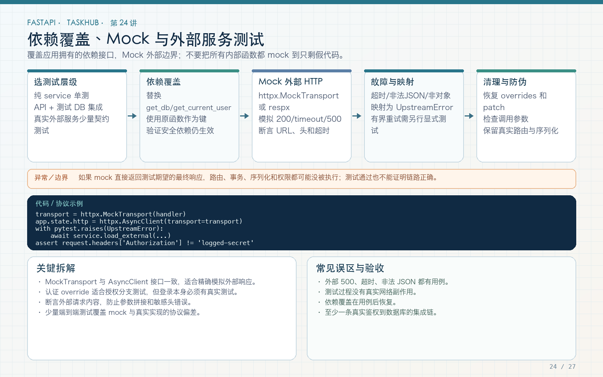

# 第 24 讲：dependency_overrides、Mock 与测试边界

学习路线位置：第 8 周  
前置章节：第 07、11、22、23 讲  
本讲核心文件：`app/core/dependencies.py`、`tests/test_external_service.py`



> 可编辑矢量版本：`images/24-overrides-mocks.svg`。优先在系统外部边界替换依赖，保留真实路由、认证、权限和业务代码；Mock 越多，测试离真实系统越远。

---

## 1. 为什么需要依赖覆盖

第 22 讲已经能测真实 API，但外部 HTTP 不能依赖公网。我们希望：

- 路由真实；
- Pydantic 校验真实；
- JWT 认证真实；
- `fetch_json_pair` 业务逻辑真实；
- 只有最终网络传输被替换。

FastAPI 提供：

```python
app.dependency_overrides[original_dependency] = override_dependency
```

它按“原依赖函数对象”查找替换，不是按函数名字符串。

---

## 2. 原依赖是可替换的边界

```python
def get_http_client(request: Request) -> httpx.AsyncClient:
    return request.app.state.http_client


HttpClientDep = Annotated[
    httpx.AsyncClient,
    Depends(get_http_client),
]
```

生产返回 lifespan 创建的 AsyncClient；测试返回 MockTransport 客户端。endpoint 不需要知道两者区别：

```python
async def aggregate_external_data(
    http_client: HttpClientDep,
    current_user: CurrentUser,
    ...
):
    ...
```

这就是依赖注入的价值：业务依赖抽象能力，不在函数内部硬编码 `requests.get` 或新建不可替换客户端。

---

## 3. MockTransport 与 dependency_overrides 各管一层

### MockTransport

替换 httpx 的网络传输：

```python
transport = httpx.MockTransport(handler)
client = httpx.AsyncClient(transport=transport)
```

保留真实 URL、请求头、Response、状态码和 `raise_for_status` 行为。

### dependency_overrides

替换 FastAPI 的依赖提供过程，让 endpoint 收到上述 mock client。

两者组合：

```text
真实 endpoint
  → 真实 get_http_client 依赖被 override
  → 测试 AsyncClient
  → MockTransport.handler
  → 返回可控 httpx.Response
```

---

## 4. 完整接口级覆盖测试

文件：`tests/test_external_service.py`

```python
def test_external_endpoint_uses_dependency_override(tmp_path):
    def handler(request: httpx.Request) -> httpx.Response:
        return httpx.Response(
            200,
            json={"path": request.url.path},
        )

    async def override_http_client():
        async with httpx.AsyncClient(
            transport=httpx.MockTransport(handler)
        ) as mock_client:
            yield mock_client

    app = create_app(make_settings(tmp_path))
    app.dependency_overrides[get_http_client] = (
        override_http_client
    )

    try:
        with TestClient(app) as client:
            register(client)
            token = login(client)
            response = client.get(
                "/api/v1/external/aggregate",
                params={
                    "url_a": "https://service.test/a",
                    "url_b": "https://service.test/b",
                },
                headers={"Authorization": f"Bearer {token}"},
            )

        assert response.status_code == 200, response.text
        assert response.json()["data"]["first"]["path"] == "/a"
        assert response.json()["data"]["second"]["path"] == "/b"
    finally:
        app.dependency_overrides.clear()
```

### 4.1 为什么 override 是 async generator

原依赖提供应用级资源，测试 override 自己创建带 MockTransport 的客户端，并在请求结束后关闭。`yield` 与 `async with` 确保清理。

### 4.2 为什么还要注册和登录

外部 endpoint 使用 `CurrentUser`。依赖覆盖只替换 HTTP Client，不应绕过认证，否则测试范围发生改变。

### 4.3 为什么 finally clear

override 是应用可变状态。测试结束清理，防止影响同一 app 的后续测试。更稳妥的做法仍是每个测试独立 app，本工程两者都使用。

---

## 5. 直接 service 测试与 API 测试互补

本工程还有两个直接测试：

```python
@pytest.mark.asyncio
async def test_external_requests_succeed():
    ...
```

它们不创建 FastAPI 应用，只测试：

- 两个 URL 的结果；
- gather 并发服务；
- 非 2xx 到 UpstreamError；
- 502 code 和 status。

API override 测试则验证：

- endpoint 路由；
- Query 参数；
- CurrentUser；
- 依赖注入；
- 响应包装。

两者不是重复。一个聚焦业务函数，一个聚焦系统集成。

---

## 6. 如何 Mock 网络错误

除了 HTTP 503，还要模拟连接异常：

```python
def handler(request: httpx.Request) -> httpx.Response:
    raise httpx.ConnectError(
        "simulated connection failure",
        request=request,
    )
```

`fetch_json_pair` 捕获 `httpx.HTTPError`，映射 UpstreamError。测试：

```python
with pytest.raises(UpstreamError) as error:
    await fetch_json_pair(client, url_a, url_b)

assert error.value.status_code == 502
```

还可以模拟：

- `httpx.ReadTimeout`；
- 非法 JSON；
- JSON list 而非 object；
- 一个 URL 成功、另一个失败；
- 响应体过大（如果服务增加限制）。

这些用真实公网很难稳定复现，Mock 是必要工具。

---

## 7. monkeypatch 适合什么

`monkeypatch` 适合临时替换小型函数或环境变量：

```python
def test_timeout_setting(monkeypatch):
    monkeypatch.setenv("EXTERNAL_TIMEOUT_SECONDS", "1.5")
    get_settings.cache_clear()
    try:
        assert get_settings().external_timeout_seconds == 1.5
    finally:
        get_settings.cache_clear()
```

这里清理 lru_cache 很关键，否则其他测试可能读到缓存配置。

替换函数：

```python
monkeypatch.setattr(
    notification_service,
    "log_task_created",
    fake_log,
)
```

注意 Python 导入方式会影响 patch 目标。如果模块已经 `from module import function`，替换原模块属性不一定改变已导入的本地引用。优先 patch 使用方命名空间，或使用依赖注入。

---

## 8. 不要 Mock 掉被测对象

错误示例：测试任务创建服务，却把 `create_task` 本身 Mock 成成功：

```python
# 没有验证任何真实业务
mock_create_task.return_value = expected
result = mock_create_task(...)
assert result == expected
```

这只能证明 Mock 按设定返回，不能证明权限、SQL、事务或序列化正确。

合理边界：

- 数据库集成测试使用独立 SQLite/PostgreSQL；
- 密码哈希可用真实实现（测试参数和性能可控）；
- JWT 用真实签名与验证；
- 外部 HTTP Mock；
- 邮件/支付等外部副作用 Mock 或沙箱；
- 时间、随机 ID 在需要确定性时注入。

---

## 9. 数据库依赖覆盖什么时候合适

可以把 `get_db` 覆盖到专用 Session factory：

```python
async def override_db():
    async with test_session_factory() as session:
        yield session

app.dependency_overrides[get_db] = override_db
```

适合已经有一个共享测试 app，但希望替换数据库的场景。本教程选择每个测试直接 `create_app(test_settings)`，更加直观，且 Engine、HTTP Client、上传目录一起隔离。

不要同时混用多套隔离策略却说不清哪个生效。例如 Settings 指向数据库 A，override_db 又指向 B，测试失败时很难排查。

---

## 10. Mock 的调用断言有价值，但不是全部

可以断言外部请求 URL：

```python
seen_urls = []

def handler(request):
    seen_urls.append(str(request.url))
    return httpx.Response(200, json={})

...
assert seen_urls == [
    "https://service.test/a",
    "https://service.test/b",
]
```

`asyncio.gather` 下完成顺序可能不同，但这里两个请求按 gather 参数创建，观察顺序也不应被当成业务 SLA。若测试只关心集合，使用 `set(seen_urls)`，不要无意义依赖调度顺序。

调用次数可以验证“没有多余重试”，但最终结果、异常映射和副作用仍要断言。

---

## 11. 时间、UUID 和后台任务

### 时间

不要在过期测试里 sleep 60 分钟。可以：

- 使用极短过期配置；
- 直接生成已经过期的 token；
- 注入 clock；
- 使用受控时间库。

### UUID

附件存储名不应断言固定 UUID，而应断言：

- 不是原文件名；
- 只含预期字符和后缀；
- 文件真实存在；
- 数据库 stored_name 与实际路径一致。

### BackgroundTasks

TestClient 会执行应用的后台任务链。若后台动作访问外部服务，应在外部边界 Mock；不要通过不触发 lifespan 或屏蔽所有 BackgroundTasks 来隐藏问题。

---

## 12. 常见错误

### 错误 1：override 的 key 用字符串

必须使用同一个依赖函数对象 `get_http_client`。

### 错误 2：覆盖后没有清理

使用独立 app 和 finally clear。

### 错误 3：Mock 整个 service 后声称 API 业务通过

保留被测业务，只替换外部边界。

### 错误 4：Mock 所有数据库行为

会漏掉 SQL、事务和约束问题。

### 错误 5：忘记 Settings cache

环境变量测试后 `get_settings.cache_clear()`。

### 错误 6：依赖调度顺序做脆弱断言

并发结果按语义比较，不比较无保证的完成顺序。

---

## 13. 练习、自测与验收

### 练习

1. 增加 ConnectError 测试，确认 UpstreamError 502。
2. 增加上游返回 list JSON 的测试，确认非 object 被拒绝。
3. 给 dependency override 测试增加匿名 401，证明认证未被绕过。
4. 使用 monkeypatch 修改超时配置，并清理 Settings cache。
5. 画出自己的项目哪些依赖适合 override，哪些应保留真实实现。

### 自测

1. dependency_overrides 的 key 是什么？
2. MockTransport 与 dependency override 分别替换哪一层？
3. 为什么 API 测试仍要登录？
4. 为什么不能 Mock 被测函数本身？
5. 为什么环境变量测试要清 Settings cache？
6. 哪些外部边界最适合 Mock？

### 验收

- [ ] 外部 HTTP 测试不访问公网。
- [ ] dependency override 使用真实函数对象。
- [ ] 覆盖后清理应用状态。
- [ ] API 测试保留真实认证和路由。
- [ ] service 成功和 503→502 有直接测试。
- [ ] 接口级 override 测试通过。
- [ ] 没有用过度 Mock 替代真实业务验证。

---

## 14. 下一讲预告

测试已经能重复运行，下一讲把它接入 Ruff 和 GitHub Actions：每次 push/PR 自动安装依赖、静态检查、运行 pytest 和 Alembic 漂移检查，让教程与示例工程的修改都有持续门禁。
