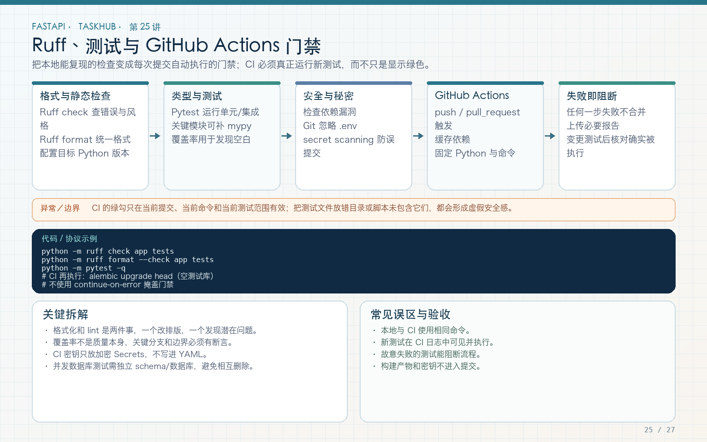

# 第 25 讲：Ruff、代码质量门禁与 GitHub Actions

学习路线位置：第 8 周  
前置章节：第 18、22～24 讲  
本讲核心文件：`pyproject.toml`、`.github/workflows/taskhub-ci.yml`



> 可编辑矢量版本：`images/25-quality-ci.svg`。CI 的价值是让每一次修改都在干净环境中经过同一套验证，不是把本地命令复制到 YAML 后就声称质量可靠。

---

## 1. 本讲建立的质量闭环

```text
开发者修改代码/教程
  → Ruff lint：发现错误、导入和部分异步问题
  → Ruff format --check：统一格式
  → pytest：验证 API、权限、文件、实时与外部服务
  → alembic upgrade head：验证空库迁移
  → alembic check：验证模型与迁移没有已知漂移
  → GitHub Actions 全绿后才作为可合并候选
```

CI 全绿不代表绝对无 bug，也不代替代码审查、安全审查和目标数据库验证。它是一套可重复的最低质量门禁。

---

## 2. 为什么同时使用 Ruff 和 pytest

Ruff 静态分析无需执行所有业务路径，可快速发现：

- 未使用导入；
- 导入顺序；
- 未定义名称；
- 某些容易出错的习惯；
- 旧式 Python 写法；
- 部分 async 规则问题。

pytest 实际执行代码，发现：

- 事务已开始；
- WebSocket 路径错误；
- 权限判断不对；
- 数据库约束和序列化失败；
- 外部服务异常映射不对。

两者互补。Ruff 通过不能证明业务正确，pytest 通过也不能证明代码风格和无用导入干净。

---

## 3. Ruff 配置

文件：`taskhub_api/pyproject.toml`

```toml
[tool.ruff]
target-version = "py312"
line-length = 120

[tool.ruff.lint]
select = ["E", "F", "I", "B", "UP", "ASYNC"]
ignore = ["B008"]

[tool.ruff.format]
quote-style = "double"
```

### 3.1 target-version

目标 Python 3.12，Ruff 按该语言版本给出升级建议。运行环境可以更新，但目标兼容性应明确。

### 3.2 规则组

- E：pycodestyle 错误；
- F：Pyflakes，未定义/未使用等；
- I：import 排序；
- B：flake8-bugbear 常见问题；
- UP：pyupgrade；
- ASYNC：部分异步使用问题。

### 3.3 为什么忽略 B008

B008 默认会对函数参数中的函数调用报警，但 FastAPI 常见：

```python
def endpoint(user=Depends(get_current_user)):
    ...
```

这是框架声明式用法，因此针对项目忽略该规则。忽略规则要有明确原因，不能为了让检查变绿而整组关闭。

---

## 4. 常用 Ruff 命令

只检查：

```bash
ruff check .
```

自动修复安全支持的项：

```bash
ruff check . --fix
```

格式化：

```bash
ruff format .
```

提交前验证格式而不修改：

```bash
ruff format --check .
```

`--fix` 会修改文件，运行后仍要查看 diff 并执行测试。不要在没有版本控制或备份的目录里盲目批量修复。

---

## 5. 开发依赖与运行依赖分离

`requirements.txt`：FastAPI、SQLAlchemy、Alembic、HTTPX 等运行依赖。  
`requirements-dev.txt`：pytest、pytest-asyncio、ruff 等开发依赖。

本地开发：

```bash
pip install -r requirements.txt -r requirements-dev.txt
```

Docker 镜像只安装运行依赖，减少体积和攻击面。CI 同时安装两套。

本教程使用明确上下界范围，便于学习和升级；对要求高度可重复的生产构建，可进一步生成锁文件并记录哈希。不要一边说“完全可复现”一边每次 CI 都拉取未锁定的新版本。

---

## 6. GitHub Actions 完整工作流

文件：仓库根 `.github/workflows/taskhub-ci.yml`

```yaml
name: TaskHub CI

on:
  push:
    branches: [main]
  pull_request:

permissions:
  contents: read

jobs:
  test:
    runs-on: ubuntu-latest
    defaults:
      run:
        working-directory: taskhub_api
    env:
      DATABASE_URL: sqlite+aiosqlite:////tmp/taskhub-ci.db
      JWT_SECRET_KEY: ci-only-secret-key-with-at-least-32-characters

    steps:
      - name: Check out repository
        uses: actions/checkout@v4

      - name: Set up Python
        uses: actions/setup-python@v5
        with:
          python-version: "3.12"
          cache: pip
          cache-dependency-path: |
            taskhub_api/requirements.txt
            taskhub_api/requirements-dev.txt

      - name: Install dependencies
        run: |
          python -m pip install --upgrade pip
          python -m pip install -r requirements.txt -r requirements-dev.txt

      - name: Ruff lint
        run: ruff check .

      - name: Ruff format check
        run: ruff format --check .

      - name: Pytest
        run: pytest -q

      - name: Validate course links and diagrams
        run: python ../tools/validate_course.py

      - name: Validate Alembic migration and model drift
        run: |
          alembic upgrade head
          alembic check
```

---

## 7. 逐段解释 workflow

### 7.1 触发条件

`push` 到 main 和所有 pull request 运行。教程文档和工程在同一仓库，因此不限制 paths，避免修改教程对应代码时漏跑。

### 7.2 最小权限

```yaml
permissions:
  contents: read
```

CI 只需要读取代码，不授予 issues、packages、deployments 等写权限。第三方 action 也应审查版本和权限。

### 7.3 working-directory

工程位于子目录 `taskhub_api`，默认所有 run 在这里执行。action 的 checkout/setup 不受该默认值影响，缓存路径仍从仓库根解析。

### 7.4 CI 专用配置

数据库指向 runner 的临时 SQLite，JWT key 明确 `ci-only`。它们不包含真实生产秘密，也不会连接开发者机器。

### 7.5 pip cache

`setup-python` 根据 requirements 文件 hash 缓存，提高重复构建速度。缓存不会代替安装和测试，依赖变化后 key 也会变化。

---

## 8. 为什么 CI 还要跑 Alembic check

实际开发中，测试使用 `auto_create_tables=True`，它能根据当前 ORM 建表。如果开发者只改模型却忘记迁移，API 测试仍可能通过。

CI 再执行：

```bash
alembic upgrade head
alembic check
```

就会从迁移文件建库，再比较当前 ORM，发现未写入迁移的结构差异。

本仓库曾实际发现 users email/username 的唯一约束、普通索引和 ORM 唯一索引不一致，统一为唯一索引后才通过。这正是“测试全绿仍需迁移漂移检查”的具体例子。

`alembic check` 不是全能审查器：它不能判断所有数据迁移安全性、锁表风险和业务正确性。

---

## 9. 本地预检与 CI 一致

推送前在仓库根：

```bash
cd taskhub_api
ruff check .
ruff format --check .
pytest -q

export DATABASE_URL='sqlite+aiosqlite:////tmp/taskhub-local-ci.db'
alembic upgrade head
alembic check
```

如果这个临时文件之前已有旧版本，结果可能不是“空库升级”。需要完全空库测试时，使用一个新的专用临时路径，并只清理自己创建的文件。

Windows 本地路径和 Shell 环境变量写法不同，可在 PowerShell 使用：

```powershell
$env:DATABASE_URL = "sqlite+aiosqlite:///./test-migration.db"
alembic upgrade head
alembic check
```

不要把这个数据库文件提交到仓库。

---

## 10. CI 失败怎么排查

### Ruff 失败

先在本地运行同一命令。格式问题运行 `ruff format .`，逻辑问题人工修复，不能只加 noqa 了事。

### pytest 失败

下载日志，定位失败测试和响应体。用单个测试复现，再全量验证。不要只重跑 CI 希望偶发通过。

### Alembic 失败

检查 DATABASE_URL、模型导入、迁移顺序、索引和约束。不要在 CI 中临时改成 `create_all` 绕过，因为这会删除门禁意义。

### 只有 CI 失败

比较 Python 版本、依赖版本、操作系统、环境变量、文件路径大小写和测试顺序。macOS 文件名大小写行为与 Linux 可能不同。

---

## 11. 警告与技术债管理

本教程本地新版 Python 上能看到 TestClient/pytest-asyncio 的弃用警告，但测试仍通过。正确处理：

1. 记录警告来源；
2. 查看当前依赖的迁移建议；
3. 在兼容版本范围内升级或调整；
4. 不在全局配置简单屏蔽所有 DeprecationWarning；
5. 等依赖支持新接口后再清理旧用法。

警告不等于失败，但完全忽略会让未来升级变困难。CI 可选择对项目自有警告设 error，对第三方已知警告精确分类，而不是一刀切。

---

## 12. 可以后续增加但不必一次堆满的门禁

- PostgreSQL service 集成测试；
- Docker build 和 Compose 冒烟；
- Markdown 相对链接检查；
- 依赖漏洞扫描；
- GitHub secret scanning；
- 覆盖率门槛；
- 多 Python 版本矩阵；
- 构建产物和 SBOM。

每项都应有明确责任。覆盖率 100% 不等于权限路径都正确，链接检查通过也不等于教程技术内容正确。

---

## 13. 常见错误

### 错误 1：CI 只运行 pytest

可能漏掉格式、迁移漂移和静态错误。

### 错误 2：CI 使用生产密钥或数据库

使用一次性测试配置和最小权限。

### 错误 3：Ruff 自动修复后不检查 diff

自动修复仍需测试与审查。

### 错误 4：为了让 CI 变绿屏蔽所有警告/规则

只对有明确理由的项做窄范围忽略。

### 错误 5：把本地未运行的命令写成“已通过”

教程和交付说明必须区分实际验证与待验证项。

### 错误 6：给 CI 过大 GitHub Token 权限

默认只读，按任务最小授权。

---

## 14. 练习、自测与验收

### 练习

1. 本地依次执行 Ruff、format check、pytest 和 Alembic check。
2. 故意新增一个未使用导入，观察 Ruff 报告后修复。
3. 故意修改一个 ORM 字段但不写迁移，观察 `alembic check`，再恢复。
4. 为 CI 增加 PostgreSQL service 的设计，不写生产凭据。
5. 审查 workflow 权限，说明为什么 contents:read 足够。

### 自测

1. Ruff 和 pytest 各发现哪类问题？
2. 为什么忽略 B008？
3. 为什么测试建表不能代替 Alembic check？
4. 为什么 CI 要使用最小权限？
5. 为什么警告不能一律屏蔽？
6. CI 全绿还不能证明什么？

### 验收

- [ ] Ruff lint 通过。
- [ ] Ruff format check 通过。
- [ ] pytest 全部通过。
- [ ] Alembic 空库升级和 drift check 通过。
- [ ] workflow 使用 Python 3.12 和独立测试配置。
- [ ] workflow 只有 contents:read。
- [ ] 本地验证结果与教程描述一致。

---

## 15. 下一讲预告

CI 已在干净 Linux runner 运行，但本地部署还依赖手工安装 Python 和 PostgreSQL。第 26 讲将使用 Dockerfile 与 Compose 构建非 root API 容器、PostgreSQL 健康检查、持久卷、迁移启动和容器冒烟测试。
