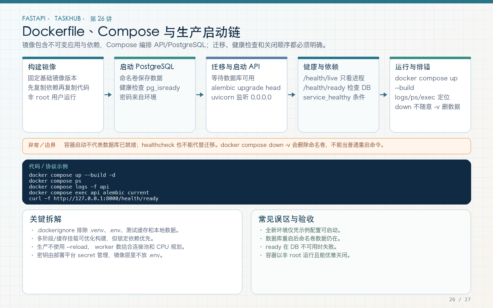

# 第 26 讲：Dockerfile、Compose、PostgreSQL 与部署冒烟

学习路线位置：第 8 周  
前置章节：第 08、12、18、25 讲  
本讲核心文件：`Dockerfile`、`compose.yaml`、`.dockerignore`



> 可编辑矢量版本：`images/26-docker-compose.svg`。镜像提供运行环境，Compose 编排 API、PostgreSQL 和卷；健康检查、迁移、非 root 用户与 secret 边界必须一起设计。

---

## 1. 为什么本地能跑不代表部署能跑

手工本地运行依赖：

- 某个 Python 版本；
- 当前虚拟环境；
- 本机 SQLite；
- 当前工作目录；
- 本机字体、路径和环境变量；
- 手动安装的系统包。

容器把应用及依赖构建为镜像，并用 Compose 明确服务关系。目标不是“把本机整个目录塞进去”，而是构建一个最小、可重复、可审查的运行环境。

TaskHub Compose：

```text
PostgreSQL 16 容器（db）
  → healthcheck 通过
  → API 容器启动
  → alembic upgrade head
  → uvicorn 监听 0.0.0.0:8000
  → /health/ready 验证应用和数据库
```

---

## 2. 完整 Dockerfile

```dockerfile
FROM python:3.12-slim

ENV PYTHONDONTWRITEBYTECODE=1 PYTHONUNBUFFERED=1
WORKDIR /app

COPY requirements.txt ./
RUN pip install --no-cache-dir -r requirements.txt

COPY app ./app
COPY alembic ./alembic
COPY alembic.ini ./

RUN addgroup --system taskhub \
    && adduser --system --ingroup taskhub taskhub \
    && mkdir -p /app/var/uploads \
    && chown -R taskhub:taskhub /app

USER taskhub

EXPOSE 8000
HEALTHCHECK --interval=30s --timeout=5s --retries=3 \
  CMD python -c "import urllib.request; urllib.request.urlopen('http://127.0.0.1:8000/health/ready')"
CMD ["uvicorn", "app.main:app", "--host", "0.0.0.0", "--port", "8000"]
```

### 2.1 为什么 slim

减少基础镜像体积和不必要工具。某些依赖需要编译时可能要添加构建工具；本工程当前依赖可在该环境安装，实际 build 是必要验证。

### 2.2 两个 ENV

`PYTHONDONTWRITEBYTECODE=1` 避免生成 pyc；`PYTHONUNBUFFERED=1` 让日志及时输出到容器 stdout/stderr，便于平台采集。

### 2.3 先复制 requirements

依赖文件变化频率低于源码。先安装依赖，再复制源码，源码修改时可复用 pip 安装层缓存。若一开始就 `COPY . .`，任何源码变化都会让后续依赖层失效。

### 2.4 非 root USER

容器默认 root 会放大漏洞影响。创建 `taskhub` 用户并切换，上传目录和 /app 权限在切换前配置。

### 2.5 EXPOSE 与端口映射

`EXPOSE 8000` 是文档和元数据，不会自动把端口发布到宿主机。Compose 的 `ports: "8000:8000"` 才进行映射。

---

## 3. .dockerignore 不是可选优化

```text
.venv
.env
.git
.pytest_cache
.ruff_cache
__pycache__
*.pyc
*.db
var
```

作用：

- 防止本机虚拟环境进入 Linux 镜像；
- 防止 `.env` 秘密进入构建上下文；
- 防止本地数据库和上传文件打入镜像；
- 减少缓存、历史 Git 和临时文件体积；
- 降低非相关文件变化导致的缓存失效。

`.dockerignore` 与 `.gitignore` 是两套机制：一个管 Docker build context，一个管 Git 跟踪。忽略 Git 不代表 Docker 也看不到，因此两边都要检查。

---

## 4. 完整 Compose 配置

文件：`compose.yaml`

```yaml
services:
  db:
    image: postgres:16-alpine
    environment:
      POSTGRES_USER: taskhub
      POSTGRES_PASSWORD: taskhub-local-password
      POSTGRES_DB: taskhub
    volumes:
      - taskhub_postgres_data:/var/lib/postgresql/data
    healthcheck:
      test: ["CMD-SHELL", "pg_isready -U taskhub -d taskhub"]
      interval: 5s
      timeout: 3s
      retries: 20

  api:
    build: .
    environment:
      ENVIRONMENT: production
      DATABASE_URL: postgresql+asyncpg://taskhub:taskhub-local-password@db:5432/taskhub
      JWT_SECRET_KEY: local-compose-only-change-this-secret-32bytes
      API_KEY_ENABLED: "false"
      UPLOAD_DIR: /app/var/uploads
    ports:
      - "8000:8000"
    volumes:
      - taskhub_uploads:/app/var/uploads
    depends_on:
      db:
        condition: service_healthy
    command: sh -c "alembic upgrade head && uvicorn app.main:app --host 0.0.0.0 --port 8000"

volumes:
  taskhub_postgres_data:
  taskhub_uploads:
```

这些密码是本地教学占位值，只能用于本机专用 Compose。公开部署必须换成 secret 注入，不能把这个配置理解为生产安全基线。

---

## 5. 为什么 hostname 是 db 而不是 localhost

容器有自己网络命名空间。API 容器里的 localhost 指向 API 容器自己，不是 PostgreSQL 容器。

Compose 在同一网络提供服务名解析：

```text
postgresql+asyncpg://taskhub:...@db:5432/taskhub
```

`db` 与 Compose service 名一致。宿主机访问 API 才使用 `127.0.0.1:8000`。

---

## 6. depends_on 与 healthcheck

只写：

```yaml
depends_on: [db]
```

通常只保证容器启动顺序，不代表 PostgreSQL 已准备好接受连接。

本工程：

```yaml
depends_on:
  db:
    condition: service_healthy
```

db 使用：

```bash
pg_isready -U taskhub -d taskhub
```

健康后才启动 API 迁移，减少首次启动时的连接失败。

但健康只代表当时可连接。运行中数据库仍可能故障，应用需要错误处理、探针和运维恢复。

---

## 7. 为什么使用两个命名卷

```text
taskhub_postgres_data → PostgreSQL 数据
taskhub_uploads       → 用户上传文件
```

容器可重建，卷保留数据。镜像和容器可替换，持久数据不应只写容器可写层。

`docker compose down` 默认保留命名卷；`down -v` 会删除卷和数据，只能用于明确可丢弃的教学环境。生产备份不能依赖“卷还在”这一件事，需要数据库备份和恢复演练。

---

## 8. 迁移为什么放在启动命令

```bash
alembic upgrade head && uvicorn ...
```

`&&` 表示迁移失败就不启动 API，避免代码连接到旧表结构。

本地单 API 容器方便教学。多副本生产环境不建议每个副本同时执行迁移，应改为：

1. 独立 migration Job；
2. 等待迁移成功；
3. 启动/更新 API 副本；
4. 就绪检查通过后接流量。

还要考虑新旧代码兼容和回滚，而不只是容器启动成功。

---

## 9. 构建与启动命令

在 `taskhub_api/`：

```bash
docker build -t taskhub-course:local .
```

Compose 构建并后台启动：

```bash
docker compose up -d --build
```

查看状态：

```bash
docker compose ps
```

查看 API 日志：

```bash
docker compose logs --tail=100 api
```

持续观察：

```bash
docker compose logs -f api
```

停止容器但保留卷：

```bash
docker compose down
```

不要把 `down -v` 当作普通停止命令，它会删除数据卷。

---

## 10. 完整部署冒烟测试

### 10.1 等 API 就绪

```bash
curl --fail --retry 30 \
  --retry-delay 2 \
  --retry-all-errors \
  http://127.0.0.1:8000/health/ready
```

预期：

```json
{"status":"ready","database":"ok"}
```

如果失败，先看 `docker compose ps` 和 logs，不要立即反复 down/up 破坏现场。

### 10.2 注册

```bash
curl --fail -s http://127.0.0.1:8000/api/v1/auth/register \
  -H 'Content-Type: application/json' \
  -d '{
    "email":"docker@example.com",
    "username":"docker_user",
    "display_name":"Docker User",
    "password":"correct-horse-123"
  }'
```

### 10.3 登录并访问

```bash
curl -s http://127.0.0.1:8000/api/v1/auth/token \
  -X POST \
  -d 'username=docker_user&password=correct-horse-123'
```

把返回 token 用于 `/users/me`、创建项目和任务。至少验证一条写链路，证明不只健康接口能返回。

### 10.4 重启验证持久化

```bash
docker compose restart api
```

等 ready 后再次登录和查询项目，数据应仍在。若重建 API 容器，数据库和上传命名卷也应保留。

---

## 11. Dockerfile HEALTHCHECK 与 Compose 探针

镜像健康检查请求 `/health/ready`，会执行数据库 `SELECT 1`。因此：

- API 进程未监听 → unhealthy；
- 数据库不可达 → unhealthy；
- 仅进程活着但 DB 失败 → 不会被误报 ready。

Dockerfile 的 HEALTHCHECK 与 Compose service healthcheck 都可配置。当前 db 在 Compose 自定义，api 使用镜像中的 HEALTHCHECK。实际 `docker compose ps` 应观察 STATUS，而不是只看容器 Up。

---

## 12. 生产部署还需要什么

- 使用 secret 管理数据库密码和 JWT key；
- HTTPS 和可信代理配置；
- 限制 CORS 到真实前端源；
- 独立迁移 Job；
- PostgreSQL 备份和恢复演练；
- 上传对象存储或多副本共享存储；
- 日志采集、指标和告警；
- 资源 requests/limits；
- 镜像漏洞扫描和固定依赖/基础镜像策略；
- 多副本下可靠任务和实时广播架构。

本 Compose 是完整本地教学部署，不假装是一套开箱即用的互联网生产平台。

---

## 13. 常见错误

### 错误 1：把 .env COPY 进镜像

构建上下文和镜像层可能长期保留秘密。使用 .dockerignore 和运行时 secret。

### 错误 2：API 连接 localhost:5432

容器内应使用 Compose 服务名 db。

### 错误 3：只用 depends_on 不等健康

数据库进程启动不等于可连接。

### 错误 4：容器 root 运行

使用非 root 用户并正确设置目录权限。

### 错误 5：把上传和数据库只放容器层

容器重建会丢失，使用卷或外部存储。

### 错误 6：每个生产副本同时迁移

改为独立迁移步骤。

### 错误 7：down -v 当普通停止

会删除数据库和上传卷。

---

## 14. 练习、自测与验收

### 练习

1. 构建镜像并查看历史层，解释 requirements 先复制的原因。
2. 启动 Compose，完成 ready、注册、登录、创建项目冒烟。
3. 重启 API 后重新查询，验证数据保留。
4. 停止 db 后请求 ready，观察失败并恢复。
5. 将启动迁移改画为独立 migration Job 流程。

### 自测

1. EXPOSE 与 ports 有什么区别？
2. 为什么 DATABASE_URL 主机是 db？
3. 为什么需要 .dockerignore？
4. 为什么 API 使用非 root 用户？
5. 为什么健康检查要访问数据库？
6. 为什么生产多副本不应各自迁移？
7. down 与 down -v 有什么差别？

### 验收

- [ ] Docker 镜像可构建。
- [ ] 镜像不包含 .env、虚拟环境和本地数据库。
- [ ] API 使用非 root 用户。
- [ ] PostgreSQL 健康后 API 才启动。
- [ ] 迁移成功后才运行 uvicorn。
- [ ] `/health/ready` 通过。
- [ ] 注册、登录和至少一条业务写入通过。
- [ ] 数据库与上传目录使用命名卷。
- [ ] 明确本地占位密码不等于生产 secret。

---

## 15. 下一讲预告

现在教程已经具备从 HTTP 到 Docker 的完整工程。第 27 讲将做总验收：按用户旅程串起所有接口，检查文档、图片、测试、迁移、CI、容器和安全边界，并给出继续演进 TaskHub 的优先级。
