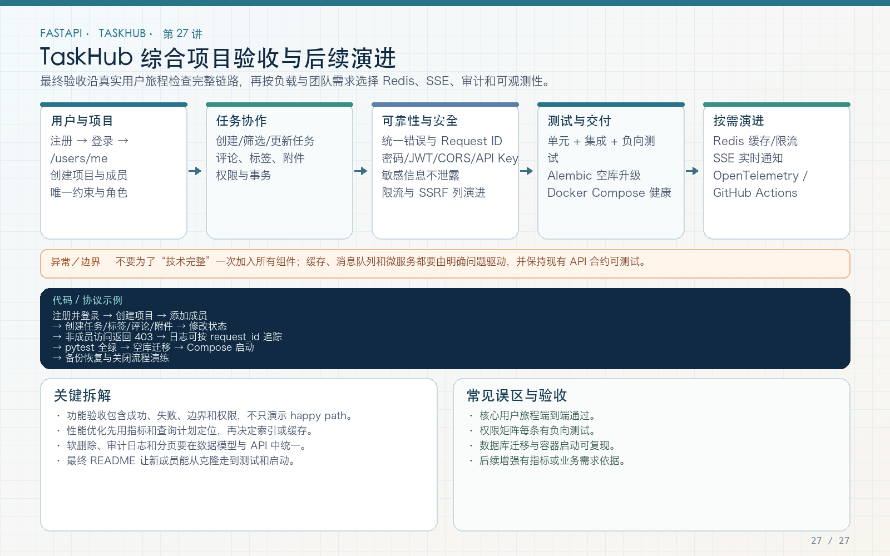

# 第 27 讲：TaskHub 综合项目验收、架构复盘与后续演进

学习路线位置：第 9～10 周  
前置章节：第 01～26 讲  
本讲核心目录：`taskhub_api/`、`.github/workflows/`、`images/`



> 可编辑矢量版本：`images/27-capstone.svg`。综合验收不是把 27 个标题打勾，而是让代码、文档、图片、数据库、测试和部署围绕同一条真实用户旅程闭环。

---

## 1. 你最终完成了什么

TaskHub API 不再是内存字典，也不是多个互不关联的代码片段，而是一个可运行工程：

- FastAPI 应用工厂与 `/api/v1` 路由；
- Pydantic Settings 和严格请求/响应模型；
- 统一业务异常、Request ID、CORS 与 422；
- API Key 服务接口与 fail-closed 配置；
- 异步 HTTP 聚合、超时和 Mock 测试；
- lifespan 管理 Engine、HTTP Client、上传目录；
- BackgroundTasks 及可靠性边界；
- 安全附件上传和鉴权下载；
- SSE 与带认证的 WebSocket；
- SQLAlchemy 2.x 异步 ORM 和关系加载；
- Alembic 初始迁移与漂移检查；
- Argon2 注册、JWT 登录和 active 用户检查；
- 系统 admin、项目 viewer/member/owner 和任务所有者权限；
- 独立测试数据库、依赖覆盖和 GitHub Actions；
- 非 root Docker 镜像、PostgreSQL Compose 和命名卷。

教程正文位于仓库根，最终可运行代码位于 `taskhub_api/`，28 组技术图解位于 `images/`。

---

## 2. 最终工程结构怎么读

```text
taskhub_api/
  app/
    main.py                 应用工厂、lifespan、中间件和异常装配
    api/v1/                 版本化路由与 HTTP 入口
    core/                   配置、错误、安全、Request ID、通用依赖
    db/                     Base、时间戳和事务边界
    models/                 ORM 表与关系
    schemas/                API 输入/输出和分页模型
    repositories/           SQLAlchemy 查询
    services/               业务、权限、认证、外部调用、后台动作
  alembic/                  异步迁移环境与版本脚本
  tests/                    独立 API/service 集成测试
  requirements.txt          运行依赖
  requirements-dev.txt      测试和 Ruff
  pyproject.toml            工具配置
  Dockerfile                非 root 镜像
  compose.yaml              API + PostgreSQL + 卷
```

阅读顺序不要从每个文件第一行机械开始，而是沿请求：

```text
router.py
  → 某个 endpoint
  → CurrentUser/DbDep
  → service
  → repository
  → model/schema
  → 对应测试
```

例如“创建任务”从 `endpoints/tasks.py` 开始，追到 `task_service`、`permission_service`、`task_repository`、`models/task.py` 和 `tests/test_tasks.py`。

---

## 3. 最终 API 地图

### 3.1 基础与认证

| 方法 | 路径 | 作用 | 认证 |
|---|---|---|---|
| GET | `/health/live` | 存活检查 | 无 |
| GET | `/health/ready` | 数据库就绪检查 | 无 |
| POST | `/api/v1/auth/register` | 注册 | 无 |
| POST | `/api/v1/auth/token` | OAuth2 form 登录 | 无 |
| GET | `/api/v1/users/me` | 当前用户 | Bearer |

### 3.2 项目与任务

| 方法 | 路径 | 作用 |
|---|---|---|
| GET/POST | `/api/v1/projects` | 可见项目列表/创建项目 |
| GET | `/api/v1/projects/{project_id}` | 项目详情 |
| POST | `/api/v1/projects/{project_id}/members` | owner 添加成员 |
| GET/POST | `/api/v1/tasks` | 筛选分页/创建任务 |
| GET/PATCH/DELETE | `/api/v1/tasks/{task_id}` | 详情/更新/删除 |
| GET/POST | `/api/v1/tasks/{task_id}/comments` | 评论列表/添加评论 |

### 3.3 文件、实时与服务能力

| 方法 | 路径 | 作用 |
|---|---|---|
| POST | `/api/v1/tasks/{task_id}/attachments` | 上传附件 |
| GET | `/api/v1/attachments/{attachment_id}` | 鉴权下载 |
| GET | `/api/v1/events/stream` | SSE heartbeat |
| WS | `/api/v1/ws/projects/{project_id}` | 项目 WebSocket |
| GET | `/api/v1/external/aggregate` | 并发外部 JSON 聚合 |
| GET | `/api/v1/service/info` | API Key 服务信息 |

WebSocket 路径包含 `/api/v1`，不是 `/ws/projects/{id}`。登录使用 form，不是 JSON。删除任务返回 204 空响应体。这些细节都应以真实 OpenAPI 和测试为准。

---

## 4. 综合用户旅程 A：注册到任务闭环

### 第一步：启动本地工程

```bash
cd taskhub_api
python -m venv .venv
source .venv/bin/activate       # Windows PowerShell 使用 .venv\Scripts\Activate.ps1
pip install -r requirements-dev.txt
cp .env.example .env            # Windows 可手动复制
```

本地学习可使用 SQLite：

```dotenv
DATABASE_URL=sqlite+aiosqlite:///./taskhub.db
AUTO_CREATE_TABLES=true
JWT_SECRET_KEY=replace-with-a-local-random-secret-at-least-32-chars
```

启动：

```bash
uvicorn app.main:app --reload
```

生产风格本地迁移则设置 `AUTO_CREATE_TABLES=false`，先运行 `alembic upgrade head`。两种方式要分清，不要启动后才发现没有表。

### 第二步：注册与登录

```bash
curl -s http://127.0.0.1:8000/api/v1/auth/register \
  -H 'Content-Type: application/json' \
  -d '{
    "email":"alice@example.com",
    "username":"alice",
    "display_name":"Alice",
    "password":"correct-horse-123"
  }'
```

```bash
curl -s http://127.0.0.1:8000/api/v1/auth/token \
  -X POST \
  -d 'username=alice&password=correct-horse-123'
```

保存 `access_token`：

```bash
export TOKEN='替换为实际 access_token'
```

### 第三步：创建项目

```bash
curl -s http://127.0.0.1:8000/api/v1/projects \
  -H "Authorization: Bearer $TOKEN" \
  -H 'Content-Type: application/json' \
  -d '{"name":"FastAPI Course","description":"Capstone"}'
```

保存返回的项目 ID，以下以 1 为例。

### 第四步：创建带标签任务

```bash
curl -s http://127.0.0.1:8000/api/v1/tasks \
  -H "Authorization: Bearer $TOKEN" \
  -H 'Content-Type: application/json' \
  -d '{
    "project_id":1,
    "title":"完成综合验收",
    "description":"验证完整任务链路",
    "status":"todo",
    "priority":"high",
    "tags":[{"name":"backend","color":"#2563eb"}]
  }'
```

检查响应包含 ID、项目、owner、tags、UTC 时间和状态。

### 第五步：更新、评论和查询

```bash
curl -s -X PATCH http://127.0.0.1:8000/api/v1/tasks/1 \
  -H "Authorization: Bearer $TOKEN" \
  -H 'Content-Type: application/json' \
  -d '{"status":"doing","tags":[]}'
```

```bash
curl -s http://127.0.0.1:8000/api/v1/tasks/1/comments \
  -H "Authorization: Bearer $TOKEN" \
  -H 'Content-Type: application/json' \
  -d '{"content":"主流程已完成，继续补负向测试"}'
```

```bash
curl -s 'http://127.0.0.1:8000/api/v1/tasks?page=1&page_size=10&status=doing' \
  -H "Authorization: Bearer $TOKEN"
```

检查 `meta.total`、稳定排序和 tags 已清空。

### 第六步：删除

```bash
curl -i -X DELETE http://127.0.0.1:8000/api/v1/tasks/1 \
  -H "Authorization: Bearer $TOKEN"
```

预期 204，响应体为空。再次 GET 应 404。

---

## 5. 综合用户旅程 B：附件与实时

上传：

```bash
printf 'TaskHub capstone attachment\n' > /tmp/taskhub-note.txt
curl -s http://127.0.0.1:8000/api/v1/tasks/1/attachments \
  -H "Authorization: Bearer $TOKEN" \
  -F 'upload=@/tmp/taskhub-note.txt;filename=../../note.txt;type=text/plain'
```

注意：如果上一段已经删除任务 1，应先创建新任务并使用真实 ID。教程命令不能脱离前置状态机械复制。

检查：

- original_name 只是 `note.txt`；
- stored_name 是服务器随机名；
- 响应不包含绝对路径；
- 下载字节与原文件一致；
- 非成员下载 403；
- 伪造 PNG 返回 400；
- 超限返回 413 且无临时文件残留。

SSE：

```bash
curl -N 'http://127.0.0.1:8000/api/v1/events/stream?limit=2' \
  -H "Authorization: Bearer $TOKEN"
```

检查 `id/event/data` 和空行。WebSocket 用测试客户端验证 authenticate → ready → ping → pong；非成员连接应以 1008 关闭。

---

## 6. 综合用户旅程 C：权限矩阵

准备 Alice 和 Bob：

1. Alice 注册并创建项目；
2. Bob 未加入时读写都应按策略拒绝；
3. Alice 添加 Bob 为 viewer；
4. Bob 可读、不可创建任务/上传；
5. Bob 为 member 时可创建自己的任务；
6. Bob 不能修改 Alice 的任务；
7. 项目 owner 可管理项目内任务；
8. 非成员 WebSocket/附件访问被拒绝；
9. 普通注册不能获得 admin。

每一步都验证具体状态码与业务 code，不只检查“失败”。权限测试还要检查失败没有产生任务、附件或成员记录。

---

## 7. 自动化质量验收

在 `taskhub_api/`：

```bash
ruff check .
ruff format --check .
pytest -q
```

迁移使用新的临时 SQLite：

```bash
export DATABASE_URL='sqlite+aiosqlite:////tmp/taskhub-capstone-migration.db'
alembic upgrade head
alembic check
alembic current
```

如果该文件已存在，结果不是空库验证。使用自己创建的新临时路径；downgrade 只在可丢弃数据库执行：

```bash
alembic downgrade base
alembic upgrade head
```

期望：

- Ruff 无错误；
- 格式检查通过；
- pytest 全绿；
- 迁移到 head；
- `alembic check` 报告无新操作；
- 测试不访问真实公网；
- 不生成仓库内测试数据库、上传残留或缓存提交物。

---

## 8. Docker 综合验收

```bash
docker build -t taskhub-course:local .
docker compose up -d --build
docker compose ps
curl --fail --retry 30 --retry-delay 2 --retry-all-errors \
  http://127.0.0.1:8000/health/ready
```

再完成注册、登录、创建项目、创建任务，重启 API 后查询数据仍在。

日志：

```bash
docker compose logs --tail=100 api
docker compose logs --tail=100 db
```

结束本地教学环境：

```bash
docker compose down
```

默认保留卷。只有明确要删除这套可丢弃教学数据时才使用 `down -v`。

---

## 9. 教程与图片验收

每讲应具备：

- 本讲问题与目标；
- 一张对应 PNG 和可编辑 SVG；
- 完整调用链；
- 能定位到真实文件的代码；
- 逐段解释而不是只贴代码；
- 手工验证与自动化验证；
- 常见错误；
- 练习、自测和验收清单；
- 与下一讲的衔接。

图片检查：

- PNG 与 SVG 均存在；
- 1600×1000；
- 中文、英文标识和符号无缺字；
- 文字不溢出、不遮挡；
- 连线方向与真实调用链一致；
- Markdown 相对路径有效；
- 图中示例不泄露真实 secret。

结构检查不能代替目视检查。至少对长标题、英文长词、密集关系和多分支图逐张复核。

---

## 10. 安全验收清单

- [ ] 密码只保存 Argon2 hash，响应无 password_hash。
- [ ] JWT 固定算法，校验 sub/iss/aud/exp，用户需 active。
- [ ] 生产默认 JWT secret 被拒绝。
- [ ] API Key 启用但无 key 时启动失败。
- [ ] 认证失败 401，权限不足 403。
- [ ] 所有项目资源有 membership 检查。
- [ ] SQL 使用参数绑定，不拼接用户输入。
- [ ] CORS 不是通配符 + credentials 的错误组合。
- [ ] Request ID 白名单校验，日志不记 Authorization/请求体。
- [ ] 上传限制大小、类型、签名、随机名和路径。
- [ ] 下载和 WebSocket 都检查项目权限。
- [ ] 外部 URL 示例明确 SSRF 风险，生产需白名单。
- [ ] `.env`、数据库和上传文件不提交。
- [ ] CI Token 只读，示例无真实凭据。

---

## 11. 已知边界：哪些没有伪装成“生产已完成”

本教程是完整学习和可运行工程，但以下仍需按真实需求演进：

1. refresh token、撤销列表和完整会话管理；
2. 项目成员角色修改、移除和最后 owner 保护；
3. 可靠邮件/通知队列与 outbox；
4. 多实例 WebSocket 广播和事件补拉；
5. 外部 URL 白名单、DNS/IP 检查和重定向限制；
6. 附件病毒扫描、对象存储和跨副本共享；
7. PostgreSQL 并发/锁与大数据量性能测试；
8. 生产独立迁移 Job、备份和恢复演练；
9. 限流、审计日志、指标、 tracing 和告警；
10. 前端界面、CSRF/XSS 等具体客户端威胁模型。

明确边界比堆砌“企业级、生产级、100% 安全”更有价值。

---

## 12. 后续演进优先级

### 第一优先：可靠性与数据安全

- PostgreSQL 集成测试；
- 独立迁移 Job；
- 数据库备份恢复；
- outbox + Worker；
- 关键操作审计日志。

### 第二优先：认证与会话

- refresh token 轮换；
- 撤销与安全事件处理；
- 登录限流和异常告警；
- 按需 MFA。

### 第三优先：规模与实时

- 游标分页；
- 查询计划和索引优化；
- Redis/消息基础设施；
- 持久事件 ID 与重连补拉；
- 对象存储。

### 第四优先：产品能力

- 成员邀请和角色变更；
- 任务截止日期、筛选和批量操作；
- 通知偏好；
- API SDK 和前端。

每次只引入能解决明确问题的组件，并同步增加测试、文档和运维方案。

---

## 13. 最终自测

不看代码，能否回答：

1. 一次创建任务请求经过哪些层？
2. Engine 和 Session 为什么生命周期不同？
3. 为什么 SELECT 后再次 session.begin 会失败？
4. 为什么 response_model 不能解决异步 lazy load？
5. 唯一约束与 IntegrityError 映射为什么都需要？
6. JWT 验签后为什么还查 active 用户？
7. member 为什么不能修改同项目所有任务？
8. 文件与数据库失败如何补偿？
9. BackgroundTasks 为什么不能保证可靠通知？
10. SSE/WebSocket 为什么不等同可靠消息？
11. 为什么测试全绿还需要 Alembic check？
12. 为什么容器启动成功不等于 ready？
13. 本地 Compose 与生产部署还差哪些安全措施？

如果能沿真实文件、接口和测试回答，而不是只背定义，就达到了本路线的核心目标。

---

## 14. 结课验收

- [ ] 能从空环境启动最终工程。
- [ ] 能完成注册→项目→任务→评论→附件完整链路。
- [ ] 能解释并验证至少三种权限失败。
- [ ] 能运行 Ruff、pytest、Alembic 和 Docker 验证。
- [ ] 能定位每讲代码在最终工程中的真实文件。
- [ ] 能读懂 28 张技术图解并指出对应调用链。
- [ ] 能说出当前系统的安全与可靠性边界。
- [ ] 能为下一个功能给出实现、迁移、测试和回滚方案。

到这里，FastAPI 独立学习总路线的 27 讲全部完成。继续学习 Agent、RAG 或其他 AI 应用之前，这套 HTTP、异步、数据库、安全、测试和部署基础仍然直接适用。
